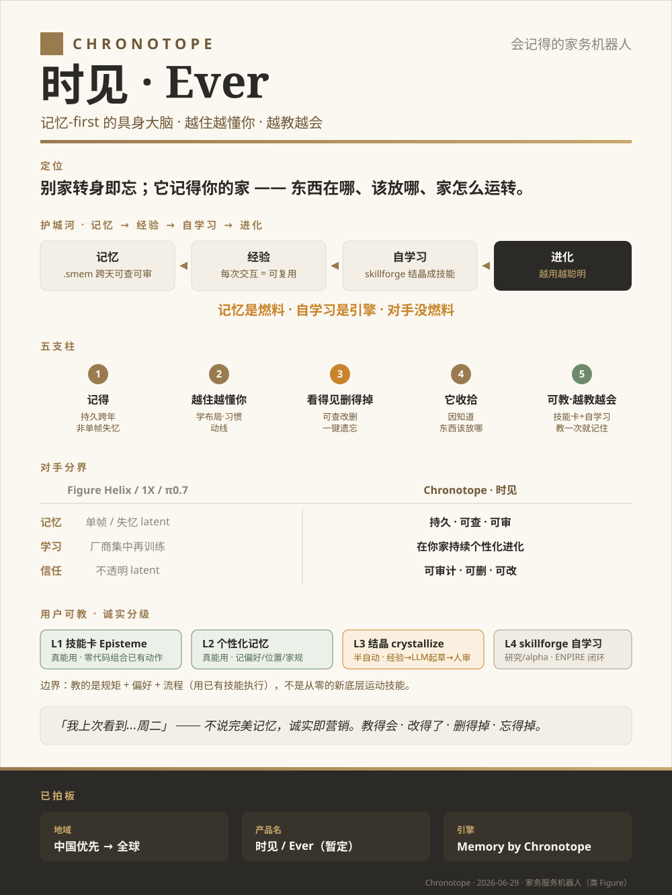
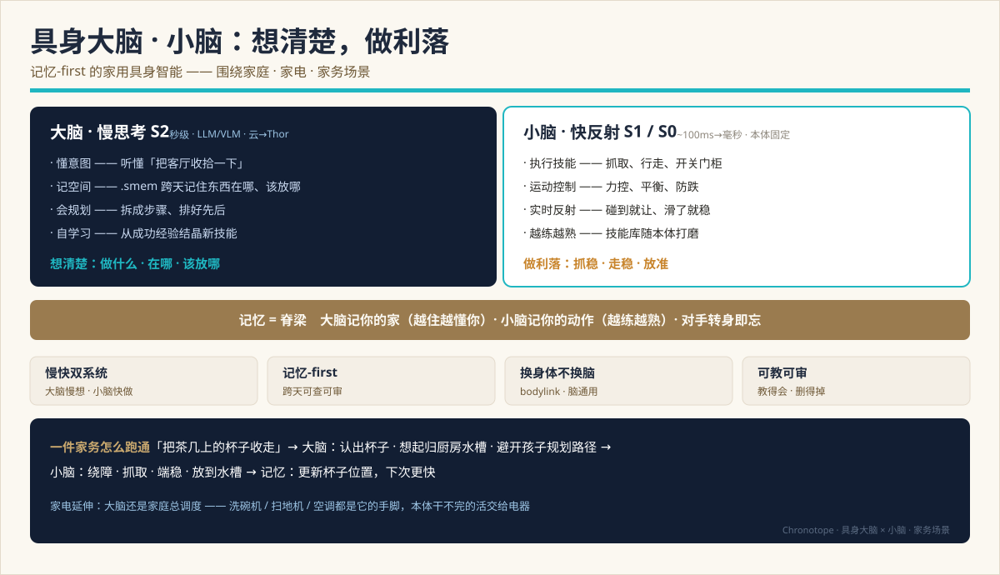

# Tech Brand · Chronotope (时见 / Ever)

> One-pager. This English version is canonical; 中文版 see [docs/zh/BRAND.md](../zh/BRAND.md).
> System vision: [VISION.md](VISION.md). Competitive landscape: [research/embodied-brain-landscape-2026.md](research/embodied-brain-landscape-2026.md).

**One line:** the home robot that **remembers** — a memory-first embodied brain. Rivals forget on turn-around; it grows to understand your home, and gets better the more you teach it.



> The one-pager graphic is in Chinese (primary launch market). EN narrative below.

---

## Architecture at a glance · Brain × Cerebellum (housework)



**Brain** (S2 slow thinking: understands intent / spatial memory `.smem` / plans / self-learns) figures out
what to do, where things are, and where they go; the **cerebellum** (S1/S0 fast reflex: skill execution /
motor control / real-time reflex) does it cleanly and stably; **memory is the spine** across both (the brain
remembers your home, the cerebellum remembers your motions). Appliance reach: the brain also orchestrates the
home — dishwasher / vacuum / AC are its extended hands. See §3 (the moat) and [TECH-DESIGN.md](TECH-DESIGN.md).

## 1. Positioning

Others forget on turn-around; **it remembers your home** — where things are, where they go, how the home runs.
Lead at point-of-sale with **competence** ("it tidies because it knows where things go"); pay off the poetry with a concrete proof ("knows where your mug is").

## 2. Brand architecture (two-tier ingredient brand, Intel-inside)

| Tier | Name | Use |
|---|---|---|
| Consumer brand | **时见 Shíjiàn / Ever** | warm product name, on the box. 时 + 见 = "across time, it knows" |
| Engine brand | **Memory by Chronotope** (时空体, Bakhtin) | spec sheet / press / B2B only |

Warm name carries emotion, hard engine name plants the tech. **The literary term 时空体 does not go on the box.**

## 3. The moat: Memory → Experience → Self-learning → Evolution

```
.smem cross-day, queryable, auditable  →  every interaction = reusable experience
                                       →  skillforge crystallizes it into a skill  →  smarter the more you use it
```

Learning = improving from experience. Experience = memory across time. **No memory → no experience → can't learn.**
This is the sharpest line versus Figure / 1X / π0.7.

> **Memory is the fuel, self-learning is the engine — rivals have no fuel.**

Self-evolution is the single most important capability of an embodied agent; memory is its **precondition** (see [research/l3-l2-fusion-roadmap.md](research/l3-l2-fusion-roadmap.md) §6).

## 4. Five pillars

1. **Remembers** — truly persistent, across reboot and across years; not single-frame amnesia
2. **Grows to understand you** — learns your layout, habits, traffic paths
3. **Visible & deletable** — memory is explicit, queryable, editable, deletable; one-tap forget (a notebook, not a camera)
4. **It tidies because it knows where things go** — memory as a capable engine, not a gimmick
5. **Teachable · gets better the more you teach** — skill cards + self-learning; teach once, it remembers

## 5. Competitive line

| | Figure Helix / 1X / π0.7 | Chronotope · 时见 |
|---|---|---|
| Memory | single-frame / amnesiac latent | persistent · queryable · auditable |
| Learning | vendor-side centralized retraining | continuous personalization in *your* home |
| Trust | opaque latent | auditable · deletable · editable |

## 6. User-teaching ladder (honest staging)

| Layer | What | Status |
|---|---|---|
| L1 Skill cards (Episteme) | zero-code, compose existing verbs into routines / rules | real |
| L2 Personalization memory | remembers preferences, object locations, house rules | real |
| L3 Crystallization | success → LLM drafts a skill card → human review into the library | semi-auto |
| L4 skillforge self-learning | ENPIRE loop; the robot proposes → practices → evolves | research / alpha |

**Boundary:** it learns rules + preferences + routines (executed with **existing** skills), NOT new bottom-level motor skills from scratch — those still need body data + fusion training.

## 7. Visual system

Patina-bronze + warm-paper + ink (heirloom / journal palette), away from steel-blue. Serif = the remembered / sans = the present; an unbroken "memory band".
Make **memory × privacy** seeable and hearable: WRITE = amber + pen-tick, RECALL = sage + page-turn, a visible memory-OFF state, one-tap forget with its own earcon.

## 8. Honesty guardrail (the honesty IS the marketing)

Never claim perfect / complete recall (real limits: full-graph truncation, best-effort `cited_node_ids`, offline-only cross-robot merge); use the "I last saw… Tuesday" voice.
**Teachable · editable · deletable · forgettable** — turn the real technical limits into character.
**Killer demos:** turn-around test + power-cycle test (reboot, it still remembers) — what amnesiac-latent rivals can't fake.

## 9. Ratified decisions (2026-06-29)

- **Geography:** **China first → then global**
- **Product name:** **时见 / Ever** (provisional, keep current name; trademark check still pending)
- **Engine name:** Memory by Chronotope (时空体)

## 10. Open

- Narrative axis (lead with emotion / competence / trust, or split by context)
- Trademark clearance and overseas name landing

## Carriers

- `战略与品牌.pptx` — 8-slide strategy + brand deck (local, untracked)
- `三层大脑架构方案汇报.pptx` — 13-slide technical ADR (local, untracked)
- This one-pager: [docs/assets/brand-onepager.svg](../assets/brand-onepager.svg)
