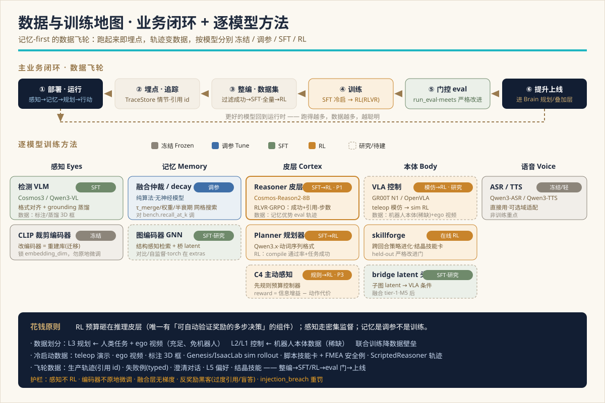

> 🌐 **English** · [中文](../zh/DATA-AND-TRAINING.md)

# Chronotope — Business Closed-Loop, Data & Training Plan

The detailed plan behind the architecture: **(1)** the main business closed-loop (production
flow + the improvement flywheel), **(2)** the data needed *before* and *after* deployment, and
**(3)** which models get post-trained, which get reinforced (RL), which stay frozen — enumerated.

Companion to [SYSTEM-DESIGN.md](SYSTEM-DESIGN.md) (architecture) and [FLOWS.md](FLOWS.md)
(diagrams). Deep sources reused: [post-training-rl-roadmap](../../mindloop/docs/en/post-training-rl-roadmap.md)
(the decision matrix) and [l3-l2-fusion-roadmap](research/l3-l2-fusion-roadmap.md) (the data
division for end-to-end fusion). **Date:** 2026-07-14.



> **One-line thesis:** spend the RL budget on the **reasoning cortex** — the one component
> whose objective is a multi-step decision with an *automatically verifiable* reward.
> Perception is dense supervision (SFT); memory is *tuning*, not training; the encoder is
> frozen. And because the runtime is already instrumented (every decision is a cited
> `TraceStore` episode), **the data flywheel pays for itself.**

---

## 1. The two loops

Chronotope runs two nested loops at different clocks:

- **The runtime business loop** (§2) — *per task, ~seconds.* Perceive → remember → deliberate →
  act → trace. This is what the robot does in the home; every pass emits training exhaust.
- **The improvement flywheel** (§3) — *per release, days–weeks.* Deploy → trace → curate → train
  → gate → promote → redeploy. This is what turns exhaust into better models.

The first loop is production; the second is how it self-improves. The memory-first design is
what makes the second loop cheap: the runtime **already** logs cited episodes, so training data
is a by-product of operating, not a separate collection project.

---

## 2. The main business closed-loop (production runtime)

One utterance drives the whole stack; each stage emits a typed artifact that is *also* a
training signal.


| # | Stage | Component | Produces (runtime) | Emits (training exhaust) |
|---|---|---|---|---|
| 1 | **Perceive** | worldsense | `Detection[]` (world meters) | frame + pose + detections (perception SFT set) |
| 2 | **Remember** | tempomem `commit()` | fused `.smem` delta, `CommitStats` | scene-graph snapshots (memory-advantage eval) |
| 3 | **Route** | mindloop `IntentRouter` | `task \| question \| chat` | (instruction → intent) label |
| 4 | **Retrieve** | `SceneContextProvider` | serialized subgraph + node ids | (question, scene) context |
| 5 | **Plan** *(LLM)* | `Planner` | `Command[]` (text verbs) | (context → verb sequence) plan trace |
| 6 | **Compile** *(rules)* | `compile_commands` | `Plan` = `SubTask[]` (ids bound, D3-gated) | compile pass/fail signal |
| 7 | **Safety** | `Phylax` | violations / clear | (plan → safety verdict) case |
| 8 | **Act** | bodylink dispatch loop | `StatusUpdate` stream, typed faults | (subtask → outcome, RecoveryHint) rollout |
| 9 | **Trace** | `TraceStore` | append-only episode citing node ids | **the labeled training case** |

**The dispatch loop is where the richest data lives** — it is preemptible (barge-in, idempotent
skip, active-perception re-look) and self-repairing (typed `FAILED` → `Replanner`):


Every `TraceStore` episode is a tuple `(instruction, serialized scene, intent, plan, safety
verdict, ordered subtasks + StatusUpdates, cited node ids, final outcome, any clarifications)`.
That tuple is exactly one training example — no separate labeling pass for the common case,
because the verifier signal (did it succeed? do the cited ids exist?) is computable in code.

---

## 3. The improvement flywheel


```
deploy / eval  ──►  log trajectories (instruction, scene, tool calls, plan, answer, outcome)
      ▲                                     │
      │                                     ▼
  better models  ◄── gate (run_eval) ◄── train (SFT → RL) ◄── curate (filter successes / full dist)
```

- **Curate.** Filter to successful traces → the **SFT** set. Use the full distribution
  (including failures + typed errors) → the **RL** signal. Crystallized skills from skillforge
  (`Evolution` winners) become P2 skill cards directly.
- **Train.** SFT cold-start, then RL — per-model method in §5.
- **Gate.** `run_eval` / `EvalThresholds` / `IntegrationReport.meets(required=)` — a candidate is
  promoted only if it **strictly** beats the current accepted score on a **held-out** split (the
  same discipline skillforge's `gate.py` enforces per episode). No silent regressions.
- **Promote.** The winner goes back into the live `Brain` (reasoner weights, planner weights, a
  new skill card, or an overlay). Then the loop runs again — more operation, more data, better
  models.

**Two altitudes of learning, complementary:** mindloop's `Replanner` repairs one step *within*
an episode (runtime); skillforge's `Evolution` improves a policy *across* episodes (offline lab);
gradient SFT/RL improves the *weights* across releases (this flywheel).

---

## 4. Data plane — before and after deployment

### 4.1 Before deployment — bootstrap / cold-start data

The data you must bring to cold-start each faculty before the flywheel can spin:

| Data | For | Nature | Notes |
|---|---|---|---|
| **Teleoperation demos** | VLA (L2/L1 control) | scarce, precious | real-robot embodiment data; the expensive input |
| **Human-task + egocentric (ego) video** | L3 planner + VLA VLM half | **abundant, robot-free** | teaches what the goal *looks like* / how to phrase it |
| **Labeled / distilled 3D boxes** | perception VLM | dense supervision | from a stronger teacher or domain frames |
| **Sim rollouts** (Genesis / IsaacLab) | VLA, skillforge | scalable | physics-grounded, host + mac verified |
| **Scripted skill cards** (P2 Episteme) | planner priors | hand-authored | procedural knowledge as data (`K2` flat steps) |
| **FMEA safety cases** | Phylax policy | hand-authored | `conservative_policy()` preset |
| **ScriptedReasoner tool-use traces** | cortex SFT cold-start | deterministic | offline harness generates/replays these |
| **Memory-advantage eval clips** | cortex RL **environment** | curated | questions answerable *only* with cross-session memory |

### 4.2 After deployment — the flywheel data (warm)

Collected for free by operating; curated into datasets:

| Data | Source | Feeds |
|---|---|---|
| **Production trace episodes** (cited) | `TraceStore` | cortex SFT (successes) + RL (full dist) |
| **Rollout logs + typed failures** | dispatch loop + `Replanner` | RL signal, replan tuning |
| **Clarification dialogues** | barge-in / ask-human | intent + dialogue SFT |
| **L5 preference corrections** | `PreferenceStore` | personalization / preference data |
| **Crystallized skills** | skillforge `Evolution` → `crystallize` | P2 skill-card library (no retrain needed) |

**The memory-advantage eval keeps the reward honest:** it specifically rewards *using persistent
memory* (object seen in clip 1, asked in clip 9) — the whole reason the architecture exists.

---

## 5. Per-model training plan (which models, how)

The decision matrix — **what to post-train, what to reinforce, what to leave alone:**

| Model | Layer | Post-train? | Method | Data source | Priority |
|---|---|---|---|---|---|
| **Reasoning cortex** (`Reasoner`, Cosmos-Reason2-8B) | L3 / S2 | ✅ highest value | **SFT cold-start → RL (RLVR / GRPO)** | filtered success traces → full dist; memory-advantage eval as the RL env | **P1** |
| **Planner** (Qwen3.x) | L3 / S2 | ✅ | **SFT** on the verb-sequence format → optional **RL** on compile-pass + task-success | plan traces, TASK-FAMILIES cases | P1–P2 |
| **Perception VLM** (Cosmos3 / `VLMDetector` Qwen3-VL) | eyes | ✅ **SFT only — no RL** | format-alignment SFT + grounding SFT / distillation | labeled/distilled 3D boxes, domain frames | P2 |
| **C4 active-perception policy** ("look closer at node N") | L3 | ⚠️ later | **rules v0 → policy RL** (info-gain − action-cost) | logged re-look trajectories | P3 |
| **CLIP / SigLIP crop encoder** | memory L1 | ❌ **frozen** | none — re-embed = a store *migration*, not training | — | — |
| **Fusion / arbiter / decay** | memory L0 | ❌ **no model** | threshold **tuning** (grid / Bayesian) vs `bench.recall_at_k` | — | — |
| **Graph encoder (GNN)** | memory L2 | ✅ (research) | contrastive / self-supervised representation | scene-graph structure | research |
| **VLA control** (GR00T N1 primary / OpenVLA baseline) | L2 / L1 | ✅ (biggest lift) | **imitation** (teleop) → **RL** (sim / skillforge) | robot-embodiment data (scarce) + ego video (VLM half) | research → prod |
| **skillforge ENPIRE** | body / lab | ✅ **online RL** | policy improvement across episodes → `crystallize` skill card | rollouts + reward bricks over real `Detection`s | active (α) |
| **Bridge-latent projection head** (fusion tier 1) | L3↔L2 | ✅ (research) | small trainable head, action loss | grounded subgraph + robot data | research (after M5) |
| **ASR / TTS** (Qwen3-ASR / Qwen3-TTS) | voice | ❌ / light | frozen, optional domain adaptation | — | low |

### 5.1 The reasoning cortex — the one RL is built for (P1)

The cortex (`reason(question, context) → Answer`) reads the serialized scene, calls memory
tools, and answers citing `node_id`s — a **multi-step decision with a checkable outcome**, the
textbook case for RL with verifiable rewards (RLVR). Reward:

```
reward =  w1·task_success        # answer correct vs ground truth (eval harness judges)
        + w2·citation_grounded   # every cited node_id exists in the store (tools verify)
        + w3·citation_relevant   # cited nodes are the ones that actually answer it
        − w4·steps               # fewer tool calls / reasoning steps is better
        − w5·hallucination       # cited a node_id that does not exist  → hard penalty
        − w6·injection_breach    # obeyed an instruction embedded in untrusted SCENE text
```

`w5` (hallucinated id) and `w6` (prompt-injection breach) are **large, asymmetric** penalties —
these are the failure modes that make an embodied agent untrustworthy. Two stages:
1. **SFT cold-start** on successful trajectories — instil the habit "serialize → query → cite
   `node_id` → answer", and the refusal habit "if memory lacks it, say so." (`ScriptedReasoner`
   is the offline harness.)
2. **RL (GRPO / PPO)** on the reward above once tool-calls are well-formed. **GRPO** fits: no
   separate value model, group-relative advantage, works on a verifiable scalar reward.

### 5.2 skillforge ENPIRE — online RL for *skills*

Distinct from gradient RL of the cortex: skillforge is the **self-learning lab** that improves a
*policy* (a `tuple[SubTask,…]`) across episodes and crystallizes the winner into a P2 skill card.
`author → rollout → reward → gate → append`, with a **held-out strict-improvement gate**
(`evaluate_gate`: accept only if it strictly beats the current accepted score on a non-leaky
split). Reward bricks score over **real `tempomem.Detection`s** so a real environment / LLM author
drops in with no loop-code change. Learned skills feed back as `provenance="learned"` cards that
`Phylax.vet_card` still governs.

### 5.3 VLA control (L2 / L1) — the biggest data lift

The low-level pixels+language→action policy (GR00T N1 primary, OpenVLA baseline). Trained by
**imitation** on teleop/robot data, then **RL** in sim (Genesis / IsaacLab) or through the
skillforge loop. This is where robot-embodiment data (scarce) is unavoidable — but the fusion
data-division (§6) is what keeps that bill bounded.

---

## 6. Fusion / end-to-end training (the L3↔L2 research track)

Current stage passes L3→L2 as **explicit language + images, not a latent** (keeps auditability
B9, body-swap D3, remote brain). The end-to-end/latent fusion is a parked research track; its
**key enabler is the training-data division:**

- **L3 planning ← human-task + egocentric (ego) video** — abundant, robot-free; teaches what the
  goal looks like and how to phrase / condition it. The planner never needs a robot to learn from.
- **L2 / L1 control ← robot-embodiment data** (teleop / real-robot) — the scarce data, needed only
  by the low-level controller.
- **Joint training** back-propagates the action loss across the layers. Because only L2/L1 depends
  on scarce robot data while the planner rides abundant human/ego video, **the end-to-end data
  barrier drops sharply.**

The latent *interface* is built in three escalating tiers (only if/when ROI clears):
1. **Grounded latent** — pooled embedding of the query-relevant subgraph (carries `node_ids`, keeps
   partial provenance) → a small trainable **projection head** → VLA System-1 conditioning. No
   LLM-service change.
2. **LLM-hidden latent** — re-serve Cosmos-Reason to expose pooled hidden states; richer semantics,
   weaker provenance.
3. **Joint end-to-end** *(last, optional — the red line)* — LoRA-trainable local LLM + trainable
   VLA + real interaction data, action loss back-propagated. **This breaks remote-brain, body-swap,
   and audit** — evaluate ROI before committing; it may never clear it.

**Grounding red line:** every latent must be *derived from* and *live alongside* the explicit
`.smem` graph (the source of truth), so provenance survives. That is exactly what keeps Chronotope
from collapsing into an "under-funded Helix / π0.7" (which are latent-only, no persistent memory).

The **memory representation** itself latent-izes on the same rule (L0 symbolic graph = truth →
L1 node embeddings shipped → L2 graph encoder new → L3 bridge latent) — encoders are torch behind
extras, **never in the numpy core**.

---

## 7. Phasing & milestones

**Post-training (the cortex-first plan):**

| Phase | Work | Output |
|---|---|---|
| **T0** | Stand up eval-as-environment (replay clips → store → question → reward) | RL/SFT harness |
| **T1** | Collect + filter cortex trajectories; **SFT cold-start** the `Reasoner` | tool-using base policy |
| **T2** | **RL (GRPO / RLVR)** on the cortex reward | grounded, fewer-step cortex |
| **T3** | Perception **format / grounding SFT** in worldsense | stable 3D-box JSON |
| **T4** | Log C4 re-look trajectories; train the **active-perception policy** | learned look controller |

Budget rule of thumb: **most of the RL spend on T1–T2 (cortex).** T3 is supervised. T4 is optional
and last.

**Fusion track (after the language interface works on real hardware):** M0 design freeze ✅ → M1
seam adds `instruction`/`goal_image` (protocol) → M2 GR00T `ExecutorAdapter` device package (sim
first) → M3 L3 emits grounded language → M4 closed loop memory→language→VLA→action (sim) → M5 real
hardware → *then* the §6 latent tiers.

---

## 8. Non-goals & guardrails

- **No RL on perception** — dense supervision dominates; RL would be wasteful (single-step objective).
- **No in-place encoder fine-tune** — `embedding_dim` is locked at store-create; re-training the
  encoder invalidates every persisted vector. Changing it = **re-embed into a fresh store**, a
  migration, not a training step.
- **No gradient training of the fusion layer** — it is pure algorithm; its thresholds are
  hyperparameters, tuned by search, not learned.
- **Reward-hacking watch** — an agent can game `citation_grounded` by over-citing, or `steps` by
  answering blindly. Keep `task_success` dominant; penalise over-citation; audit on the held-out
  memory-advantage set.
- **Safety in the loop** — `injection_breach` stays a first-class, heavily-penalised reward term;
  untrusted scene text is an exfiltration vector and RL *will* find the breach if it is not priced in.
  Learned/crystallized skills can never loosen a safety rule (`Phylax` still vets them).

---

## 9. References

[SYSTEM-DESIGN](SYSTEM-DESIGN.md) · [FLOWS](FLOWS.md) · [TASK-FAMILIES](TASK-FAMILIES.md) ·
[INTEGRATION-E2E](INTEGRATION-E2E.md) · [post-training-rl-roadmap](../../mindloop/docs/en/post-training-rl-roadmap.md) ·
[l3-l2-fusion-roadmap](research/l3-l2-fusion-roadmap.md) · [brain-architecture](../../mindloop/docs/en/brain-architecture.md) ·
[skillforge architecture](../../skillforge/docs/en/architecture.md).
