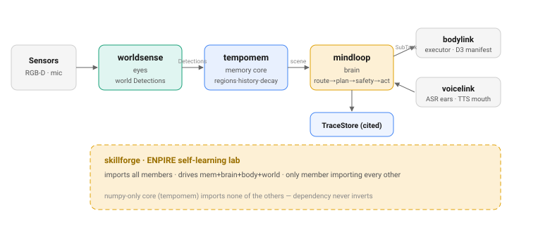
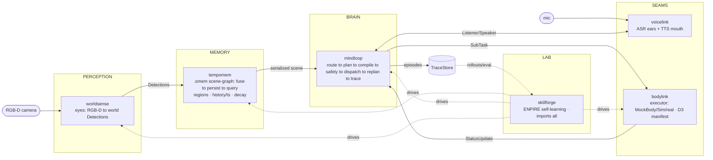
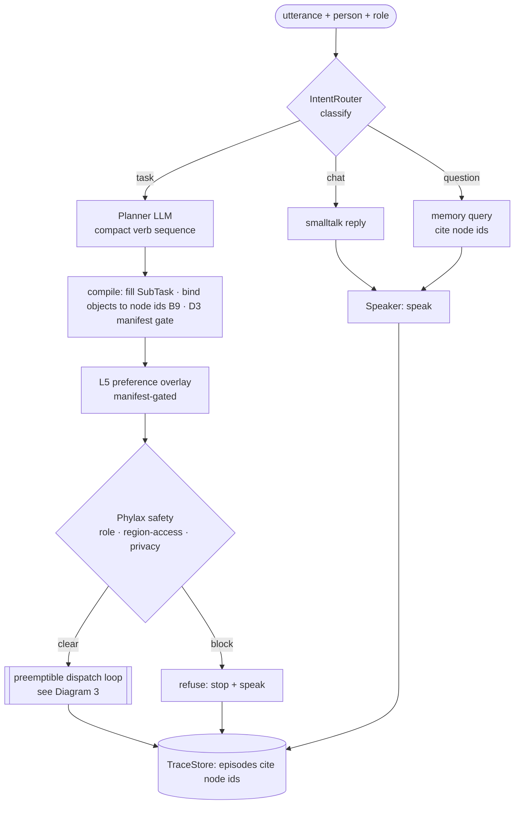
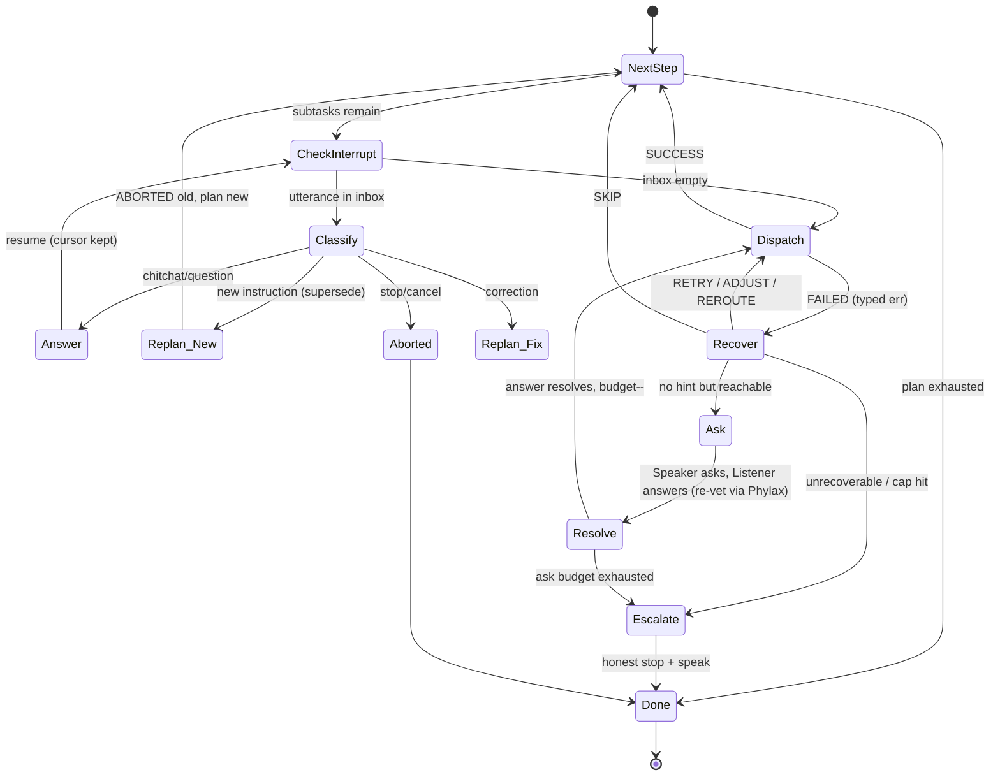
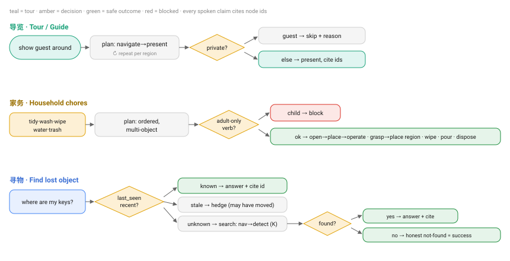
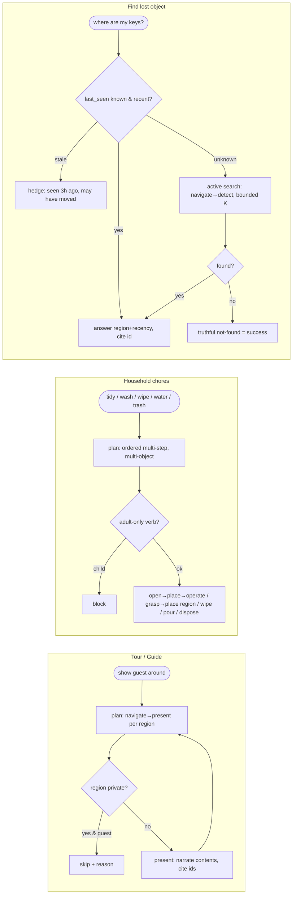
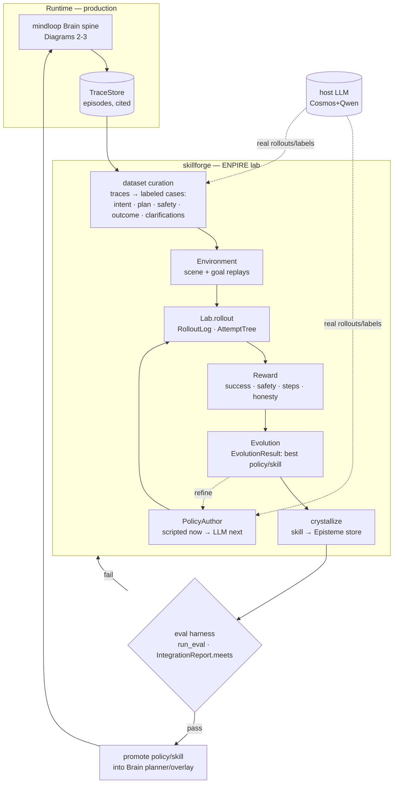

# Flows — Scenario · Full Pipeline · Key Components · Data/Training Loop

> Canonical flow diagrams for the Chronotope embodied-brain stack as it serves our
> household-robot scenario. Mermaid renders on GitHub. Companion to
> [INTEGRATION-E2E.md](INTEGRATION-E2E.md) (production capstone) and
> [TASK-FAMILIES.md](TASK-FAMILIES.md) (task families + execution dynamics).
> The data/training closed-loop (Diagram 5) is the plan for the next phase.
>
> **Each diagram is committed as a standalone SVG under [`../assets/`](../assets/)
> (renders on GitHub, light + dark) with its editable mermaid source kept beside it
> in a `
` block — when you change a diagram, update BOTH the mermaid and the SVG.**

---

## 1. Component map (who owns what, data direction)

mermaid source — update the SVG when you edit this

Dependency direction (never inverted): `worldsense→core`, `mindloop→core`,
`bodylink→mindloop`, `voicelink→mindloop`, `skillforge→tempomem+mindloop+bodylink`.
The core (`tempomem`) imports none of the others — numpy-only contract.

---

## 2. Request lifecycle (the brain spine, one utterance)

mermaid source — update the SVG when you edit this

Two-stage planning is an invariant: **LLM emits text verbs → deterministic compile**
binds them to memory node ids and gates each verb on the D3 manifest. No online
rule-planning fallback.

---

## 3. Execution dynamics (dispatch loop: barge-in · replan · ask-human)

mermaid source — update the SVG when you edit this

Guards: irreversible step (stove on) finishes-or-safe-aborts, never hard-killed
mid-action; supersede confirms when the current task is near-done; clarification
answers are re-vetted by Phylax (Diagram 2); ask budget ≤2/task.

---

## 4. Task-family flows (compact)

mermaid source — update the SVG when you edit this

Cross-cutting: every spoken claim cites node ids; stranger asking for owner's items
is privacy-blocked; a non-owner tour skips private regions.

---

## 5. Data & training closed-loop (next-phase plan)

The runtime is already instrumented (every decision is a `TraceStore` episode citing
node ids). The closed loop turns that exhaust into training signal via skillforge.

mermaid source — update the SVG when you edit this

**Loop stages → real symbols (skillforge):** `Lab(env, author)` drives
`Environment` replays with a `PolicyAuthor` (today `ScriptedAuthor`, next an LLM
author on the host) → `RolloutLog` / `AttemptTree` → `Reward` → `EvolutionResult` →
crystallize skill into an Episteme store → `run_eval` / `IntegrationReport.meets`
go/no-go gate → promote into the live `Brain`. Closing the loop is what makes the
robot self-improve on our scenarios; the metrics (§4 of TASK-FAMILIES) are the gate.

**What's built vs planned:** runtime tracing ✅, eval harness ✅, ENPIRE walking
skeleton (`v0.1.0a0`, network-free, ScriptedAuthor) ✅. Planned: dataset curation
from real traces, LLM PolicyAuthor on host, Episteme crystallization, and the
promote-back gate. See TASK-FAMILIES build order step 7.
