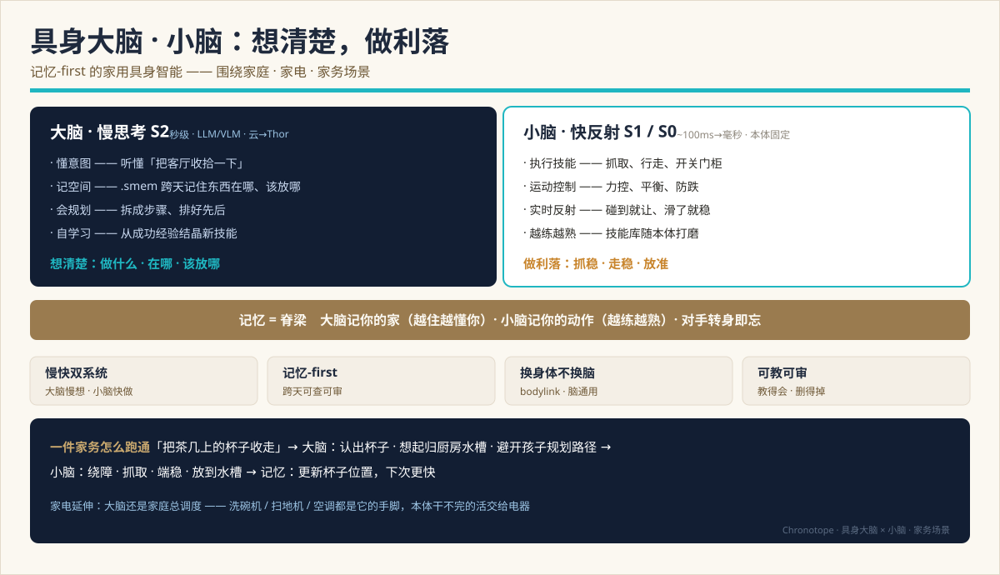
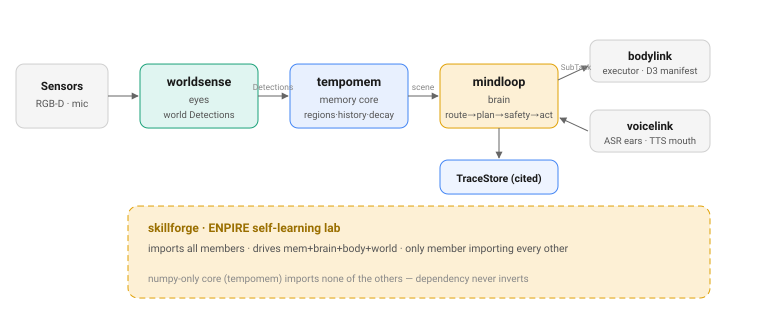
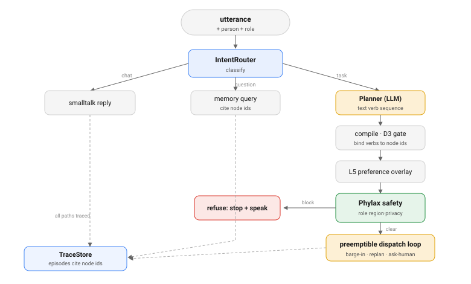
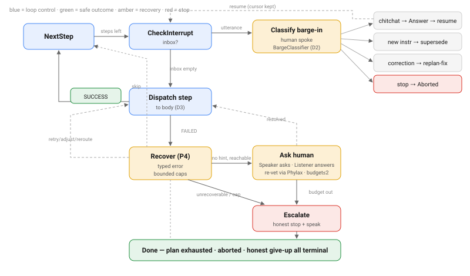
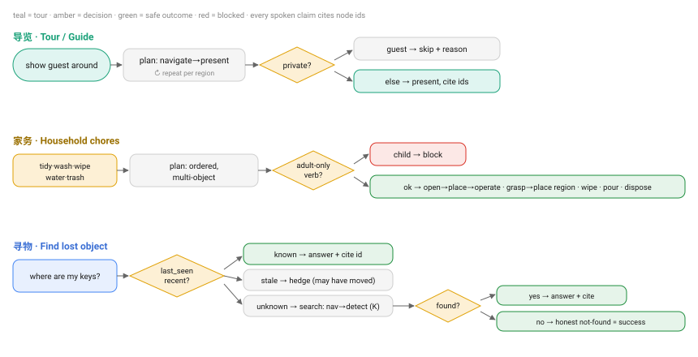
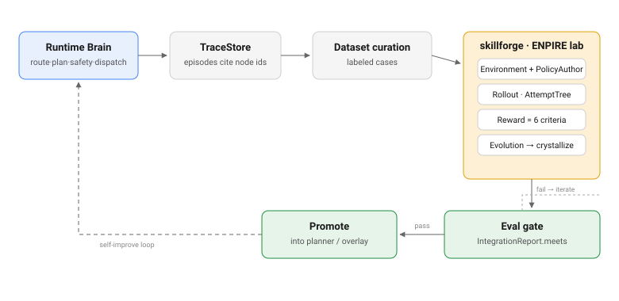

> 🌐 **English** · [中文](../zh/SYSTEM-DESIGN.md)

# Chronotope — System Design

One consolidated design of the whole embodied-brain stack: **(1)** the overall system,
**(2)** each subsystem's internal design, and **(3)** how the layers — and the **brain and
the body** — interact. This is the single "how it all fits" document; it reuses and
cross-links the deeper sources rather than duplicating them.

- Vision / why: [VISION.md](VISION.md) · Brand / positioning: [BRAND.md](BRAND.md)
- Current-state snapshot + ratified contracts: [TECH-DESIGN.md](TECH-DESIGN.md)
- Canonical flow diagrams (the SVGs embedded below): [FLOWS.md](FLOWS.md)
- Production capstone: [INTEGRATION-E2E.md](INTEGRATION-E2E.md) · Scenarios: [TASK-FAMILIES.md](TASK-FAMILIES.md)
- Normative specs are cross-linked per subsystem (§3).

**Date:** 2026-07-14. **Where we are:** L3 brain software feature-complete (P0–P5 ✅,
P6 real-LLM validated ◐, P7 failover + ASR/VAD ◐); bodylink multi-model + Genesis sim ✅;
skillforge ENPIRE walking skeleton (`v0.1.0a0`). Tests are network-free and GPU-free.

---

## 1. Overview

Chronotope is a **memory-first embodied brain** for a household robot. The stack is split
across **six independently published, independently versioned Python packages**, mapped onto
a body metaphor. The design goal in one line: **think clearly (a slow deliberative brain),
act cleanly (a fast reflexive cerebellum), and remember across time (a persistent, auditable
memory that is the spine of both).**



### The six packages

| Package | Body part | Role | Heavy deps |
|---|---|---|---|
| **tempomem** | hippocampus | memory core — `.smem` SQLite scene-graph, fuse→persist→query; the **only stateful object** | none (numpy-only) |
| **worldsense** | eyes | RGB(-D) → world-frame `Detection`s; camera→world lift, CLIP/VLM detectors | behind `[clip]` (torch) |
| **mindloop** | brain (S2) | the deliberative cognitive loop + `Reasoner`; ships the `ExecutorAdapter`/`Listener`/`Speaker` seams | none in core; LLM is remote/self-hosted |
| **bodylink** | body seam | fills `ExecutorAdapter`: `MockBody` + `CapabilityManifest` + multi-model + Genesis sim | none (stdlib) |
| **voicelink** | ears + mouth | fills `Listener`/`Speaker` (ASR/TTS) over an OpenAI-compatible audio endpoint | none (stdlib) |
| **skillforge** | self-learning lab | ENPIRE loop over mem+brain+body+world; the **only** member that imports all others | none (`v0.1.0a0`) |

### Who owns what, and the data direction



### Dependency direction (never inverted)

```
worldsense → tempomem      bodylink → mindloop      skillforge → tempomem + mindloop + bodylink
mindloop   → tempomem      voicelink → mindloop
```

**The core (`tempomem`) imports none of the others.** It only *ships the protocols* the
others fill (`PerceptionAdapter`, `Verbalizer`); `mindloop` ships `ExecutorAdapter` /
`Listener` / `Speaker`. Adding a torch/LLM import to the core would break the numpy-only
contract — this is a load-bearing invariant, not a preference.

---

## 2. Layered model

Two orthogonal layerings meet in this stack: the **cognitive stack** (speed tiers) and the
**memory stack** (representation tiers).

### 2.1 Cognitive stack — three speed tiers

| Tier | "Brain part" | Latency | What | Where | Compute |
|---|---|---|---|---|---|
| **Deliberation (S2)** | 大脑 brain | ~seconds | intent → plan → safety → dispatch → replan; reasoning + memory | **mindloop** | LLM/VLM, cloud→Thor |
| **Habit (S1)** | 小脑 cerebellum | ~100ms | skill execution (BT + memory), motor control | **bodylink** (onboard) | onboard, per-body |
| **Reflex (S0)** | brainstem | ~1ms | e-stop, torque/collision limits, balance | firmware | per-body MCU |

The governing rule (`mindloop/docs/en/brain-architecture.md`): **an upper layer's "want-to"
can never override a lower layer's "must-not".** Safety is monotonic downward. mindloop is
**S2 only** (contract **D1**) — it never speaks joint space or base-frame geometry (**B8**).

### 2.2 Memory stack — representation tiers

Memory is symbolic today, with a torch-behind-extras path to latent that keeps the symbolic
graph as the source of truth (see [research/l3-l2-fusion-roadmap.md](research/l3-l2-fusion-roadmap.md)):
**L0** symbolic scene-graph (shipped, the `.smem`) → **L1** per-node embeddings (shipped, CLIP
feature) → **L2** graph encoder (research) → **L3** bridge latent to the VLA (research). Encoders
are torch behind extras — **never in the numpy core**.

---

## 3. Subsystem designs

Each subsection is the internal design; the normative spec is linked. Symbols are the real
code names.

### 3.1 tempomem — memory core (the hippocampus)

**Role.** The numpy-only, single-stateful-object memory core that turns per-frame
`Detection`s into a persistent, queryable 3D scene-graph in one `.smem` SQLite file.

**Internal modules** (stateless helpers that `TempoMem` composes):
`store.py` (row CRUD: nodes/edges/observations/node_obs/props/events) · `fusion.py` (the
fusion arbiter: `ingest_observation` match→score→merge/new/reject, `split_node`,
`consolidate`) · `query/` (retrievers `semantic_vec`/`semantic_keyword`/`spatial`/`recent`/
`relational` + `detect_intent` router) · `serialize.py` (graph → `format="prompt"` token-budgeted
/ `format="json"`) · `relations.py` (geometry-only `near`/`on`/`under` edges) · `persist/`
(open/create `.smem`, forward-only migrations) · `trace.py` (L4 episodic `TraceLog`/`TraceRecord`,
cites node ids, D2) · support: `frame.py` (`Detection`/`Observation`), `encoders.py`/`verbalize.py`/
`perception.py` (BYO protocols), `vec.py` (sqlite-vec ANN), `cli.py`/`viz.py`.

**Public API** (`TempoMem`, from `__all__`): ingest `add_detections(dets, episode=)` (meters,
world frame) / `add_frame(rgb, depth, pose, intrinsics=)` (routes a `PerceptionAdapter`) /
`commit()` → `CommitStats`; maintenance `decay` / `forget` / `resplit` / `consolidate` /
`relate` / `update` / `define_region`; query `query(text, k, intent)` → `QueryResult`,
`semantic` / `spatial` / `recent` / `salient`, `answer(query, verbalizer=)`; output
`serialize(format, root, k_hops, relations, max_tokens, node_ids)`.

**Schema** (`.smem`, one SQLite file): `nodes` (type ∈ object|place|room|floor; label +
`labels_json` distribution; conf-weighted running centroid+bbox; `feature` BLOB; `parent_id`),
`edges` (typed, unique `(src,dst,type)`), `observations`, `node_obs` (many:many), optional
`node_vec` (sqlite-vec cosine mirror). **A node id is the SQLite INTEGER PK** — the single
id-space echoed back verbatim as citations (**B9**) and shared with `TraceLog`.

**Invariants.** *Fuse-before-persist*: `add_*` only stage into `self._pending`; nothing is
fused until `commit()`, the **sole drainer**. Every structural mutator calls `_flush_pending()`
first (sqlite implicit-transaction mode — committing unfused rows would persist orphans).
*numpy-only*: heavy backends behind `[clip]`/`[vec]`/`[perception]` with linear/keyword
fallbacks. *BYO*: no encoder ⇒ keyword; no verbalizer ⇒ raise — never a silent default.

Spec: [API](../../tempomem/spec/API.md) · [SCHEMA](../../tempomem/spec/SCHEMA.md) ·
[FUSION-ARBITER](../../tempomem/spec/FUSION-ARBITER.md) · [QUERY-ROUTER](../../tempomem/spec/QUERY-ROUTER.md)

The fusion decision (from `spec/FUSION-ARBITER.md`):
```
s = w_g·s_geom + w_i·s_iou + w_s·s_sem + w_l·s_label     # w = 0.2, 0.2, 0.5, 0.1
if   s(c*) ≥ τ_merge (0.62) → MERGE into c*
elif s(c*) ≥ τ_ambig (0.45) → DEFER
elif o.confidence < τ_obs (0.30) → REJECT
else → NEW node
```

### 3.2 worldsense — eyes

**Role.** Turns a posed RGB(-D) frame into world-frame `tempomem.Detection`s by injecting a
heavy GPU detector into a pure-numpy adapter, so the memory core stays perception-free.

**Internal modules:** `geometry.py` (pure-numpy camera→world lift: `rpy_to_matrix`,
`transform_points`, `oriented_box_corners`, `world_aabb_from_obb`) · `adapters.py` (`Box3D`
camera-frame OBB, `Detector3D` injected-detector Protocol, `BoxDetectorAdapter` = the
`PerceptionAdapter` fill) · `encoders.py` (`ImageEncoder` Protocol + `OpenClipImageEncoder`,
dual text+image CLIP towers) · `vlm.py` (`VLMDetector`, a `Detector3D` backed by a grounding
VLM — Qwen3-VL over an OpenAI-compatible endpoint; stdlib PNG encoder, pillow-free).

**`Detection`** (defined in the *core*, `tempomem/frame.py`, so it is the shared cross-seam
type): `@dataclass(frozen=True, slots=True)`; coordinates right-handed **meters, world frame**;
`label`, `feature` (L2-normalized), `center_xyz`, `bbox_min`, `bbox_max` (axis-aligned world),
`confidence∈[0,1]`, `mask_rle`, `ts`, `aux`.

**Geometry lift.** The detector emits camera-frame OBBs (`center`, `size`, `rpy`);
`world_aabb_from_obb(pose, center, size, rpy)` builds 8 local corners (`R = Rz(yaw)@Ry(pitch)@Rx(roll)`),
applies the 4×4 camera→world `pose`, and takes component-wise min/max → world AABB. In `vlm.py`
the 2D→3D back-projection uses intrinsics (`Z = median depth in box`, `X=(u−cx)/fx·Z`,
`Y=(v−cy)/fy·Z`; thickness from the in-box depth 10–90th percentile, floored 0.15 m).

**Encoders.** `OpenClipImageEncoder` (behind `[clip]`) implements **both** `encode_text`
(satisfies `tempomem.Encoder` for query) and `encode_image` (perception) in the **same** CLIP
space — one instance serves both seams so semantic query aligns. No `[clip]` ⇒ tests use hash
encoders. Spec: [cosmos3-perception-adapter](../../worldsense/docs/en/cosmos3-perception-adapter.md).

### 3.3 mindloop — brain (S2 cognitive loop)

**Role.** The Deliberation (S2) brain: a thin stdlib-only orchestrator that binds tempomem
memory to a BYO LLM `Reasoner`, routes an instruction to an answer or a grounded plan,
safety-gates it, dispatches to a body, and repairs failures — owning the seam protocols others fill.

**The pipeline** — `Brain.handle(instruction, *, k, person, safety_context, dialogue)`:



1. **`IntentRouter.classify`** → `task | question | chat` *(LLM)*. `question`/`chat` divert to
   **`ask`** (retrieve → reason → cited `Answer`).
2. **`Planner.plan(instruction, context)`** → `tuple[Command,...]` *(LLM — the one generative
   step; a compact verb-per-line text sequence)*.
3. **`compile_commands(commands, mem, manifest)`** → `Plan` *(deterministic: macro-expand →
   drop verbs ∉ manifest (D3) → bind object mentions to node ids (B9) → fill per-verb metadata)*.
4. **`Phylax.check(plan, safety_context)`** → violations *(deterministic policy gate; any
   violation blocks the **whole** plan — stop + speak, no reroute)*.
5. **`ExecutorAdapter.dispatch(subtask)`** → `Iterator[StatusUpdate]` *(the preemptible loop, §5)*.

Entry points besides `handle`: `observe(rgb, depth, pose)` / `ingest(detections)` (perceive→
fuse→commit); `ask` (retrieve→reason); `converse(instruction, conversation, …)` (P5 multi-turn).
**Only routing / compile / Phylax / replan are deterministic; classify, plan, reason are LLM.**

**Protocols mindloop ships:** `ExecutorAdapter` (`capabilities()→CapabilityManifest`,
`dispatch(SubTask)→Iterator[StatusUpdate]`) · `Reasoner` (`reason(question, context)→Answer`) ·
`Verbalizer` (`complete(prompt)→str`, protocol owned by the core, filled here by
`CosmosReasonVerbalizer` / `FailoverVerbalizer`) · `Listener` (`transcribe(bytes)→str`) /
`Speaker` (`say(text)→None`) · `IntentRouter` / `Planner`.

**Sub-components:** `CosmosReasonVerbalizer` (stdlib urllib → any OpenAI-compatible
`/v1/chat/completions`) · `Phylax` (P3 semantic safety: permission / adult-only / forbidden-zone /
region-access / allergen / proximity-speed; `conservative_policy()` FMEA preset;
`vet_card`/`vet_role` provenance gate) · `TraceStore` (append-only over the core `TraceLog`,
cites node ids, D2) · `Replanner` (P4 bounded typed-error repair) · `Conversation` + L5
`PreferenceStore` (manifest-gated post-compile overlay) · `VoiceLoop` (hear→think→speak) ·
`FailoverVerbalizer` (edge P7, call-based hysteresis) · `run_eval` (P6 metrics + coverage gate).

Spec: [brain-architecture](../../mindloop/docs/en/brain-architecture.md) ·
[full system design](../../mindloop/docs/en/cosmos3-tempomem-llm-brain.md) ·
[devplan specs P1–P7](../../mindloop/docs/en/devplan/).

### 3.4 bodylink — body seam (swap the body, keep the mind)

**Role.** Fills mindloop's `ExecutorAdapter` with a reference body plus a declarative per-robot
adaptation framework, so one brain drives many robots unchanged (contract **D3**).

**Two-tier `CapabilityManifest`** (defined in `mindloop.execute` — the brain owns the contract,
bodies fill it): a **`BodyProfile`** hardware tier (`dof`, `base_type` ∈ wheeled/legged/fixed,
joints/sensors/gripper — **executor-facing; the brain never reads these**, B8) + a **`VerbSpec`**
verb tier (`name`, `params`, `appliance_types` — **the only part that changes what the brain
plans**). D3 gating: a body that omits a verb (e.g. wheeled `g1d` lacking `climb_stair`) silently
drops that plan step, no brain change.

**`BaseExecutorAdapter` SDK.** A device package implements **only** `_execute(subtask)→StatusUpdate`;
the base handles the verb gate (D3, raises `UnsupportedVerbError`), the RUNNING→terminal stream,
the node-id echo (B9), and an optional cancel/pause preemption handshake. `MockBody` and the
example `SimDeviceAdapter` are subclasses.

**Catalog & conformance.** `load_manifest("g1d"|"h1"|"gr1"|"arm6")` resolves stdlib builtins
(zero deps) or a vendor `*.yaml` (lazy PyYAML, `manifests` extra). `check_executor_adapter()`
proves any body honors the seam: manifest well-formed · reaches terminal · B9 echo · B3 typed
error · D3 refusal · (optional) cancel handshake.

| id | body | dof | base_type | verbs |
|---|---|---|---|---|
| g1d | Unitree G1-D | 32 | wheeled | `_COMMON_VERBS` |
| h1 | Unitree H1 | 19 | legged | `_COMMON_VERBS` + `climb_stair` |
| gr1 | Fourier GR-1 | 40 | legged | `_COMMON_VERBS` + `climb_stair` |
| arm6 | Reference 6-DOF Arm | 6 | fixed | `_ARM_VERBS` (no locomotion) |

**Physics sim** (`bodylink.sim`, `[sim]` extra): `SimBackend = (verb, params, node_ids) →
(success, message)`; `MockSimBackend` (CI default) + `GenesisSimBackend` (real Genesis scene;
`node_map` resolves node id → scene entity since the brain sends ids not coordinates, B8);
`make_sim_backend("mock"|"genesis")`. Verified on a Linux RTX PRO 6000 host **and** macOS Apple
Silicon. Spec: [multi-model-adaptation-design](../../bodylink/docs/en/multi-model-adaptation-design.md).

### 3.5 voicelink — ears + mouth (voice seam)

**Role.** stdlib-only fills for mindloop's `Listener` (ASR) / `Speaker` (TTS) over an
OpenAI-compatible audio endpoint plus a local energy-VAD segmenter — the brain hears and speaks
while staying text-only (the P7 offline chain).

**Modules:** `endpoint.py` (`EndpointListener.transcribe(bytes)→str` POSTs multipart to
`/audio/transcriptions`; `EndpointSpeaker.synthesize(text)→bytes` / `say(text)` POSTs JSON to
`/audio/speech`; `ASRTransport`/`TTSTransport` injectable callables → network-free tests) ·
`vad.py` (`SpeechSegmenter` deterministic energy-VAD state machine, `pcm_to_wav`; stdlib
`array`/`wave`, no numpy) · `stream.py` (`MicSource` Protocol, `SpeechStream` mic frames → VAD →
WAV utterances). Defaults `model="qwen3-asr"` / `"qwen3-tts"`.

**VAD is not inside the listener** — `SpeechSegmenter` produces utterance PCM, `pcm_to_wav`
wraps it, then hands WAV bytes to `transcribe`. `VoiceLoop.turn` (in mindloop) drives the pair:
`transcribe` → (silent `""` is a no-op) → `Brain.converse` → `reply_text` → `say`. Audio is
opaque `bytes` at every seam.

**Status:** endpoint fills + transport injection + **ASR+VAD v1** built and network-free-tested;
pending: on-device engines (`local` extra empty), real-mic capture, wire-format validation vs the
chosen server.

### 3.6 skillforge — self-learning lab (research track)

**Role.** A meta-orchestrator that drives memory + eyes + brain + body in a closed **ENPIRE**
loop so a body acquires a skill from its own trials, no human in the loop — the only member that
imports all others (`v0.1.0a0` walking skeleton).

**ENPIRE loop** (ports NVIDIA GEAR's ENPIRE): **EN — Environment** (`environment.py`+`reward.py`:
adds the two primitives a stateless `ExecutorAdapter` lacks — `reset()→list[Detection]` and
`reward(goal)`) · **PI — Policy Improvement** (`author.py`+`policy.py`: `PolicyAuthor.author(task,
history)→Policy`, an immutable `tuple[SubTask,…]`) · **R — Rollout** (`rollout.py`:
`run_episode` reset→plan→dispatch under budget→score→`RolloutLog`) · **E — Evolution**
(`evolution.py`+`tree.py`: `evolve` = author→rollout→score→**gate**→append; `AttemptTree` lineage).

**API:** `Lab(env, author).run(task, val_tasks=, env_for=) → LabResult{tree, metrics, solved}`.
Walking-skeleton defaults are network-free/GPU-free (`ScriptedAuthor` + `MockEnvironment` over
`bodylink.MockBody`). Reward bricks score over **real `tempomem.Detection`s** — the exact type a
real `worldsense` camera produces — so swapping in a real environment or LLM author needs no
loop-code change.

**Gate (borrowed SkillOpt discipline):** `gate.py evaluate_gate` accepts a candidate only if it
**strictly** beats the current accepted score, scored on a non-leaky held-out split — closing the
"scripted-to-succeed, no validation gate" gap without depending on the package. **Feedback:**
`crystallize(result, task) → mindloop.SkillCard | None` turns a gate-accepted winner into a
`provenance="learned"` skill card the runtime brain reuses through the existing P2 library —
learn → crystallize → plan-from-card, no new runtime machinery, and `Phylax.vet_card` still
governs it. Spec: [architecture](../../skillforge/docs/en/architecture.md) ·
[skillopt-borrow-decision](../../skillforge/docs/en/skillopt-borrow-decision.md).

---

## 4. Inter-layer interactions

The stack is a chain of **typed seams**. Each seam is a protocol (owned by one side, filled by
another) carrying frozen value types. Nothing crosses a seam except these.

| Seam (from → to) | Protocol (owner) | Crosses | Key invariant |
|---|---|---|---|
| worldsense → tempomem | `PerceptionAdapter` (core) | `Detection[]` (world meters) | perception stays out of the numpy core |
| tempomem → mindloop | `Verbalizer` / query API (core) | serialized subgraph (`format="prompt"`) + `NodeHit[]` | BYO encoder/verbalizer; no model in core |
| mindloop → bodylink | `ExecutorAdapter` (mindloop) | `SubTask` (verbs + node ids) | verb ∈ manifest (D3); ids not geometry (B8) |
| bodylink → mindloop | `ExecutorAdapter` (mindloop) | `StatusUpdate[]` (RUNNING→terminal) | echo `touched_node_ids` (B9); typed faults (B3) |
| voicelink ↔ mindloop | `Listener` / `Speaker` (mindloop) | audio `bytes` ↔ text | audio opaque at the seam |
| mindloop → tempomem | `TraceLog` (core) | `TraceRecord` (episodes, cited) | every decision cites node ids (D2/B9) |
| skillforge → all | the above, as libraries | drives the closed loop | crystallized skills feed back as P2 cards |

**Perception → memory.** `worldsense.BoxDetectorAdapter.process_frame(rgb, depth, pose,
intrinsics)` runs the injected `Detector3D`, lifts each box to a world AABB, attaches a CLIP
`feature`, and emits `Detection[]`; `TempoMem.add_detections/add_frame` stages them into
`_pending`, and `commit()` fuses (arbiter §3.1) and persists.

**Memory → brain.** For `ask`/planning, `SceneContextProvider.context(Focus(query), k, max_tokens)`
wraps `mem.query` + `serialize` of the hits + 1-hop relations + hierarchy ancestors within a token
budget. `_assemble_context` stacks recent dialogue (P5) + the `WorldState` overlay (P2) + the
scene subgraph. The reasoner prompt mandates `[#id]` citations; `_extract_ids` parses them into
`Answer.cited_node_ids`. The **same node ids** later cross to the body and come back — one id-space,
end to end (B9).

**Value types on the wire:** `Command` (LLM IR pre-compile: `verb`/`args`/`params`) →
`SubTask` (`id`, `verb`, `target_node_ids: tuple[int,…]`, `params`, `skill`, `preconditions`,
`effects`, `timeout_s`, `negation_constraints`) → `StatusUpdate` (`status: TaskStatus`,
`progress`, `error_code: ErrorCode|None`, `recovery_actions: tuple[RecoveryHint,…]`,
`touched_node_ids`). `Answer(text, cited_node_ids)`, `HandleResult(intent, answer, plan, statuses,
violations, mode; .blocked)`, `SafetyContext`, `Policy`, `Violation`.

---

## 5. Brain ↔ body interaction (the dispatch loop)

This is where S2 meets S1. The brain plans **skill verbs + node ids**, never joint angles (B8);
the body realizes verbs below L2. Step ⑤ of the pipeline is a **preemptible loop**, not one shot.



**What dispatch sends and receives.** `ExecutorAdapter.dispatch(subtask)` sends a `SubTask`
carrying an open-vocab `verb` (already gated at compile against `manifest.verb_names()` — D3) plus
`target_node_ids` (B9). It returns an `Iterator[StatusUpdate]` drained to a terminal status;
`touched_node_ids` echoes the ids verbatim, keeping the citation audit closed. Expected failure
returns `FAILED` (never raises).

**The loop, per step:**
- **barge-in** — before dispatching, poll the utterance inbox; a new instruction can supersede
  (confirmed when the current task is near-done), a question is answered and the cursor resumes,
  a stop aborts. Clarification answers are **re-vetted by Phylax**.
- **idempotent skip** — if the `WorldState` overlay already satisfies a step's `effects`, skip it
  (P3-dyn) — a multi-step task stays grounded without re-perceiving.
- **active perception** — the brain may re-look between steps and trigger a bounded tail re-plan
  from fresh context (P4-dyn).
- **typed failure → replan** — a `FAILED` + `RecoveryHint` feeds the **`Replanner`** (P4): bounded
  `RETRY` / `ADJUST` / `REROUTE` / `SKIP` / `ESCALATE` / `ASK`, caps `max_per_target=2`,
  `max_total=6`, ask-budget ≤2. `REROUTE` re-vets through Phylax.
- **success write-back** — a confirmed success writes its `effects` to the symbolic `WorldState`
  overlay (P2), injected into the next step's context.

**Safety is three tiers (contract D4):** the **semantic** tier (Phylax, in the brain — ✅) blocks a
plan that violates a declarative `Policy` *before* dispatch; a **symbolic-BT** tier (in bodylink —
planned) guards skill execution; a **reflex** tier (firmware — per-body) is the hard floor. Monotonic
downward: a lower "must-not" always wins.

**Irreversibility guard:** an irreversible step (e.g. stove on) finishes-or-safe-aborts, never
hard-killed mid-action.

---

## 6. End-to-end flow (a worked example)

> **"Put the mug on the coffee table away."** — one utterance, the whole stack.

1. **Ears** — `voicelink.EndpointListener.transcribe` turns the utterance into text; `VoiceLoop`
   hands it to `Brain.converse`.
2. **Route** — `IntentRouter.classify` → `task`.
3. **Retrieve** — `SceneContextProvider` queries `tempomem` ("mug", "coffee table", "kitchen sink")
   → a serialized subgraph with node ids `[#42 mug, #17 coffee table, #12 kitchen]`.
4. **Plan** *(LLM)* — `Planner.plan` → `navigate(sink) · grasp(mug) · place(mug, sink)` as text verbs.
5. **Compile** *(rules)* — bind "mug"→`#42`, "sink"→resolved node; gate each verb against the body's
   manifest (a `g1d` has `grasp`/`place`/`navigate`); fill `preconditions`/`effects`.
6. **Safety** — `Phylax.check` clears it (no forbidden zone, actor permitted).
7. **Dispatch loop** — for each `SubTask`, `bodylink` streams `RUNNING → SUCCESS`, echoing
   `touched_node_ids=[42]`; on a `FAILED(ERR_GRASP_SLIP)` the `Replanner` issues `ADJUST`/`RETRY`;
   each success advances the `WorldState`.
8. **Memory update** — the mug's new location is re-observed and fused; **next time it's faster.**
9. **Speak + trace** — `Speaker.say` reports; every decision is a `TraceStore` episode citing node
   ids.

**Appliance reach:** the same brain orchestrates the home — the dishwasher / vacuum / AC are
verbs+appliance-typed manifest entries, extended hands for work the body can't finish itself.

The task-family shapes (tour/guide, chores, find-lost-object) share this spine:



---

## 7. Self-learning closed loop

The runtime is already instrumented — every decision is a `TraceStore` episode citing node ids.
skillforge turns that exhaust into training signal and feeds learned skills back.



`Lab(env, author)` drives `Environment` replays with a `PolicyAuthor` (today `ScriptedAuthor`,
next an LLM author on the host) → `RolloutLog` / `AttemptTree` → `Reward` → `EvolutionResult` →
`crystallize` into an Episteme skill card → `run_eval` / `IntegrationReport.meets` go/no-go gate →
promote into the live `Brain`. **skillforge's `Evolution` improves policy across episodes;
mindloop's `Replanner` repairs one step within an episode — different altitudes, complementary.**
Built: runtime tracing ✅, eval harness ✅, ENPIRE walking skeleton ✅. Planned: dataset curation
from real traces, LLM author on host, the promote-back gate.

> **The full data & training plan — the business closed-loop, the data needed before/after
> deployment, and which models get SFT / RL / frozen — is [DATA-AND-TRAINING.md](DATA-AND-TRAINING.md).**

---

## 8. Contracts & invariants

The load-bearing decisions the seam is governed by (full list in [TECH-DESIGN.md §4](TECH-DESIGN.md)):

| Id | Contract |
|---|---|
| **D1** | the brain is **S2 only** (deliberative); reflex/control live below L2 |
| **D3** | **open-vocabulary verbs** + a two-tier `CapabilityManifest` — new body, no brain change |
| **D4** | three-tier **Phylax** guardian (semantic in brain ✅, symbolic-BT in bodylink, reflex in firmware) |
| **B3** | executor faults are **typed** (`ErrorCode` + `RecoveryHint`), never free text |
| **B8** | the brain never speaks **joint space / base-frame geometry** |
| **B9** | scene-graph **node ids cross the seam and are echoed back** — the audit chain stays closed |
| **K2** | skill cards are **flat steps + rules** (DAG reserved via `schema_version`) |

Cross-cutting invariants: **fuse-before-persist** (`commit()` is the sole drainer) · **two-stage
planning** (LLM text verbs → deterministic compile; **no online rule-planning fallback**) ·
**numpy-only core** · **every spoken claim cites node ids**.

---

## 9. Models & deployment

- **Reasoner:** Cosmos-Reason2-8B (physical-AI VLM) on an RTX PRO 6000 (96 GB), served
  OpenAI-compatible; `CosmosReasonVerbalizer` speaks to any `/v1/chat/completions`.
- **Planner / IntentRouter:** a strong instruction-follower (Qwen3.x, thinking off) for clean verb
  sequences — the dual-model split is the quality sweet spot; a single Cosmos also works.
- **Eyes:** `VLMDetector` (Qwen3-VL grounding) or `OpenClipImageEncoder`, both over the injected
  `Detector3D`/transport seam.
- **Voice:** Qwen3-ASR / Qwen3-TTS over the OpenAI-compatible audio endpoint.
- **On-body (P7 edge fallback):** the same Qwen-aligned split, smaller, reached via
  `FailoverVerbalizer` when the network drops (no brain change) — memory and safety are already
  local, so they never go offline.
- **Sim:** Genesis (CPU backend) on the host and locally on macOS.
- **Tests:** network-free and GPU-free — `ScriptedReasoner`, hash encoders, injected transports,
  `MockBody`, `MockSimBackend`. No LLM or model download in any test.

Serving specifics: [mindloop/docs/en/local-serving.md](../../mindloop/docs/en/local-serving.md).

---

## 10. Status & references

**Done:** P0 seam · P1 plan · P2 skill cards · P3 safety gate · P4 trace + bounded replanning ·
P5 dialogue + full S2 loop · P6 eval harness + real Cosmos+Qwen validated · P7.1 LLM failover +
P7.2/P7.3 voice ASR+VAD · dynamic scene context (4 phases) · bodylink multi-model (4 builtins, SDK,
conformance) · Genesis sim (host + mac) · skillforge ENPIRE walking skeleton + crystallize + gate.

**Pending:** Cosmos as the standard reasoner end-to-end + cloud→Thor switch (HW); on-body ASR/TTS
engines + degradation telemetry (edge HW); a true hardware body adapter (not sim); the symbolic-BT
and reflex tiers of D4; the self-learning promote-back loop on real traces.

**References:** [DATA-AND-TRAINING](DATA-AND-TRAINING.md) · [VISION](VISION.md) ·
[TECH-DESIGN](TECH-DESIGN.md) · [FLOWS](FLOWS.md) · [TASK-FAMILIES](TASK-FAMILIES.md) ·
[INTEGRATION-E2E](INTEGRATION-E2E.md) · [BRAND](BRAND.md) · [DEV-STATUS](DEV-STATUS.md).
Per-subsystem specs are linked inline in §3.
