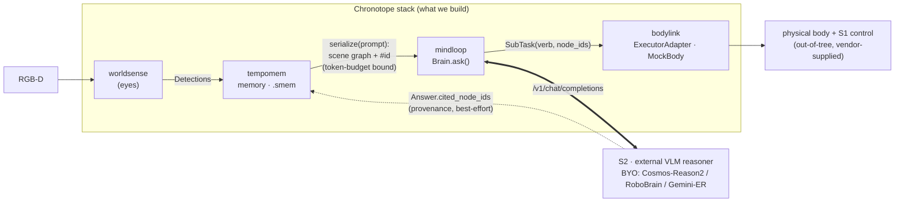

> 🌐 **English** · [中文](../zh/VISION.md)

# Chronotope · System-Level Vision and Positioning (2026 · Finalized v3)

> **TL;DR** — **Chronotope** is an engineering-grade **external spatial hippocampus**: it
> fuses RGB-D perception into a persistent, queryable 3D scene-graph memory (`.smem`) with
> `#id` references that the **S2** (slow-reasoning VLM) of any dual-system robot brain can
> mount. **What it is:** a structured spatial-memory + query service. **What it is not:**
> not a VLA, not a brain large-model, not a robot body. **Status:** numpy-only memory core
> working; closed-loop `Brain.ask()` prototype; commercial willingness-to-pay unverified
> (see §0 open questions). **The stack is 5 workspace members** — `tempomem` (memory core) ·
> `worldsense` (eyes) · `mindloop` (brain) · `bodylink` (body/executor seam) · `skillforge`
> (self-learning lab, research track).

> This document is the system-level vision and positioning document for the **Chronotope**
> stack (workspace dir: `SpatialRobot/`; 5 members: `tempomem` / `worldsense` / `mindloop` /
> `bodylink` / `skillforge`). "Chronotope" is the product/brand name; "SpatialRobot" is only
> the engineering workspace directory.
> Input basis: [research/embodied-brain-landscape-2026.md](research/embodied-brain-landscape-2026.md) (8-dimension, adversarially verified research) + a careful read of the actual member code in this repository.
> All cited figures are handled per the report's verdict: **refuted ones are not adopted, updated ones use the updated value, uncertain ones are explicitly marked "to be verified".**
> The single-package (memory core) vision is in [tempomem/docs/00-VISION.md](../../tempomem/docs/en/00-VISION.md); this document is its system-level superset, and the two do not conflict.
> **v2 finalization note**: This version absorbs adversarial critique from three perspectives — engineering / business / strategy. Every vulnerability exposed by the critique is either already filled in the main text (with engineering evidence) or explicitly downgraded to an **[open question]** with the minimum criterion to close it. This document distinguishes two kinds of assertion: those marked **[verified]** come from a careful code read or research confirmed; those marked **[internal analysis]** are this project's own judgment and must not be treated externally as independent evidence; those marked **[open question]** are unclosed bets that require external validation.
> **v3 delta**: rebrands the stack to its ratified product name **Chronotope** and grows the member set from three to **five** — `bodylink` (the brain↔body executor seam, reference `MockBody`) and `skillforge` (an autonomous self-learning lab, working name, walking-skeleton `v0.1.0a0`) join the original memory/eyes/brain triad. Positioning, niche, and open questions are unchanged; the two new members extend the closed loop downstream (act) and across episodes (learn) — see §2.1 and §3.

---

## Glossary (terms used before they are defined)

| Term | Meaning |
|---|---|
| **dual-system** | the converged robot-brain structure: **S2** (slow VLM planner) + **S1** (fast control policy) |
| **S2 / S1** | S2 = ~7B VLM, ~7–9 Hz, plans; S1 = ~80M policy, ~200 Hz, controls. Chronotope is the *external memory of S2* |
| **wedge** | the differentiation entry point — the structural gap (no persistent spatial memory) Chronotope enters through |
| **`.smem`** | Chronotope's single-file SQLite scene-graph memory format; survives restarts, incrementally updatable |
| **`#id` / `cited_node_ids`** | scene-graph node references; the brain's `Answer` back-references the memory nodes it used (provenance) |
| **BYO** | "bring your own" — perception / verbalizer / reasoner are pluggable protocol seams, not bundled defaults |
| **ICP** | ideal customer profile — the first paying-party prototype (OQ-1, still unverified) |
| **Open Core** | permissive core + separately-licensed enterprise layer commercialization model |
| **recall@k** | evaluation metric: did the right memory nodes appear in the top-k retrieved set |

---

## One-Sentence Positioning

**Chronotope is an engineering-grade, production-ready "external spatial hippocampus" — it fuses RGB-D perception into a persistent, queryable 3D scene-graph memory with `#id` references, mounts onto the S2 (slow-reasoning VLM) of any dual-system robot brain, and gives today's embodied brains — which structurally lack cross-frame spatial memory — the ability to "remember what is in the room, where it is, and how things relate."**

We do not build a fourth VLA, do not build a brain large model, and do not build a robot body — we build **a structured spatial-memory and query service that any S2 can mount, that is neutral and commercially viable.**

> **Honest boundary of the one-sentence positioning (absorbing engineering critique)**: "persistent, queryable" refers to the **storage layer**: a `.smem` single file survives restarts, can be incrementally updated, and can be precisely retrieved via `query()`. It does **not** equal "an infinitely large scene fits all at once into the Reasoner context" — the latter is constrained by the token budget (see §2.3 truncation limit). The selling point is "memory is not lost" + "can be queried", not "fits in one shot."

---

## 0. Key Open-Question List (decision prerequisite, must be read first)

The table below lists all the bets this document admits are not yet closed. Each gives a **current status**, the **minimum criterion to close it**, and the **section** it lives in. This table is the dividing line between this vision and "PPT logic" — we explicitly flag the uncertain places rather than papering over them with narrative.

| # | Open Question | Current Status | Minimum Criterion to Close It | Section |
|---|---|---|---|---|
| OQ-1 | **Who is the first paying party?** | Completely blank (research: not a single party procures spatial memory as a standalone line item) | 1 customer prototype willing to pay for some product form (even a hypothetical ICP + 1 real interview as corroboration) | §6 |
| OQ-2 | **Open-source license + Open Core dividing line** | Blank | Decide the distribution license + at least 1 "enterprise-only" feature list + first commercial product form | §6 |
| OQ-3 | **Why won't robot-body vendors / brain vendors build it themselves?** | Only a "time window" argument (weak) | At least 1 **organizational / economic structural** reason; otherwise honestly mark it a "time-window bet" | §4.3 |
| OQ-4 | **The tipping point at which next-gen S2 internalizes memory** | Signals have appeared (π0.7 added MEM) | Write an explicit "wedge failure tipping condition", and use it to draw the line between "safe scenarios / fragile scenarios" | §7.1 |
| OQ-5 | **Whether RoboOS / InternRobotics ship their own scene graph** | Not verified (decides "complementary" vs "subsumed") | A one-week spike research doc at the end of P1; the conclusion decides the P2 direction | §7.2, §8 |
| OQ-6 | **The real recall of `Brain.ask()` in large scenes** | Currently full-graph truncation (the code has been verified to have this flaw) | "query-filter the subgraph first, then serialize" engineering delivery + an over-budget evaluation scenario | §2.3, §8 |
| OQ-7 | **The reliability of `cited_node_ids`** | Pure regex extraction; any format drift silently yields `[]` | Two-layer evaluation (format-compliance rate + content-correctness rate); ship structured output in P2/P3 | §2.4, §8 |
| OQ-8 | **The stickiness mechanism of neutrality** | Neutral = easily forked, no natural stickiness | Lock in at least 1 stickiness source (format migration cost / benchmark lock-in / cross-machine data network effect) and prioritize building it | §4.4 |

---

## 1. Problem Statement: Why "All S2 Lack Persistent Spatial State"

The core landscape judgment from the research (executive summary 1–2, Chapter 3 paradigms, 6.1 wedge) is the reason this project exists:

**1.1 The technical paradigm has converged from end-to-end VLA to layered dual-system, but this convergence exposes the memory problem even more thoroughly.** [verified · research confirmed]
The leading 2024–2025 companies (Figure Helix, Physical Intelligence π0.5/Hi Robot, NVIDIA GR00T N1, Google DeepMind Gemini Robotics-ER) have converged on the dual-system structure of **S2 (7B-class VLM, ~7–9 Hz, planning) + S1 (~80M policy, ~200 Hz, control)**.

> Wording discipline: in the research, the two claims "dual-system is the industrial **de facto standard**" and "PsiBot first proposed dual-system" were marked **evidence-leaning-strong** and **refuted** respectively. This document uniformly adopts the more conservative wording "leading companies converged", does not write "de facto standard", and does not write any first-mover attribution.

**1.2 Whether end-to-end VLA or the S2 of dual-system, both structurally lack persistent, queryable cross-frame spatial state.** [verified · research confirmed] This is a hard fact the report repeatedly confirms: OpenVLA / π0 / Helix / GR00T / Gemini-ER are all single-frame or short-context, with **no explicit scene memory and no cross-frame persistent state** (the "weakness" column of the Chapter 3 paradigm table). The moment a robot turns around, it "forgets" what it just saw.

**1.3 Leading companies need it in fact, but none have built it into a standalone reusable layer (the 6.1 evidence chain):**

Here we must distinguish **external first-hand evidence** from **internal analysis** (absorbing strategy critique CRITICAL-1, avoiding self-circular argument):

*External first-hand signals (publicly verifiable, not self-attested by this project):*
- Physical Intelligence only added a history vision encoder (MEM) **in π0.7** — a leading team admitted the memory gap through a product action;
- 1X explicitly mentions in its public materials the need for **memory context** to handle drift / partial observability;
- BAAI's **RoboOS writes "cross-robot spatial memory sharing" directly into its architecture doc**;
- On the academic side, 3DLLM-Mem on 3DMem-Bench scores **32.1% on hard tasks vs ~5% baseline** (measured in the paper, confirmed) — this is **external third-party data** that "a memory layer brings real, measurable gains."

*Still indirect inference (marked as internal analysis, not used as a final-verdict basis):*
- Field AI's map-free navigation localization / replanning pain points "point to" persistent spatial state — this is our interpretation, not their statement; [internal analysis]
- Dyna's on-the-job continual learning "needs" persistent environment knowledge — same as above; [internal analysis]
- Galbot's retail shelf-state tracking "is equivalent to" our capability — same as above. [internal analysis]

> **Closing the wedge self-circularity (half of OQ-3)**: the above "internal analysis" items cannot serve as proof that the wedge holds; they can only serve as leads "worth validating via customer interviews." The real external support for the wedge is only three items: π0.7's product action, RoboOS's architecture doc, and 3DLLM-Mem's third-party data. **When communicating the wedge externally, cite only these three.**

**1.4 Academia is already a clear paradigm, but almost no one has engineered it into a pluggable, embeddable, commercially viable standalone component.** [verified · research confirmed] ConceptGraphs, Hydra/Clio, HOV-SG, Embodied-RAG, 3DLLM-Mem, RoboMemory are all implementations of this paradigm, but all are research code or heavy C++/ROS stacks.

> Wording discipline: the report marks "3DLLM-Mem is 6× higher than baseline" as **refuted** — the paper's main framing is an absolute **+16.5 percentage points**, and "6×" corresponds only to the hard subset. This document cites only the absolute value and the hard-subset 32.1% vs ~5%, and does not write "6×".

**Conclusion: what is missing is not a stronger VLA, but an external persistent spatial-memory layer that all S2 can mount. This is Chronotope's technical niche.** But "the technical niche holds" ≠ "the commercial niche holds" — the latter depends on OQ-1/OQ-2/OQ-3, see §6.

---

## 2. What We Do / What We Explicitly Do Not Do

### 2.1 What We Do (standing at the "spatial-memory pole")

Chapter 3 of the report groups the field into three **orthogonal, complementary** poles:
- **Action-generation pole** (end-to-end VLA → dual-system, two-generation mainline);
- **Data / imagination pole** (world model, learned simulator + synthetic data);
- **Persistent-state / memory pole** (spatial memory / 3D scene graph).

Chronotope explicitly stands at the third pole. Its anchor is the memory core; the
other members are the seams that feed it and act on it. The stack is **five workspace
members**:

1. **Memory (`tempomem`, the memory core)** — a numpy-only `.smem` SQLite 3D scene graph: fuse → persist → query. It is the system's **only stateful object**, the hippocampus.
2. **Perception (`worldsense`, the eyes)** — RGB-D → world-frame `Detection`; camera→world geometry lift, CLIP encoding (torch is only introduced behind the `[clip]` extra).
3. **Brain (`mindloop`, the brain seam)** — the `Brain` cognitive loop + `Reasoner` + `CosmosReasonVerbalizer`, interfacing with the S2 of **any OpenAI-compatible `/v1/chat/completions`**. It also ships the `ExecutorAdapter` *protocol* (the brain↔body seam).
4. **Body seam (`bodylink`, the executor adapter)** [P0 reference impl] — fills `mindloop`'s `ExecutorAdapter` protocol: `MockBody` accepts the brain's `SubTask`s, echoes the driving node ids (B9 provenance), and reports typed success/failure — letting the L3 brain run **end-to-end with no robot and no network**. A real body is an out-of-tree device package differing only by its **Body Profile + verb set** ("swap the body, keep the mind", D3). It also ships the `CapabilityManifest` reference (`g1d_manifest`, a G1-D wheeled humanoid).
5. **Self-learning lab (`skillforge`, the meta-orchestrator)** [research track · working name · walking skeleton `v0.1.0a0`] — the **only** member allowed to import all the others. It drives memory+brain+body+world in a closed **ENPIRE** loop (Environment / Policy-improvement / Rollout / Evolution) so a body can **acquire a skill from its own trials**, no human in the loop. Parallel to the `mindloop` DEV-PLAN, not on its critical path; the name is not yet owner-ratified.

> **Dependency direction (the contract the whole pitch rests on):** `worldsense → core`,
> `mindloop → core` (+ optional `mindloop[perception]`), `bodylink → mindloop`,
> `skillforge → tempomem + mindloop + bodylink`. **The core (`tempomem`) imports none of
> the others** — it only ships the protocols they fill. This is what keeps the core
> numpy-only and edge-installable.

The members plug into Chronotope through **the core's BYO protocol seams —
`PerceptionAdapter` / `Verbalizer` / `Reasoner` — plus `mindloop`'s `ExecutorAdapter`**
(filled by `bodylink`). The system's closed-loop interface is already a prototype:
`Brain.ask()` produces, via `serialize(format="prompt")`, a token-efficient **hierarchical
scene graph** with `#id` references fed to the Reasoner, returning **`Answer(text,
cited_node_ids)`**. This is precisely the engineering implementation of the "VLM planner +
structured spatial context" paradigm.

### 2.2 What We Explicitly Do Not Do (6.2 normative)

- **No end-to-end VLA / no brain large model.** That is the red ocean of Physical Intelligence / Skild / Generalist / RoboBrain / Qianxun / X-Square; head-on competition is sure to lose.
- **No robot body (hardware).** That is the capital-intensive arena of Unitree / AgiBot / Fourier / LimX. **Note the distinction**: `bodylink` is the *executor-adapter seam* (the `ExecutorAdapter` reference fill + a no-hardware `MockBody`), **not** a robot. We build the brain↔body *interface*; the physical body stays out-of-tree, vendor-supplied.
- **No SLAM.** World-frame poses come from upstream (KISS-ICP/MIT, cuVSLAM, ARKit, simulation ground truth); we **absolutely do not link ORB-SLAM3 (GPLv3 contagion) into the distribution package**.
- **No world model itself, but we provide its structured prior** (see §3).
- **No "cloud-first".** Local-first, embeddable, BYO-LLM; a hosted layer is a later convenience, **but whether it generates revenue is an open question** (see §6 OQ-2, absorbing business critique: you cannot both reject the hosting moat and not provide an alternative stickiness).

### 2.3 [verified · engineering limit] Context truncation: `Brain.ask()` is currently full-graph truncation, not subgraph recall

This is a hard limit that must be written into the vision after absorbing engineering critique **CRITICAL-1**, and **directly bears on the truthfulness of the "persistent cross-frame spatial state" selling point in large scenes.**

**Code facts (carefully read):**
- `brain.py:63`: `context = self._mem.serialize(format="prompt", max_tokens=self._budget)`, defaulting to `max_tokens=1500`;
- `serialize.py:81–82`: nodes are emitted "most-recent-first", over-budget whole subtrees are dropped, with a `… (N more omitted)` marker appended (not silent — this part is good);
- `Brain.ask()` does **not `query()`-filter first**, but instead packs the whole graph in reverse-chronological order into the budget.

**Consequence:** once the node count exceeds the budget, **what is in memory but cannot enter the Reasoner context is precisely the older nodes** — directly contradicting the core selling point "it remembers what is in the room" in large scenes. At this point the recall metric of `Answer.cited_node_ids` is a bogus number (only the portion that entered the context can possibly be cited).

**Conclusion and commitment:**
- This vision explicitly declares this a v0 limit and **makes no commitment whatsoever to "the whole graph fits into the context at once"**;
- The P1 engineering task must list **"query()-filter the relevant subgraph first, then serialize"** (retrieval-style context, not temporal truncation) as a formal item (see §8 OQ-6);
- The P1 evaluation set **must explicitly cover "over-budget scenarios"**, reporting recall separately under the two strategies "full-graph truncation" and "query subgraph", and is forbidden from reporting only small-scene numbers.

### 2.4 [verified · engineering limit] `cited_node_ids` is best-effort extraction, not a hard guarantee

Absorbing engineering critique **HIGH-4**. **Code facts:** `reason.py:18` uses `_ID_RE = re.compile(r"#(\d+)")` to extract references; `_PROMPT` contains only a single soft instruction `"Cite node ids as [#id]"`. Any Reasoner output format drift (`node_3`, `[id:3]`, full-width parentheses) leads to `cited_node_ids=[]` with **silent no error**. For an 8B-class VLM, the compliance rate of this soft constraint is itself an unknown.

**Conclusion and commitment:**
- The vision explicitly declares **`cited_node_ids` is "best-effort extraction", not a hard format guarantee** — "locatable, auditable" is a **goal**, not a **current established fact**;
- The P1 evaluation set splits into two layers: **(a) format-compliance rate** (does the Reasoner output per `#id`) + **(b) content-correctness rate** (is the cited id actually relevant);
- The P2/P3 roadmap lists **structured output (JSON mode / function call) replacing regex extraction** as an explicit engineering task (see §8 OQ-7).

### 2.5 [verified · architectural boundary] Cross-robot "real-time sharing" vs "offline merge"

Absorbing engineering critique **CRITICAL-2** and strategy critique **HIGH-2**. **Code facts:** the comment at `brain.py:8–9` explicitly states "v0 is single-threaded; serialize all access (the core store is one sqlite connection)"; `SpatialMemory.merge()` (`__init__.py:633`) is a **session-replay-style offline merge**, not real-time concurrent sync. The SQLite single-writer lock immediately becomes a bottleneck under concurrent writes from multiple robots.

**Conclusion (must be declared simultaneously when citing RoboOS's "cross-robot real-time sharing"):**
- **Implemented**: cross-episode / cross-robot **offline merge** (one robot's `.smem` replayed into another memory);
- **Not implemented**: **real-time multi-robot concurrent writes** — this requires a separate service layer / concurrency control / conflict resolution, is work for P3 and beyond, and the current architecture does not support it;
- Therefore, when §4 cites RoboOS as a "demand signal", it can only say "we overlap with it in the **offline sharing** semantics", and **must not** imply we can currently do real-time concurrent sharing.

---

## 3. Relationship to dual-system (S1/S2) and to world model

### 3.1 Relationship to dual-system: be the external memory of S2

- **S2 = the external Reasoner `mindloop` interfaces with** (Cosmos-Reason2 / RoboBrain / Gemini-ER / π0.5, etc., any OpenAI-compatible model) — **BYO, not bundled**;
- **S1 = the downstream controller** inside the physical body, out of scope; the brain reaches it through the `bodylink` `ExecutorAdapter` seam (a real body can wrap LeRobot's 5 official VLAs: Pi0Fast / Pi0.5 / GR00T N1.5 / SmolVLA / XVLA as the S1 executor, confirmed);
- **the memory layer precisely fills "the cross-frame persistent spatial state that all these systems jointly lack"** (executive summary 2).

We are **neutral and mountable** with respect to S2: because the interface is OpenAI-compatible `/v1/chat/completions` + protocol seams, the same memory layer can simultaneously serve any Reasoner on either the Chinese or US side (2.3 shared gap).

> **The double-edged boundary of neutrality (absorbing business critique 6, strategy critique HIGH-1)**: neutral = technically anyone can mount, but it also means **full-stack in-house vendors (PI / Figure / Helix) have no incentive to adopt an external neutral layer** — memory capability is exactly their differentiation barrier. Neutrality has real value only to **pure-executor vendors that do not build their own S2 / open-source brain teams**. Target customers must be split accordingly, see §6.1.

### 3.2 Relationship to world model: complementary, not competing (executive summary 3, 6.2)

The report explicitly judges: **world model and spatial memory are a complementary third pole, not a replacement relationship.**
- World model (Cosmos 3, 1X WM, Wayve GAIA-1, Covariant RFM-1, X-Square WUM, V-JEPA 2) does **pixel-level imagination / synthetic data / forward prediction**, positioned as a learned simulator + synthetic data source;
- Chronotope does **structured, explicit, queryable 3D object-relationship memory**.

The value combinations of the two (not replacement):
1. Use a world model to generate synthetic RGB-D to augment the perception training set;
2. Use the `.smem` scene graph to provide **object positions / relationship priors for imagination rollouts, reducing the search space**.

> Wording discipline: the report marks "Cosmos 3 30-second action-conditioned prediction" and "Genie 3 2026-01 subscription open" as **uncertain (first-hand source unverified)**. This document does not rely on these specific figures for positioning, and uses only their directional fact that "a unified single-system world model is confirmed".

---

## 4. Differentiation Wedge and Moat

### 4.1 Wedge (after evidence grading, judged "technically holds, commercially to be verified")

The three-segment evidence chain (after distinguishing external evidence from internal analysis, see the discipline in §1.3):
1. End-to-end VLA and dual-system S2 **structurally lack persistent cross-frame spatial state** — [verified · research confirmed];
2. Leading companies need it in fact — the **external evidence** is only the three items π0.7 adding MEM, the RoboOS architecture, and 3DLLM-Mem data; the rest is [internal analysis];
3. Academia is already a paradigm but **almost no one has built it into a standalone, pluggable, commercially viable, numpy-only engineering component** — [verified · research confirmed].

> **Honest restatement of the nature of the wedge**: the judgment that the wedge holds is **[internal analysis]**, not external independent confirmation. When communicating externally, one must say: "the technical gap is corroborated by three external signals; commercial willingness to pay is not yet verified (OQ-1); the moat's sustainability depends on OQ-3."

This repository's engineering choices happen to turn this academic capability into "an external hippocampus embeddable into any S2":
- **numpy-only core** (the contract mandated by CLAUDE.md) → installable in any environment, including the edge (deployment matrix in §4.2);
- **`.smem` single-file SQLite + sqlite-vec ANN** (with linear/keyword fallback behind heavy backends) → survives restarts, can be incrementally updated, zero infrastructure dependency;
- **the BYO protocol seams `PerceptionAdapter` / `Verbalizer` / `Reasoner` (+ `ExecutorAdapter`)** → not locking in upstream perception / downstream models / the physical body;
- **`#id`-referenceable serialization + `Answer.cited_node_ids`** → moving toward "locatable, auditable" (currently best-effort extraction, see §2.4);
- **the fuse-before-persist invariant** → engineering-correctness guarantee (a new mutator must first `_flush_pending()`).

### 4.2 [new] Deployment configuration matrix: tiered installability

Absorbing engineering critique **HIGH-5** — "numpy-only, installable on the edge" is a core selling point, but its boundary with the perception package's torch dependency must be clarified, otherwise robot-body vendors' embedded teams will have misaligned expectations.

| Configuration | Install | Dependencies | Compute / VRAM | Suitable for | End-to-end capability |
|---|---|---|---|---|---|
| **core-only** | `pip install tempomem` | numpy (no torch, no CUDA) | CPU, can run from MCU-class up | edge / embedded / receiving upstream `Detection` | fusion + persistence + query (keyword/linear fallback); **no visual front-end** |
| **+perception** | `+ [clip]` extra | torch + open-clip + (SAM2/GDINO) | GPU (CLIP inference) | on-machine with GPU / edge box | RGB-D → scene graph (with semantic encoding) |
| **+brain** | `+ mindloop` | stdlib only (LLM remote) | depends on S2 deployment location | any (S2 can be in cloud / remote vLLM) | memory + reasoning closed loop |
| **+body seam** | `+ bodylink` | stdlib only (depends on `mindloop`) | CPU (`MockBody` is hardware-free) | run/test the brain→body loop with no robot | memory + reasoning + dispatch `SubTask`s (mock or out-of-tree real body) |
| **full stack** | all + local S2 | torch + CUDA + local vLLM/NIM | high (e.g. Cosmos-Reason2-8B needs RTX PRO 6000 class) | workstation / R&D | full closed loop running locally |
| **+self-learning** (research track) | `+ skillforge` | depends on `tempomem`+`mindloop`+`bodylink` | CPU for the walking skeleton (`ScriptedAuthor`+`MockBody`); scales with a real author/sim | cross-episode skill acquisition experiments | ENPIRE loop: a body learns a skill from its own trials (`v0.1.0a0`, network-free) |

**P1 acceptance must include**: (a) **an end-to-end smoke test of the GPU-free pure-numpy fallback path** (core-only configuration, BYO `Detection` → query); (b) simultaneously verifying the GPU path of the +perception configuration. Only when both pass is "tiered installability" a credible selling point.

### 4.3 Moat (sorted by defensibility) + structural-sustainability analysis

The moat is not in a single-point technology (academia already has comparable paradigms), but in the **compound of engineering componentization + interface standard + evaluation benchmark**:

1. **Interface-standard moat (strongest, but not yet established)**: aim to get the `#id`-referenceable prompt serialization protocol + the `.smem` persistence format **adopted as the default memory layer by an open-source brain (RoboBrain / InternRobotics) or a robot-body vendor**. Once it becomes the "embodied-memory standard interface", migration cost is the moat.
2. **Evaluation-benchmark moat (an unoccupied gap)**: evaluation of spatial-memory query correctness is **currently unoccupied**. We build our own "query correctness + `cited_node_ids` recall (including format-compliance rate) + cross-episode persistence + decay/forget correctness" evaluation set (referencing Embodied-RAG's Embodied-Experiences, 3DLLM-Mem's 3DMem-Bench), which both proves the value proposition and sets an industry yardstick.
3. **Engineering-maturity moat**: turning research code into a production-grade, network-free-tested, numpy-only portable SDK is itself the dirty work that competitors (academic prototypes) are unwilling to do and robot-body vendors have no time to do.
4. **Neutrality moat (double-edged, needs a stickiness mechanism)**: see §4.4.

**[OQ-3] Why won't a robot-body vendor / brain vendor spend 3 months internalizing this capability themselves?** (absorbing business critique 3, strategy critique CRITICAL-2)

The falsification threat is real: π0→π0.5→π0.7 in under a year, and the engineering cost of RoboBrain adding a scene-graph module is extremely low. If the moat relies only on "they have no time", the moat's lifespan = the time it takes for them to free up. We propose two **candidate structural reasons**, but honestly mark their quality:

- **(a) Organizational incompatibility [internal analysis, candidate strongest]**: internalizing memory and "neutral cross-robot sharing" are naturally in conflict organizationally — Unitree will not make its own `.smem` schema public to benefit AgiBot; PI will not open its memory format to Figure. Only a **neutral third party** can provide a "cross-vendor interoperable" memory standard. This is structural, not temporal. **But the premise is that "cross-vendor interoperability" actually has demand** — which itself depends on OQ-1.
- **(b) Ongoing maintenance cost [weaker]**: engineering maintenance is an ongoing investment, not a one-time one. This argument has limited persuasiveness for resource-rich big vendors.

**Honest conclusion**: before OQ-1 (the paying party) and OQ-5 (whether RoboOS ships its own) are closed, reason (a) is still a **bet**, not a settled conclusion. **If in the end no structural reason harder than (a) can be found, this wedge should be explicitly marked a "time-window bet"** — i.e. what we bet on is "establishing the interface standard and the evaluation benchmark as established facts before the leaders internalize them." This is an honest qualitative characterization, not a failure characterization, but it must be written out.

### 4.4 [new · absorbing business critique 6 + OQ-8] The stickiness mechanism of neutrality

Neutral = no customer has strong stickiness; anyone can fork and walk away. Vector databases (Pinecone/Weaviate) also lead with neutrality, but generate revenue and stickiness via **hosting + API + enterprise SLA** — whereas we currently reject the hosting moat. We must specify at least one stickiness source and prioritize building it:

| Candidate stickiness | Mechanism | Strength | Decision |
|---|---|---|---|
| **`.smem` format migration cost** | once data is deposited in `.smem`, migrating out has cost | medium (weak when the format is open) | one of the main picks: amplify by "the format becoming a de facto standard" |
| **Evaluation-benchmark lock-in** | we define "how spatial-memory correctness is measured" → benchmark discourse power | medium-high (consistent with moat 2) | **main pick**: whoever defines the measurement method holds the standard discourse power |
| **Cross-robot persistence-data network effect** | multiple robots share one memory → the more data the more useful | high (but depends on real-time sharing, §2.5 not implemented) | long-term bet, after P3 |

**Decision**: in P1–P2, prioritize building **evaluation-benchmark lock-in** (merged with moat 2, the most realistic stickiness at present); `.smem` format standardization serves as the carrier of the P3 interface-standard moat; the network effect is a long-term option after P3. **Abandon the naive "pure-neutral, no-stickiness" positioning.**

---

## 5. North-Star Metric and Preferred Target Scenarios

### 5.1 North-Star Metric (add a "quality gate", absorbing strategy critique HIGH-3)

**North star: the number of independent external S2 / robot bodies / open-source brains that have actually adopted it as a mountable spatial-memory layer and that satisfy the quality gate.**

A mere "interface-working demo" cannot distinguish real value from technical curiosity — a research team plugging in a demo is easy, but it does not equal niche lock-in, much less willingness to pay. **A qualified mount must simultaneously satisfy three quality gates:**
1. **Measurable improvement**: a measurable improvement in long-horizon task performance on our task evaluation set (not "it ran");
2. **Sustained maintenance**: the integration is maintained for **≥ 2 months** without disconnection (proving it is not a one-off demo);
3. **Public external citation**: a paper / blog / public code repository citation (proving the other party is willing to publicly endorse it).

Missing any of the three means it does not count toward the north star. Supporting metrics:
- **Correctness**: query correctness on the evaluation set, `cited_node_ids` format-compliance rate + content-correctness rate, cross-episode persistence, decay/forget correctness;
- **Efficiency**: serialization token cost, query latency, **large-scene `commit()` latency** (see §8 performance gate);
- **Persistence**: memory fidelity across restarts / across episodes / across robots (offline merge).

### 5.2 Preferred target scenarios (add temporal annotation, absorbing business critique 5)

**Prefer "multi-shift / long-duration continuous operation" scenarios — in these scenarios persistent spatial memory is a rigid need, not a nice-to-have:**
- Multi-shift warehousing (tracking goods / shelf state across shifts);
- Long-duration continuous-operation humanoids (the **scenario type** of "long-duration continuous running", not any specific vendor's continuous-duration claim);
- Retail shelf state (shelf-state tracking is a textbook use case).

> **Temporal discipline of the execution gap (absorbing business critique 5, strategy critique HIGH-1)**: the industrial scenarios in §5.2 are a **commercial-validation direction entered only at P3**, not an industrial PoC deliverable within 6–12 months. Explicit phasing:
> - **The target "customers" in P1–P2 = open-source brain / robot-body integration teams** (technical validation, not industrial sales);
> - **Industrial-scenario commercial validation is entered only at P3** (requires real robot integration, industrial-grade reliability, IT procurement processes).
> No reader should misread §5.2 as a near-term commercial commitment.

> Wording discipline: the report marks some of the claims "UBTech Walker S2 7×24h", "Dyna 24h 99%+", "Figure Helix full 8-hour autonomous shift" as **uncertain / misleading wording**. This document uses these only as examples of **scenario types**, and **does not cite any specific continuous-running duration as an established fact**.

---

## 6. [new section] Commercialization and GTM: paying party, license, Open Core

This chapter is dedicated to closing the three P0 gaps exposed by the business critique (OQ-1/OQ-2/OQ-3). Until these three are closed, all technical roadmaps are built on assumptions.

### 6.1 Paying-party ICP: lock in the first prototype customer with a 2×2 matrix (OQ-1)

The procurement decision chains of candidate paying parties are entirely different:

| | **Strong procurement capability** | **Weak procurement capability** |
|---|---|---|
| **High willingness to pay** | (ideal ICP, existence to be confirmed) | early-stage research team (willing to try, no budget) |
| **Low willingness to pay** | robot-body vendors (Unitree/AgiBot/Fourier): strong in-house tendency, more likely to free-ride the open source then fork; system integrators: have budget but conservative tech stacks, migration cost is the obstacle | enterprise end users: buy a "robot solution", not the underlying SDK |

**Conclusion and decision:**
- **First prototype-customer profile (hypothetical ICP, to be confirmed by P3 interviews)**: a **pure-executor robot-body vendor or open-source brain team** that does not build its own S2 but needs long-duration / multi-shift spatial memory — they have no "building memory in-house = weakening the moat" concern (unlike PI/Figure), and have a real long-horizon task need.
- **[OQ-1 closing criterion]**: P3 must use 1–2 real customer interviews to converge the above hypothetical ICP into "a concrete customer prototype willing to pay for some product form". **Before OQ-1 is closed, do not invest heavy resources in commercialization / hosting.**
- **Honest annotation**: there is currently **no verified paying party whatsoever** — this is this project's biggest commercial uncertainty.

### 6.2 Open-source license + Open Core dividing line + first commercial form (OQ-2)

Currently completely blank. **This vision gives the to-be-decided framework (the specific values are what OQ-2 closes):**

- **(a) Distribution license [to be decided]**: candidates — the core uses a permissive license (Apache-2.0, maximizing adoption, consistent with "build the niche by adoption"); if free-rider prevention is needed, consider a commercial license (dual licensing) for **hosting / enterprise features**. **Default leaning: core permissive, enterprise layer separately discussed.**
- **(b) Open Core dividing line [to be decided]**: candidate "enterprise-only" features — cross-robot **real-time** concurrent persistence (§2.5 not implemented, naturally suited to the enterprise layer), multi-tenant `.smem`, audit logging / compliance export, enterprise SLA support. **The Community edition includes**: core memory + query + offline merge + BYO seams.
- **(c) First commercial product form [to be decided]**: candidates — ① SDK license fee; ② hosted API (note: the research positions "the hosting layer is not a moat", but **hosting can be a revenue source, and the two are not contradictory** — absorbing business critique 2); ③ on-site PoC consulting. **Default leaning: do not sell in P1–P2; in P3 start with "PoC consulting + enterprise-layer license".**

**[OQ-2 closing criterion]**: decide (a) the distribution license + (b) at least 1 "enterprise-only" feature list + (c) the first commercial form. Before the three are in place, investors will not take the commercial narrative seriously.

### 6.3 GTM path: the mechanism from "release the evaluation set" to "be adopted" (absorbing business critique 4)

The P2→P3 jump from "release the evaluation set → be adopted by default" lacks a persuasion mechanism. Fill it in as **two-layer acceptance** (also written into the §8 P3 milestone):

- **(a) Technical-adoption incentive**: make explicit what the other party gets — saving N engineering-months of "fusion + dedup + persistence + serialization" wheel-reinvention (this is precisely the core narrative of the single-package vision: "every embodied team is rebuilding the same pipeline");
- **(b) Commercial commitment**: adopted ≠ take the open source and vanish. The P3 "adopted by default" is split into two independent acceptances: **technical adoption** (the other party imported/forked it) + **commercial commitment** (there is a license agreement or paid PoC). Whether they still depend on us after forking → depends on the stickiness mechanism in §4.4 (evaluation benchmark + format standard).

### 6.4 [OQ-2 related] The route conflict between enterprise-ready and developer-friendly (absorbing business critique 7)

"Local-first, BYO-LLM" is developer-friendly, but the IT departments of industrial customers want SLA / hosting options / security compliance / technical support — friction rather than a selling point for enterprise buyers. **Decision (consistent with the §5.2 timing):**
- **P1–P2 explicitly do no enterprise sales** — the target is developers / open-source teams, and "local-first BYO-LLM" is the correct positioning;
- **From P3, add an "enterprise-ready path"** (hosting option, support contract, data isolation) as the Open Core enterprise layer (§6.2), and only start it after OQ-1 is closed.

---

## 7. Largest Long-Term Risks and Responses

### 7.1 Top risk: next-gen S2 internalizing memory capability + an explicit tipping condition (absorbing strategy critique CRITICAL-2, OQ-4)

The report lists this item as **the wedge's largest long-term risk**: whether next-gen S2 such as Cosmos 3 / RoboBrain 2.5 will internalize memory capability — **the signal has appeared: π0.7 has begun to internalize MEM (history vision encoder).** PI's iteration speed means π1.0 / RoboBrain 3.x have **a fairly high probability of internalizing "30-minute session-level spatial state"** by the end of 2026. The defensive narrative ("play the auditable differentiation") is insufficient to respond; one must give an **explicit failure tipping point**:

**[OQ-4 · internalization tipping-point definition]** When some external S2 simultaneously has **all** of the following capabilities, this project's wedge fails in "the scenarios that S2 serves":
1. Cross-episode **persistence** (not just a single-session context window);
2. **Multi-robot sharing** (not just single-model private memory);
3. **Locatable / auditable** memory references (not just implicit latents).

Based on this tipping point, divide scenarios:

| Scenario | Can internalization cover it | Characterization |
|---|---|---|
| 30-minute single-episode single-robot spatial state | internalization likely covers it (driven by context-window expansion) | **fragile scenario** — should not be the main battlefield |
| Cross-shift / cross-day / long-duration persistence (beyond a single episode) | internalization is limited by the context window and the single episode | **safe scenario** (for now) — the main battlefield |
| Cross-robot sharing (even offline merge) | organizationally conflicts with single-model private memory (§4.3 reason a) | **safe scenario** — a structural difference |
| Auditable / locatable (regulatory / compliance needs) | implicit memory inherently cannot do it | **safe scenario** — but the demand scale is to be verified |

**Response strategy:**
1. **Continuous monitoring (mandatory)**: each quarter, carefully read Cosmos / RoboBrain / π-series updates and score them against the above three tipping conditions.
2. **Place the main battlefield only in "safe scenarios"**: concentrate resources on the three classes — cross-shift / cross-robot / auditable — that are inherently weak spots for internalization, and proactively give up the "single-episode short-term memory" fragile scenario.
3. **Bet on the interface standard and the evaluation benchmark** (see §7.3 for the revision of the analogy).

### 7.2 Secondary risk: being subsumed by domestic "one-brain-many-bodies" open-source stacks shipping their own scene graph (OQ-5, absorbing engineering critique 6 + strategy critique HIGH-2)

The report makes it explicit: **whether RoboOS / InternRobotics already ship their own scene-graph memory decides whether we are "complementary" or "subsumed".** The current roadmap has a logical contradiction — §1.3 treats RoboOS as demand corroboration, while P2 treats "RoboOS integration" as an acceptance goal, but the "subsumed" conclusion may appear in the first week of P2.

**Response (probe first, then decide; research is front-loaded as a gate):**
- Move the **RoboOS / InternRobotics scene-graph capability-boundary research up to the end of P1**, as a **"P2 prerequisite gate spike" (~one week)**;
- Before the spike reaches a conclusion, §1.3's citation of RoboOS is **downgraded to a "market signal to be verified"** and not used as demand corroboration;
- The spike conclusion decides the P2 goal: **if RoboOS already ships a complete scene graph** → P2 pivots to a "lighter-weight / numpy-only portable / cross-stack neutral" differentiation or **lightweight-alternative positioning**; **if not** → P2 cements "complementary integration".
- **Do not preset the P2 integration goal**, to avoid "subsumed" invalidating the entire P2 acceptance criteria.

### 7.3 Strategic risk: revision of the analogy for the interface-standard moat (absorbing strategy critique MEDIUM-1)

The original draft used "vector databases' interface value is rising" to argue for the interface-standard moat — **this analogy fails**: a vector database's real moat is hosting operations, and the interface is already highly homogenized (pgvector goes directly into Postgres). The revised argument:

- **Switch to "evaluation-benchmark definition power"**: whoever defines "how spatial-memory correctness is measured" holds the standard discourse power (consistent with §4.3 moat 2, §4.4 stickiness mechanism);
- **Switch to "`.smem` format cross-robot interoperability"**: in cross-vendor scenarios, the migration cost of a unified format is a real barrier (consistent with §4.3 reason a).
- These two are more defensible than the vector-database analogy.

### 7.4 Commercial risk: willingness to pay not verified

See §6.1 (OQ-1). Listed as an explicit P3 milestone; before verification, do not invest heavy resources in hosting / commercialization; first build the niche via open-source adoption (north star, with quality gate).

### 7.5 Strategic discipline: do not be led by the rhythm of marketing numbers

The report's executive summary 8 warns: financing / shipment numbers in this field are extremely prone to going stale and have muddled framing (Galbot's ¥9.3 billion financing **refuted**, Skild $14B/$30M ARR **to be verified**, Fourier's 10,000 units mostly rehabilitation exoskeletons, the Unitree vs AgiBot "world No.1" framing dispute). **Response: anchor the vision on technical architecture and niche, not on marketing numbers.** All company citations in this document are used only to illustrate "technical demand" and "integration targets", and do not cite any refuted/uncertain commercial number as an established fact.

---

## 8. Phased Roadmap (P1 / P2 / P3)

Based on research 6.3 and absorbing the engineering critique (performance gate, protocol v2, evaluation feasibility) and the business critique (two-layer acceptance), landing in three phases.

### P1 · Foundation (0–3 months): cement the memory core and the BYO seams

> **Scope discipline (absorbing engineering critique 7)**: delivering "the first PerceptionAdapter + dual Reasoner backends + an annotated QA evaluation set" simultaneously in P1 is overly optimistic for a one-person team. Therefore the P1 evaluation **does only the automated, deterministic part**; manual annotation of semantic correctness is pushed to P2; the P1 exit criterion **does not hang on a bogus "query correctness Y%"**.

| Milestone | Acceptance criterion |
|---|---|
| First concrete `PerceptionAdapter` implementation (ConceptGraphs route: SAM 2 + GroundingDINO + OpenCLIP, all Apache/MIT, behind the `[clip]` extra) | RGB-D sequence → `.smem` scene graph runs end-to-end; core stays numpy-only (pyright clean, no torch import into the core) |
| **PerceptionAdapter Protocol v2 design** (absorbing engineering critique HIGH-3) | the current protocol has only `process_frame()`, no lifecycle interface; v2 adds at least `__enter__`/`__exit__` (or `close()`/`flush()`) to manage the lifecycle of stateful encoders (CLIP model loading) |
| **Retrieval-style context (query-filter the subgraph first, then serialize)** (absorbing engineering critique CRITICAL-1, OQ-6) | `Brain.ask()` no longer full-graph truncates; recalls the relevant subgraph in over-budget scenarios. The evaluation covers "over-budget scenarios", reporting separately the recall under the two strategies full-graph truncation vs query subgraph |
| Cement dual Reasoner backends | both backends, Cosmos-Reason2 (local RTX PRO 6000, OpenAI-compatible `/v1`) and RoboBrain, can drive `Brain.ask()` to return an `Answer` with `cited_node_ids` |
| **Build your own spatial-memory evaluation set v0 (automated, deterministic)** | use the existing `SyntheticScene` to generate deterministic scenes + scripts to auto-generate QA pairs; do only **recall@k + `cited_node_ids` format-compliance rate** (no manual semantic annotation); cover cross-episode persistence + decay/forget correctness; produce the first baseline numbers |
| **Performance gate** (absorbing engineering critique HIGH-3) | besides the existing "100 obs / 30ms", add a **"`commit()` latency in a 1000 obs / 100 nodes scene"** upper bound as an acceptance gate |
| **Deployment-matrix smoke** (absorbing engineering critique HIGH-5) | (a) GPU-free pure-numpy core-only path end-to-end smoke (BYO `Detection` → query); (b) +perception GPU path smoke. Both pass |
| **[P2 prerequisite spike] RoboOS / InternRobotics scene-graph capability research** (absorbing strategy critique HIGH-2, OQ-5) | completed in the last week of P1; produces a research doc whose conclusion decides the P2 integration direction (complementary / lightweight alternative). Until then, the §1.3 RoboOS citation is downgraded to "signal to be verified" |
| Core quality gate | core coverage ≥ 75%; tests network-free throughout (ScriptedReasoner / HashEncoder); ruff + pyright pass |

**P1 exit criterion**: be able to prove with one **reproducible** sentence that the wedge is not a PPT — "there are X objects in memory, surviving restarts, recall@k = R on a deterministic synthetic scene, `cited_node_ids` format-compliance rate = F, 1000 obs `commit()` latency < T, pure-numpy path smoke passes". **Note: it is recall@k and format-compliance rate (auto-measurable), not manually annotated semantic correctness.**

### P2 · Integration validation (3–6 months): end-to-end on a real robot body + open-source ecosystem

| Milestone | Acceptance criterion |
|---|---|
| End-to-end demo on 1–2 open-source-friendly domestic robot bodies | prioritize Fourier N1 (fully open source), LimX FluxVLA (MIT); retail shelf is a textbook use case. Produce a reproducible demo + video |
| Plug into the LeRobot ecosystem | LeRobotDataset v3.0 as the standard data source feeding `PerceptionAdapter`; downstream interface with its official VLA (one of Pi0Fast/Pi0.5/GR00T N1.5/SmolVLA/XVLA) as S1 |
| **Interface with an external S2 (direction decided by the P1 spike)** | if RoboOS does not ship its own scene graph → cement "complementary integration"; if it already does → pivot to "lightweight / numpy-only portable / cross-stack neutral" differentiation or a lightweight alternative. **Do not preset the conclusion** |
| Evaluation goes external + manual semantic annotation | the evaluation set is released externally, inviting 1–2 external teams to reproduce; **do the manual semantic-correctness annotation deferred from P1** |
| **`cited_node_ids` two-layer evaluation + structured-output exploration** (absorbing engineering critique HIGH-4, OQ-7) | report the format-compliance rate + content-correctness rate separately; explore JSON mode / function call to replace regex extraction |

**P2 exit criterion**: at least 1 external team runs through "after mounting Chronotope, S2's long-horizon task performance is **measurably improved**" on a real or semi-real robot body (not "it ran").

### P3 · Niche lock-in (6–12 months): make it the "embodied-memory standard interface" + the first commercial validation

| Milestone | Acceptance criterion |
|---|---|
| Release a stable serialization protocol | versioned `#id`-referenceable prompt format, backward-compatibility commitment; stable `.smem` schema version; structured output landed as the hard-guarantee path for `cited_node_ids` |
| Cross-episode / cross-robot persistence + lifecycle | the decay / consolidate / forget lifecycle is externally stable; a cross-robot **offline merge** demo (real-time concurrent sharing explicitly marked as after P3) |
| **Adopted by default (two-layer acceptance)** (absorbing business critique 4) | **(a) technical adoption**: an open-source brain / robot-body vendor imports/forks it as the default memory layer; **(b) commercial commitment**: there is a license agreement or paid PoC (not take the open source and vanish) |
| **Commercial baseline (close OQ-1/OQ-2)** | complete 1–2 real customer interviews, converging the hypothetical ICP into a concrete paying-customer prototype; decide the distribution license + Open Core dividing line + first commercial form; start the enterprise-ready path (hosting / support / data isolation) |

**P3 exit criterion**: the north-star metric ≥ 1 external brain/body adopts Chronotope as the **default** (not optional) memory layer **and satisfies all three quality gates** (measurable improvement + ≥2 months maintenance + public citation), while OQ-1 has a credible paying-customer prototype.

---

## 9. License Red Lines and Engineering Red Lines (6.4, hard constraints, tiered management)

Absorbing strategy critique **MEDIUM-2**: license red lines (irreversible legal risk) and engineering red lines (controllable technical debt) have different failure consequences, and **should not share the same priority**. Split into two classes, each with an exception-escalation path.

### 9.1 License red lines (legal-compliance constraints · must not be violated · no exception path)

**The distribution package absolutely must not link the following contagious / non-commercial license components:**

| Red line | Reason | Replacement |
|---|---|---|
| **ORB-SLAM3** | **GPLv3 contagion**, commercially unfriendly | use **KISS-ICP (MIT)** / KISS-SLAM for pose |
| **AgiBot World / part of RoboCasa datasets** | **CC BY-NC-SA non-commercial**, commercial products **cannot use** | for commercial use OXE (CC BY 4.0) / DROID (permissive); non-commercial research only |
| **OpenVLA / any LLaMA-2-derived weights** | **LLaMA-2's 700M MAU clause** (confirmed) | prefer LLaMA-3.2 / Qwen-series backbones (e.g. OpenVLA-mini) |
| **GR00T N1 / N1.5 weights** | **NVIDIA non-commercial license, commercial use prohibited** | for commercial use **N1.7 (Apache-2.0)** or Cosmos Open Model License |

> **Exception-escalation path**: none. License red lines have no exception — any proposal to introduce a contagious / non-commercial component into the distribution package is rejected outright. Only a "non-commercial research branch" may use NC resources, under the premise of isolation and non-distribution, and must not flow back into the mainline.

### 9.2 Engineering red lines (architectural-integrity constraints · changes need RFC + owner approval)

- the core stays **numpy-only** — adding a torch/LLM import to `tempomem/` breaks the contract;
- the **fuse-before-persist invariant** — any new mutator must first `_flush_pending()`;
- tests are **network-free** — use `ScriptedReasoner` / `HashEncoder`, and absolutely never reach a real LLM or download a model in a test.

> **Exception-escalation path**: engineering red lines are controllable technical debt; changes must go through an **RFC process + architecture-owner approval** (different from the "no exception" of license red lines). For example, if it is later proven that the core must introduce some lightweight optional dependency, an RFC must argue its impact on "edge installability" and be approved, rather than committing directly.

### 9.3 Green reusable list (Apache-2.0 / MIT / BSD, can fork/port/depend on directly)

- Perception: SAM 2 (Apache-2.0, code + weights), GroundingDINO v1 (Apache-2.0), OpenCLIP (Apache-2.0, already depended on), KISS-ICP (MIT);
- Memory reference: ConceptGraphs (code MIT), HOV-SG (MIT), Hydra (BSD-2);
- Brain: Cosmos-Reason (NVIDIA Open Model License, commercially usable, derivatives allowed, already interfaced), LeRobot (Apache-2.0), openpi (Apache-2.0), SmolVLA (Apache-2.0), RoboBrain 2.0/2.5 (Apache-2.0), InternVLA/FluxVLA/WALL-OSS/RLDX-1 (Apache/MIT), Fourier N1 (fully open source).

> **Must do before fork/port:** the exact licenses of Clio / 3DLLM-Mem / RoboMemory / Embodied-RAG are mostly "to be confirmed"; introduce them only after checking each repo's LICENSE one by one (research 7. gaps to be researched).

---

## Appendix: Relationship Between This Document and the Single-Package Vision

- This document (system level) = the niche, paradigm relationships, roadmap, risks, and commercialization framework of the Chronotope five-member whole;
- [tempomem/docs/00-VISION.md](../../tempomem/docs/en/00-VISION.md) (single-package level) = the "Mem0-for-3D-space" narrative of the memory core as a standalone SDK;
- The two are consistent: the system level places the single-package "spatial-memory SDK" into the full embodied-brain panorama of dual-system + world model, defining it as "the external hippocampus that all S2 can mount." In case of conflict, this document's research facts and code read prevail.

---

## Appendix (internal): v2 Finalization Ledger of Dispositions for the Three-Perspective Critique

> **Internal process record — not part of the external pitch.** Transparently records the disposition of each critique for ease of re-review; it exposes raw internal critique IDs (CRITICAL-1, HIGH-4, …) and is kept for re-audit, not external circulation. verdict: **adopted** (filled into the main text) / **downgraded to open question** (written into the §0 list) / **partially adopted**.

**Engineering perspective:**
- CRITICAL-1 (full-graph truncation) → **adopted**: §2.3 declares the limit + §8 P1 lists the "retrieval-style context" task + evaluation covers the over-budget scenario (OQ-6).
- CRITICAL-2 (concurrency vs sharing contradiction) → **adopted**: §2.5 distinguishes offline merge (implemented) vs real-time concurrency (not implemented, after P3).
- HIGH-3 (Protocol has no lifecycle + no large-scene performance gate) → **adopted**: §8 P1 lists Protocol v2 (`__enter__`/`__exit__`) + the "1000 obs `commit()` latency" performance gate.
- HIGH-4 (cited_node_ids regex fragile) → **adopted**: §2.4 declares "best-effort extraction" + two-layer evaluation + P2/P3 structured output (OQ-7).
- HIGH-5 (numpy installability confused with torch) → **adopted**: §4.2 deployment matrix + P1 GPU-free smoke acceptance.
- MEDIUM-6 (RoboOS milestone logical contradiction) → **adopted**: §7.2 + §8 move the research up to an end-of-P1 spike gate.
- MEDIUM-7 (P1 evaluation overly optimistic) → **adopted**: §8 P1 evaluation does only automation (recall@k + format-compliance rate), manual annotation pushed to P2, exit does not hang on a bogus Y%.

**Business perspective:**
- P0-1 (paying party unclear) → **adopted + downgraded to open question**: §6.1 gives the 2×2 + hypothetical ICP (OQ-1, closed in P3).
- P0-2 (open-source/commercialization blank) → **adopted + downgraded to open question**: §6.2 gives the license/Open Core/commercial-form framework (OQ-2, closed in P3).
- P1-3 (wedge commercial scarcity) → **adopted**: §4.3 gives structural reasons (a)(b) + honestly marks the time-window bet (OQ-3).
- P1-4 (adoption→default jump) → **adopted**: §6.3 two-layer acceptance + §8 P3 splits technical adoption / commercial commitment.
- P1-5 (18-month execution gap) → **adopted**: §5.2 temporal annotation (P1–P2 technical validation / P3 commercial validation).
- P2-6 (neutral = easily replaced) → **adopted**: §4.4 stickiness-mechanism table (OQ-8, main pick evaluation-benchmark lock-in).
- P2-7 (local-first vs enterprise procurement) → **adopted**: §6.4 no enterprise sales in P1–P2 / P3 enterprise-ready path.

**Strategy perspective:**
- CRITICAL-1 (wedge self-circularity) → **adopted**: §1.3 distinguishes external evidence vs internal analysis + externally cites only the three external signals.
- CRITICAL-2 (π0.7 response is defensive) → **adopted**: §7.1 gives an explicit internalization tipping point + safe/fragile scenario division (OQ-4).
- HIGH-1 (neutrality depends on unverified customer structure) → **adopted**: §3.1 boundary + §6.1 splits pure-executor vendors (the real target) vs full-stack in-house (not the target).
- HIGH-2 (RoboOS complementarity unverified yet taken as premise) → **adopted**: §7.2 front-loads research as a P1 spike; before the spike RoboOS is downgraded to a "signal to be verified".
- HIGH-3 (north-star demo count has no quality gate) → **adopted**: §5.1 three quality gates (measurable improvement + ≥2 months maintenance + public citation).
- MEDIUM-1 (vector-database analogy fails) → **adopted**: §7.3 switches to evaluation-benchmark definition power + `.smem` interoperability.
- MEDIUM-2 (license red lines / engineering red lines mixed tiers) → **adopted**: §9 splits into two classes, each with an exception-escalation path (license no exception / engineering goes through RFC).
