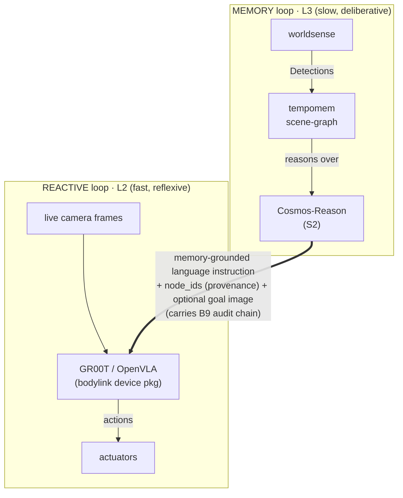

# L3↔L2 Interface Roadmap — How the Brain Talks to the Body

> 🌐 **English** · [中文](../../zh/research/l3-l2-fusion-roadmap.md)
>
> Status: **research roadmap, low priority.** Push when time allows. No code yet.
> Last updated: 2026-06-25.

> **TL;DR — Decision:** pass L3→L2 as explicit **language + images**, **not** a latent vector.
> Latent fusion is parked to a research track (§6). The seam lives in **`bodylink`** (the 4th
> Chronotope member, which fills `mindloop`'s `ExecutorAdapter`): today `bodylink.MockBody` is the
> hardware-free reference; a real GR00T/OpenVLA body is an **out-of-tree `bodylink`-style device
> package** consuming `instruction + live frames`. Rationale: language+image keeps auditability (B9),
> body-swap (D3), and the training-free remote brain — a latent trades all three away.

## 1. The question and the decision

**Question raised:** can we fuse the L3 brain (`mindloop`, the LLM cognitive loop)
and the L2 VLA (the low-level vision-language-action policy) by passing a **latent
vector** between them, making the stack end-to-end (jointly trainable)?

**Decision (current stage): pass data as explicit *language + images*, NOT latent.**
Latent fusion is deferred to a research track (§6). Rationale:

- **Latent ≠ free end-to-end.** Just passing a latent without joint training is only
  *conditioning*. True end-to-end means back-propagating an action loss into the LLM —
  which needs a local trainable LLM, a trainable VLA, and real robot-interaction data.
- **Latent trades away the three things this stack is built on:** auditability/
  provenance (B9 memory→actuator chain — a latent is opaque, you cannot cite which
  memory node drove an action), body-swap (D3 "swap the body, keep the mind" — a latent
  is co-trained with one specific VLA), and the training-free remote brain + numpy-only
  core contracts.
- **A chat API cannot emit a latent.** Today's `CosmosReasonVerbalizer` speaks
  `/v1/chat/completions` — text in, text out, no hidden states. Latent passing would
  first require re-serving the LLM to expose hidden states.

By contrast, **language + image passing is the most interpretable interface possible**
(you can read exactly what L3 told L2), needs **no joint training**, and is the
**native input** of modern VLAs (GR00T, OpenVLA). It also satisfies the interpretability
priority chosen for evaluation.

## 2. The two-loop picture

> The **bridge is text + image** (the thick arrow), not a latent — human-readable end to end.

**Division of labor.** L3 supplies *memory-grounded intent*: it reads the persistent
scene-graph (it knows "the mug you used yesterday is in the left cabinet") and emits a
natural-language sub-instruction. The VLA supplies *pixels + language → reactive control*
from its own live cameras. The bridge is text + image — human-readable.

The value the bridge carries is exactly what a discrete verb cannot: the VLA only sees
the current frame; the language instruction injects `tempomem`'s persistent spatial
memory into the VLA's reactive loop.

## 3. Current-stage interface (language + image)

The current symbolic seam is `SubTask(verb, node_ids, params)` validated against a
`CapabilityManifest`. A VLA wants free-form language. **Recommendation: coexist, do not
replace** — keep the symbolic verb for audit + capability-gating, add a language field
the VLA actually consumes.

| Field | Role | Consumer |
|---|---|---|
| `verb` (symbol) | audit anchor + capability check (D3) | planner / manifest |
| **`instruction` (new, natural language)** | what the VLA executes; L3 generates it from memory | VLA |
| `node_ids` | provenance (B9) | audit chain |
| `goal_image` (new, optional) | goal conditioning | goal-conditioned VLA |

**Image channels (two, parallel):**

- **Live frames → VLA.** GR00T runs on-robot with its own cameras; the reactive loop
  consumes **raw pixels**, not `tempomem`'s `Detection` abstraction.
- **Detections → tempomem.** `worldsense` still emits `Detection`s for the memory loop
  (what L3 reasons over). The two loops run in parallel.
- L3 may optionally emit a `goal_image` (a target crop) for a goal-conditioned VLA.

**Paper-level changes (no implementation yet):**

- `mindloop.execute`: add `instruction: str` (+ optional `goal_image`) to `SubTask`;
  add a `CapabilityManifest` flag for whether a body consumes language / image-goals.
- L3 output: `Brain.plan` / the reasoner produces `SubTask`s carrying a grounded
  `instruction` generated from the query-relevant subgraph.
- A new VLA device package fills `ExecutorAdapter` — i.e. an **out-of-tree `bodylink` device
  package** (the same seam `bodylink.MockBody` already fills, swapped for a real body): it feeds
  `instruction + live frames` to GR00T and streams back `StatusUpdate`. The `tempomem` core does
  not change.

## 4. VLA choice

| | Language + image interface | Current-stage role |
|---|---|---|
| **GR00T N1** (NVIDIA) | native language + multi-camera → actions; aligns with the Cosmos/NVIDIA stack | **primary** |
| **OpenVLA** | language + single image → action tokens | comparison baseline |

Note: both GR00T and OpenVLA are themselves internally `System2 (VLM) → System1 (action)`
with a latent bridge. **The current stage uses only their external language+image API**;
tapping their internal latent is the future track (§6).

## 5. Invariants preserved

| Invariant | How it is kept |
|---|---|
| Auditability (B9) | `instruction` text + `node_ids` — the whole bridge is human-readable, stronger than latent |
| Body-swap (D3) | GR00T / OpenVLA each fill `ExecutorAdapter`; the manifest declares what they consume |
| Interpretability (chosen eval priority) | a language interface is the most explainable possible — read the L3→L2 dialogue directly |
| numpy-only core / training-free brain | no training, no torch in the core; L3 stays a remote chat LLM |

## 6. Future research track — latent fusion (parked)

Resume only after the language interface works on real hardware. Summary of the deferred
plan so it is not lost:

- **Grounded latent (first):** latent = pooled embedding of the query-relevant subgraph
  (carries `node_ids`, so it keeps partial provenance) → a small trainable **projection
  head** → GR00T **System1** conditioning input. No LLM-service change needed.
- **LLM-hidden latent (second):** re-serve Cosmos-Reason to expose pooled hidden states
  (vLLM pooling / hidden-states endpoint); richer semantics, weaker provenance.
- **Joint end-to-end (last, optional):** LoRA-trainable local LLM + trainable VLA + real
  interaction data, action loss back-propagated. Evaluate ROI before committing — it
  breaks remote-brain, body-swap, and audit.
- **Interpretability-first evaluation** (the chosen priority): provenance-completeness
  (can an action be traced to `node_ids`), linear probing of the latent for scene-graph
  attributes, symbolic↔latent consistency, and ablation (how much does the latent
  actually contribute).

References that match this exact pattern: Figure **Helix** (System2 VLM emits one latent
vector conditioning a fast System1 policy), **LCB** (Latent Codes as Bridges — a learned
`<ACT>` token bridges LLM and policy, trained end-to-end), Physical Intelligence **π0**
(VLM backbone + flow-matching action expert).

## 7. Milestones (current stage)

| ID | Milestone | Notes |
|---|---|---|
| M0 | Design freeze (this doc) | done |
| M1 | Seam change: `SubTask` + `instruction` / `goal_image` (protocol only) | paper |
| M2 | GR00T `ExecutorAdapter` device package (language + frames in, actions out) — IsaacLab sim first | sim, no real robot |
| M3 | L3 emits grounded language instructions (`Brain.plan` from the subgraph) | |
| M4 | Closed loop: memory → language → VLA → action (sim) | |
| M5 | Real hardware | gates the §6 latent track |

## 8. Open decisions

1. **`instruction` vs `verb`:** coexist (recommended — keeps audit + capability check)
   or let `instruction` replace the discrete verb (closer to a VLA, loses manifest safety)?
2. **`goal_image`:** include it (only needed for a goal-conditioned VLA) or language-only?
3. **GR00T deployment:** on-robot with its own cameras (reactive loop eats pixels) vs.
   `worldsense` feeds frames?
4. **Instruction granularity:** whole-task sentence ("put the red cup on the table") vs.
   stepwise atomic instructions?

## 9. Relationship to the rest of the stack

A research branch parallel to the `mindloop` DEV-PLAN (P1–P6) symbolic mainline; it does
not block it. It lands in **`bodylink`** (the 4th Chronotope member): the `ExecutorAdapter`
protocol it fills is exactly the L3↔L2 seam this doc designs, so the `instruction` /
`goal_image` field additions and the GR00T device package are `bodylink` work, not core work.
Depends on the L2 VLA being GR00T/OpenVLA (decision above) rather than a purely symbolic
Brain2Robot L2 — if the reused L2 is symbolic-only, the language/image interface needs a
VLA-side change. The latent track (§6) sits after M5.
