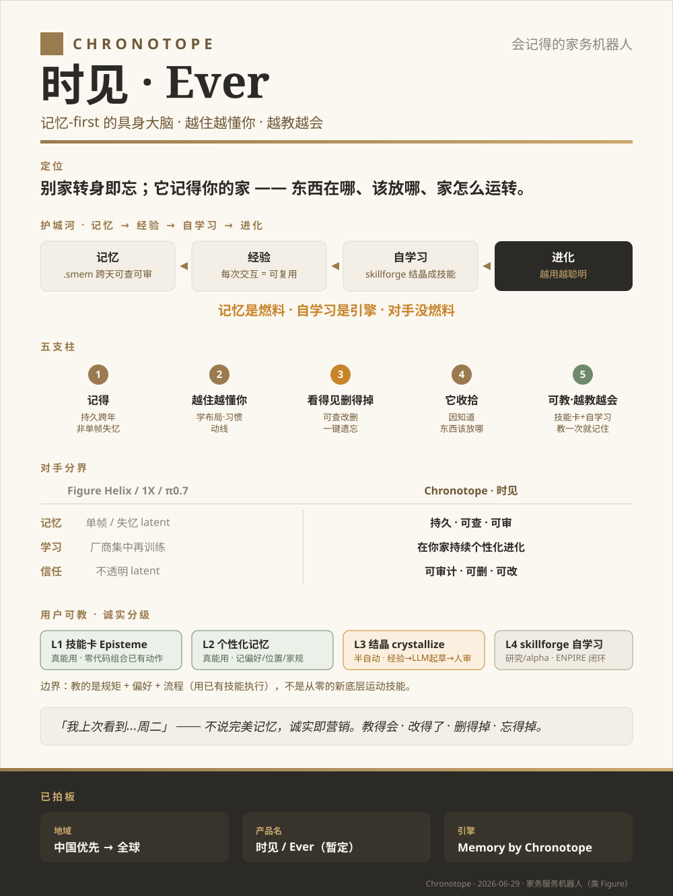
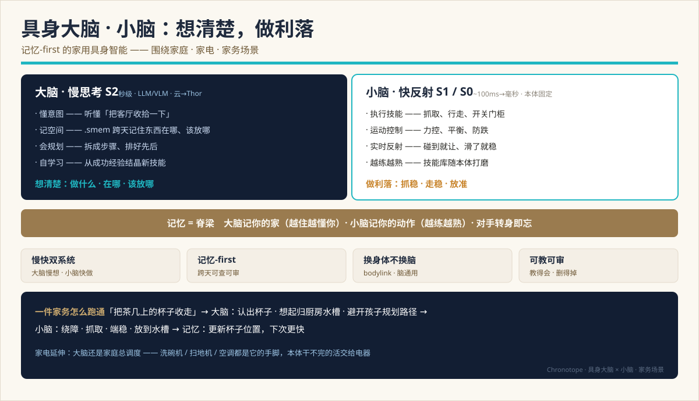

# 技术品牌 · Chronotope（时见 / Ever）

> 一页纸总结。英文规范版见 [docs/en/BRAND.md](../en/BRAND.md)。
> 系统愿景见 [VISION.md](VISION.md)，竞品全景见 [research/embodied-brain-landscape-2026.md](research/embodied-brain-landscape-2026.md)。

**一句话**：会记得的家务机器人 —— 记忆-first 的具身大脑。别家转身即忘，它越住越懂你、越教越会。



---

## 架构一图 · 大脑 × 小脑（家务场景）



**大脑**（S2 慢思考：懂意图 / 记空间 `.smem` / 会规划 / 自学习）想清楚要做什么、东西在哪、该放哪；
**小脑**（S1/S0 快反射：执行技能 / 运动控制 / 实时反射）把动作做利落、做稳；**记忆是脊梁**，贯穿两者
（大脑记你的家、小脑记你的动作）。家电延伸：大脑当家庭总调度，洗碗机 / 扫地机 / 空调都是它的手脚。
细节见 §3 护城河与 [TECH-DESIGN.md](TECH-DESIGN.md)。

## 1. 定位

别家转身即忘；**它记得你的家** —— 东西在哪、该放哪、家怎么运转。
货架前台先讲**能干**（"它收拾，因为知道东西该放哪"），用一句具体证明兑现诗意（"知道你的杯子在哪"）。

## 2. 品牌架构（双层成分品牌，Intel-inside）

| 层 | 名 | 用途 |
|---|---|---|
| 消费品牌 | **时见 Shíjiàn / Ever** | 暖产品名，上盒子。时 + 见 = 跨时间地知道 |
| 引擎品牌 | **Memory by Chronotope**（时空体，Bakhtin） | 只上规格表 / press / B2B |

暖名拉情感，硬引擎名立技术。**文学词「时空体」不上盒子。**

## 3. 护城河：记忆 → 经验 → 自学习 → 进化

```
.smem 跨天可查可审  →  每次交互 = 可复用经验  →  skillforge 结晶成技能  →  越用越聪明
```

学习 = 从经验改进。经验 = 跨时间的记忆。**无记忆 → 无经验 → 学不动。**
这是和 Figure / 1X / π0.7 最锋利的分界。

> **记忆是燃料，自学习是引擎，对手没燃料。**

自学习进化是具身智能最重要的能力；记忆是它的**前提**（详见 [research/l3-l2-fusion-roadmap.md](research/l3-l2-fusion-roadmap.md) §6）。

## 4. 五支柱

1. **记得** — 真持久，跨重启跨年；非单帧失忆
2. **越住越懂你** — 学布局、习惯、动线
3. **看得见、删得掉** — 记忆显式可查可改可删，一键遗忘（笔记本，非摄像头）
4. **它收拾因为知道东西该放哪** — 记忆是能干的引擎，不是噱头
5. **可教 · 越教越会** — 技能卡 + 自学习，教一次就记住

## 5. 对手分界

| | Figure Helix / 1X / π0.7 | Chronotope · 时见 |
|---|---|---|
| 记忆 | 单帧 / 失忆 latent | 持久 · 可查 · 可审 |
| 学习 | 厂商集中再训练 | 在你家持续个性化进化 |
| 信任 | 不透明 latent | 可审计 · 可删 · 可改 |

## 6. 用户可教阶梯（诚实分级）

| 层 | 是什么 | 现状 |
|---|---|---|
| L1 技能卡 Episteme | 零代码，组合已有动作教流程 / 规矩 | 真能用 |
| L2 个性化记忆 | 记住偏好、物品位置、家规 | 真能用 |
| L3 结晶 crystallization | 成功经验 → LLM 起草技能卡 → 人审核入库 | 半自动 |
| L4 skillforge 自学习 | ENPIRE 闭环，本体自己提出 → 练习 → 进化 | 研究 / alpha |

**边界**：教的是规矩 + 偏好 + 流程（用**已有**技能执行），不是从零的新底层运动技能 —— 后者仍靠本体数据 + 融合训练。

## 7. 视觉系统

铜锈 + 暖纸 + 墨（传家宝 / 日记调性），走出钢蓝冷光。serif = 被记得的 / sans = 当下的；一条不断的"记忆带"。
**记忆 × 隐私**做成可看可听：写 = 琥珀 + 笔尖声，回忆 = 鼠尾草 + 翻页声，记忆-OFF 可见状态，一键遗忘有专属音效。

## 8. 诚实护栏（护栏即营销）

绝不宣称"完美 / 全部记忆"（全图截断、best-effort `cited_node_ids`、跨机离线合并等真实限制）；用"我上次看到…周二"的口吻。
**教得会 · 改得了 · 删得掉 · 忘得掉** —— 把技术真实限制做成品格。
**杀手 demo**：转身测试 + 断电重启测试（重启后它仍记得）—— 失忆 latent 对手伪造不了。

## 9. 已拍板决策（2026-06-29）

- **地域**：**中国优先 → 全球**
- **产品名**：**时见 / Ever**（暂定，沿用现名；仍需商标核查）
- **引擎名**：Memory by Chronotope（时空体）

## 10. 待拍板

- 叙事主轴（情感 / 能干 / 信任 三选一打头，还是分场景）
- 商标核查与海外名落地

## 承载物

- `战略与品牌.pptx` — 8 页战略 + 品牌 deck（本地，不入库）
- `三层大脑架构方案汇报.pptx` — 13 页技术 ADR（本地，不入库）
- 本一图流：[docs/assets/brand-onepager.svg](../assets/brand-onepager.svg)
