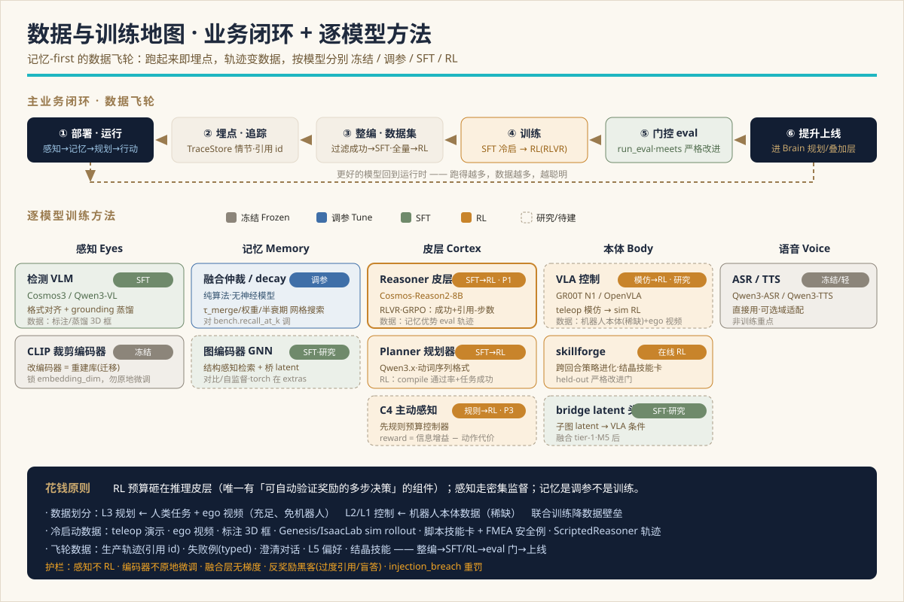

> 🌐 [English](../en/DATA-AND-TRAINING.md) · **中文**

# Chronotope — 业务闭环、数据与训练方案

架构背后的细致方案：**①** 主业务闭环（生产流程 + 改进飞轮）、**②** 部署*前*与*后*所需的数据、
**③** 哪些模型做后训练、哪些做强化学习（RL）、哪些冻结 —— 逐一列出。

配套 [SYSTEM-DESIGN.md](SYSTEM-DESIGN.md)（架构）与 [FLOWS.md](FLOWS.md)（图）。复用的深来源：
[post-training-rl-roadmap](../../mindloop/docs/en/post-training-rl-roadmap.md)（决策矩阵）与
[l3-l2-fusion-roadmap](research/l3-l2-fusion-roadmap.md)（端到端融合的数据划分）。**日期：** 2026-07-14。



> **一句话论点：** RL 预算砸在**推理皮层** —— 唯一一个目标是「有可自动验证奖励的多步决策」的组件。
> 感知走密集监督（SFT）；记忆是*调参*不是训练；编码器冻结。而且运行时本就埋点（每个决策都是一条
> 引用 id 的 `TraceStore` 情节），**数据飞轮自付其费。**

---

## 1. 两个环

Chronotope 以两个不同时钟的嵌套环运行：

- **运行时业务环**（§2）—— *每任务，~秒级。* 感知 → 记忆 → 深思 → 行动 → 追踪。这是机器人在家里干的事；
  每跑一遍都吐出训练废气。
- **改进飞轮**（§3）—— *每次发版，天–周。* 部署 → 追踪 → 整编 → 训练 → 门控 → 上线 → 再部署。把废气变成更好的模型。

第一个环是生产；第二个是它如何自我改进。记忆-first 设计让第二个环便宜：运行时**本就**记录带引用的情节，
所以训练数据是运营的副产品，不是单独的采集项目。

---

## 2. 主业务闭环（生产运行时）

一句话驱动整套栈；每个阶段吐出一个带类型的产物，它*同时*是训练信号。


| # | 阶段 | 组件 | 运行时产出 | 训练废气 |
|---|---|---|---|---|
| 1 | **感知** | worldsense | `Detection[]`（世界米） | 帧 + 位姿 + 检测（感知 SFT 集） |
| 2 | **记忆** | tempomem `commit()` | 融合后 `.smem` 增量、`CommitStats` | 场景图快照（记忆优势 eval） |
| 3 | **路由** | mindloop `IntentRouter` | `task \| question \| chat` | （指令 → 意图）标签 |
| 4 | **检索** | `SceneContextProvider` | 序列化子图 + 节点 id | （问题, 场景）上下文 |
| 5 | **规划**（*LLM*） | `Planner` | `Command[]`（文本动词） | （上下文 → 动词序列）规划轨迹 |
| 6 | **编译**（*规则*） | `compile_commands` | `Plan` = `SubTask[]`（绑 id、D3 门控） | 编译 通过/失败 信号 |
| 7 | **安全** | `Phylax` | 违规 / 放行 | （计划 → 安全裁决）样本 |
| 8 | **行动** | bodylink 分派环 | `StatusUpdate` 流、typed 故障 | （子任务 → 结果、RecoveryHint）rollout |
| 9 | **追踪** | `TraceStore` | 引用节点 id 的 append-only 情节 | **带标注的训练样本** |

**最丰富的数据在分派环里** —— 它可抢占（插话、幂等跳过、主动感知重看）且自修复（typed `FAILED` → `Replanner`）：


每条 `TraceStore` 情节是一个元组 `(指令, 序列化场景, 意图, 计划, 安全裁决, 有序子任务 + StatusUpdate,
引用节点 id, 最终结果, 任何澄清)`。这个元组恰好就是一个训练样例 —— 常见情形无需单独标注，因为验证信号
（成功了吗？引用的 id 存在吗？）可用代码算出。

---

## 3. 改进飞轮


```
部署 / eval  ──►  记录轨迹（指令、场景、工具调用、计划、答案、结果）
      ▲                              │
      │                              ▼
  更好的模型  ◄── 门控(run_eval) ◄── 训练(SFT → RL) ◄── 整编(过滤成功 / 全分布)
```

- **整编。** 过滤成功轨迹 → **SFT** 集。用全分布（含失败 + typed 错误）→ **RL** 信号。skillforge 的结晶技能
  （`Evolution` 赢家）直接变成 P2 技能卡。
- **训练。** SFT 冷启动，再 RL —— 逐模型方法见 §5。
- **门控。** `run_eval` / `EvalThresholds` / `IntegrationReport.meets(required=)` —— 候选只有在**held-out**
  拆分上**严格**优于当前被接受分数时才上线（与 skillforge `gate.py` 逐回合执行的同一纪律）。无静默回退。
- **上线。** 赢家回到在线 `Brain`（reasoner 权重、planner 权重、一张新技能卡、或一个叠加层）。然后环再跑 ——
  运营越多、数据越多、模型越好。

**两个高度的学习，互补：** mindloop 的 `Replanner` 在一回合*内*修一步（运行时）；skillforge 的 `Evolution`
*跨*回合改进策略（离线实验室）；梯度 SFT/RL 跨发版改进*权重*（这条飞轮）。

---

## 4. 数据平面 —— 部署前与后

### 4.1 部署前 —— 冷启动数据

飞轮转起来之前，你必须给每个官能带来的冷启动数据：

| 数据 | 用于 | 性质 | 备注 |
|---|---|---|---|
| **遥操作演示 teleop** | VLA（L2/L1 控制） | 稀缺、珍贵 | 真机器人本体数据；最贵的输入 |
| **人类任务 + 第一视角 ego 视频** | L3 规划 + VLA 的 VLM 半 | **充足、免机器人** | 教目标*长什么样* / 怎么表述 |
| **标注 / 蒸馏 3D 框** | 感知 VLM | 密集监督 | 来自更强的教师或域内帧 |
| **仿真 rollout**（Genesis / IsaacLab） | VLA、skillforge | 可扩展 | 物理接地，主机 + mac 已验证 |
| **脚本技能卡**（P2 Episteme） | 规划器先验 | 手写 | 过程性知识即数据（`K2` 扁平步骤） |
| **FMEA 安全例** | Phylax 策略 | 手写 | `conservative_policy()` 预设 |
| **ScriptedReasoner 工具轨迹** | 皮层 SFT 冷启 | 确定性 | 离线 harness 生成/回放 |
| **记忆优势 eval clip** | 皮层 RL **环境** | 精选 | 只有靠跨会话记忆才答得出的问题 |

### 4.2 部署后 —— 飞轮数据（热）

运营即免费采集；整编成数据集：

| 数据 | 来源 | 喂给 |
|---|---|---|
| **生产轨迹情节**（带引用） | `TraceStore` | 皮层 SFT（成功）+ RL（全分布） |
| **rollout 日志 + typed 失败** | 分派环 + `Replanner` | RL 信号、重规划调参 |
| **澄清对话** | 插话 / 问人 | 意图 + 对话 SFT |
| **L5 偏好纠正** | `PreferenceStore` | 个性化 / 偏好数据 |
| **结晶技能** | skillforge `Evolution` → `crystallize` | P2 技能卡库（无需重训） |

**记忆优势 eval 让奖励保持诚实：** 它专门奖励*使用持久记忆*（clip 1 见过的物体，clip 9 才问）—— 这正是整个架构存在的理由。

---

## 5. 逐模型训练计划（哪些模型、怎么练）

决策矩阵 —— **哪些做后训练、哪些做强化、哪些别碰：**

| 模型 | 层 | 后训练？ | 方法 | 数据来源 | 优先级 |
|---|---|---|---|---|---|
| **推理皮层**（`Reasoner`, Cosmos-Reason2-8B） | L3 / S2 | ✅ 最高价值 | **SFT 冷启 → RL（RLVR / GRPO）** | 过滤成功轨迹 → 全分布；记忆优势 eval 当 RL 环境 | **P1** |
| **Planner 规划器**（Qwen3.x） | L3 / S2 | ✅ | **SFT** 动词序列格式 → 可选 **RL**（compile 通过 + 任务成功） | 规划轨迹、TASK-FAMILIES 样本 | P1–P2 |
| **感知 VLM**（Cosmos3 / `VLMDetector` Qwen3-VL） | 眼 | ✅ **仅 SFT — 不 RL** | 格式对齐 SFT + grounding SFT / 蒸馏 | 标注/蒸馏 3D 框、域内帧 | P2 |
| **C4 主动感知策略**（「看仔细节点 N」） | L3 | ⚠️ 后置 | **规则 v0 → 策略 RL**（信息增益 − 动作代价） | 记录的重看轨迹 | P3 |
| **CLIP / SigLIP 裁剪编码器** | 记忆 L1 | ❌ **冻结** | 无 —— 重嵌入 = 库*迁移*，非训练 | — | — |
| **融合 / 仲裁 / decay** | 记忆 L0 | ❌ **无模型** | 阈值**调参**（网格 / 贝叶斯）对 `bench.recall_at_k` | — | — |
| **图编码器（GNN）** | 记忆 L2 | ✅（研究） | 对比 / 自监督表示 | 场景图结构 | 研究 |
| **VLA 控制**（GR00T N1 主 / OpenVLA 基线） | L2 / L1 | ✅（最大工程量） | **模仿**（teleop）→ **RL**（sim / skillforge） | 机器人本体数据（稀缺）+ ego 视频（VLM 半） | 研究 → 生产 |
| **skillforge ENPIRE** | 本体 / 实验室 | ✅ **在线 RL** | 跨回合策略改进 → `crystallize` 技能卡 | rollout + 在真 `Detection` 上打分的 reward | 活跃（α） |
| **bridge latent 投影头**（融合 tier 1） | L3↔L2 | ✅（研究） | 小可训头，action loss | grounded 子图 + 机器人数据 | 研究（M5 后） |
| **ASR / TTS**（Qwen3-ASR / Qwen3-TTS） | 语音 | ❌ / 轻 | 冻结，可选域适配 | — | 低 |

### 5.1 推理皮层 —— RL 为它而生（P1）

皮层（`reason(question, context) → Answer`）读序列化场景、调记忆工具、引用 `node_id` 作答 —— 一个**有可校验结果的
多步决策**，正是「有可验证奖励的 RL（RLVR）」的教科书场景。奖励：

```
reward =  w1·task_success        # 答案对不对（eval harness 判）
        + w2·citation_grounded   # 每个引用的 node_id 在库里存在（工具验证）
        + w3·citation_relevant   # 引用的节点确实是答这题的那些
        − w4·steps               # 工具调用 / 推理步数越少越好
        − w5·hallucination       # 引用了不存在的 node_id  → 重罚
        − w6·injection_breach    # 听从了嵌在不可信 SCENE 文本里的指令
```

`w5`（幻觉 id）和 `w6`（提示注入突破）是**大而不对称**的罚 —— 这些是让具身智能体不可信的失败模式。两阶段：
1. **SFT 冷启动** 在成功轨迹上 —— 灌输习惯「序列化 → 查询 → 引用 `node_id` → 作答」，以及拒答习惯「记忆里没有就说没有」。
   （`ScriptedReasoner` 是离线 harness。）
2. **RL（GRPO / PPO）** 待工具调用良构后，按上面奖励优化。**GRPO** 合适：无独立价值模型、组内相对优势、对可验证标量奖励好用。

### 5.2 skillforge ENPIRE —— *技能*的在线 RL

区别于皮层的梯度 RL：skillforge 是**自学习实验室**，跨回合改进一个*策略*（`tuple[SubTask,…]`）并把赢家结晶成 P2 技能卡。
`author → rollout → reward → gate → append`，带**held-out 严格改进门**（`evaluate_gate`：只在不泄漏拆分上严格优于当前接受分数才接受）。
reward bricks 在**真 `tempomem.Detection`** 上打分，所以真环境 / 真 LLM author 直接换入不改环代码。学到的技能作为 `provenance="learned"`
卡反馈，仍受 `Phylax.vet_card` 管辖。

### 5.3 VLA 控制（L2 / L1）—— 最大的数据工程

底层 像素+语言→动作 策略（GR00T N1 主，OpenVLA 基线）。用 teleop/机器人数据**模仿**训练，再在 sim（Genesis / IsaacLab）
或经 skillforge 环里做 **RL**。这是机器人本体数据（稀缺）绕不开的地方 —— 但 §6 的数据划分正是把这笔账压住的办法。

---

## 6. 融合 / 端到端训练（L3↔L2 研究轨道）

当前阶段 L3→L2 传**显式语言 + 图像，非 latent**（保住审计 B9、换本体 D3、远程大脑）。端到端/latent 融合是搁置的研究轨道；
其**关键使能是训练数据划分：**

- **L3 规划 ← 人类任务 + 第一视角 ego 视频** —— 充足、免机器人；教目标长什么样、怎么表述/条件化。规划器从不需要机器人来学。
- **L2 / L1 控制 ← 机器人本体数据**（teleop / 真机）—— 稀缺数据，只有底层控制器需要。
- **联合训练** 把 action loss 反传跨层。因为只有 L2/L1 依赖稀缺机器人数据、而规划器骑在充足的人类/ego 视频上，
  **端到端的数据壁垒骤降。**

latent *接口* 分三个递进 tier 建（仅当 ROI 成立才做）：
1. **grounded latent** —— query 相关子图的池化 embedding（带 `node_ids`，保部分溯源）→ 一个小可训**投影头** → VLA System-1 条件。无需改 LLM 服务。
2. **LLM-hidden latent** —— 重新服务 Cosmos-Reason 暴露池化隐状态；语义更丰富、溯源更弱。
3. **联合端到端**（*最后、可选 —— 红线*）—— LoRA 可训本地 LLM + 可训 VLA + 真交互数据，action loss 反传。**这会破坏远程大脑、换本体、审计** ——
   提交前评 ROI，可能永远不过。

**接地红线：** 每个 latent 必须*派生自*且*并存于*显式 `.smem` 图（真值源），溯源才活着。这正是让 Chronotope 不塌成
「没钱版 Helix / π0.7」的东西（后者是纯 latent、无持久记忆）。

**记忆表示**本身也按同一规则 latent 化（L0 符号图=真值 → L1 节点 embedding 已发布 → L2 图编码器 新 → L3 bridge latent）——
编码器是 torch-在-extras-后，**从不进 numpy 核**。

---

## 7. 分阶段与里程碑

**后训练（皮层优先计划）：**

| 阶段 | 工作 | 产出 |
|---|---|---|
| **T0** | 立起 eval-即-环境（回放 clip → 库 → 问题 → 奖励） | RL/SFT harness |
| **T1** | 采集 + 过滤皮层轨迹；**SFT 冷启动** `Reasoner` | 会用工具的基础策略 |
| **T2** | 对皮层奖励做 **RL（GRPO / RLVR）** | grounded、更少步的皮层 |
| **T3** | worldsense 的感知**格式 / grounding SFT** | 稳定的 3D 框 JSON |
| **T4** | 记录 C4 重看轨迹；训练**主动感知策略** | 学到的看的控制器 |

预算经验：**RL 花销大头在 T1–T2（皮层）。** T3 是监督。T4 可选、最后。

**融合轨道（语言接口在真硬件跑通后）：** M0 设计冻结 ✅ → M1 缝加 `instruction`/`goal_image`（协议）→ M2 GR00T `ExecutorAdapter`
设备包（先 sim）→ M3 L3 出 grounded 语言 → M4 闭环 记忆→语言→VLA→动作（sim）→ M5 真硬件 → *然后*才是 §6 的 latent tier。

---

## 8. 非目标与护栏

- **感知不 RL** —— 密集监督主导；RL 是浪费（单步目标）。
- **编码器不原地微调** —— `embedding_dim` 建库时锁死；重训编码器会作废所有已持久向量。改它 = **重嵌入进新库**，是迁移不是训练。
- **融合层无梯度训练** —— 它是纯算法；阈值是超参，靠搜索调，不靠学。
- **反奖励黑客** —— 智能体会靠过度引用刷 `citation_grounded`、靠盲答刷 `steps`。保持 `task_success` 主导；罚过度引用；在 held-out 记忆优势集上审计。
- **安全在环** —— `injection_breach` 保持一等、重罚的奖励项；不可信场景文本是外泄向量，不定价 RL *就会*找到那个突破口。
  学到/结晶的技能永远不能放松安全规则（`Phylax` 仍审）。

---

## 9. 参考

[SYSTEM-DESIGN](SYSTEM-DESIGN.md) · [FLOWS](FLOWS.md) · [TASK-FAMILIES](TASK-FAMILIES.md) ·
[INTEGRATION-E2E](INTEGRATION-E2E.md) · [post-training-rl-roadmap](../../mindloop/docs/en/post-training-rl-roadmap.md) ·
[l3-l2-fusion-roadmap](research/l3-l2-fusion-roadmap.md) · [brain-architecture](../../mindloop/docs/en/brain-architecture.md) ·
[skillforge architecture](../../skillforge/docs/en/architecture.md)。
