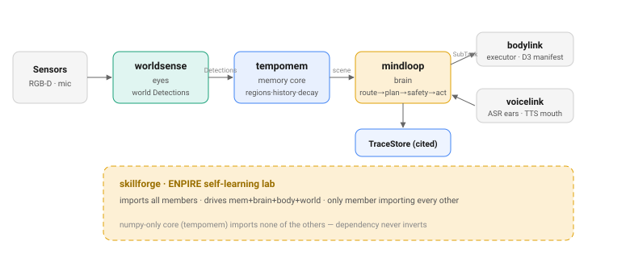
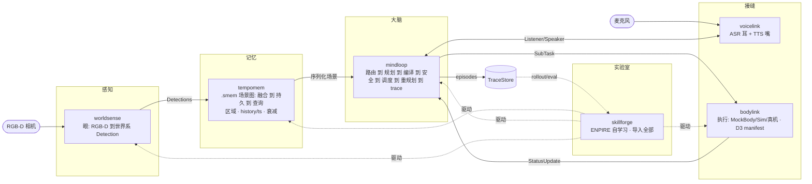
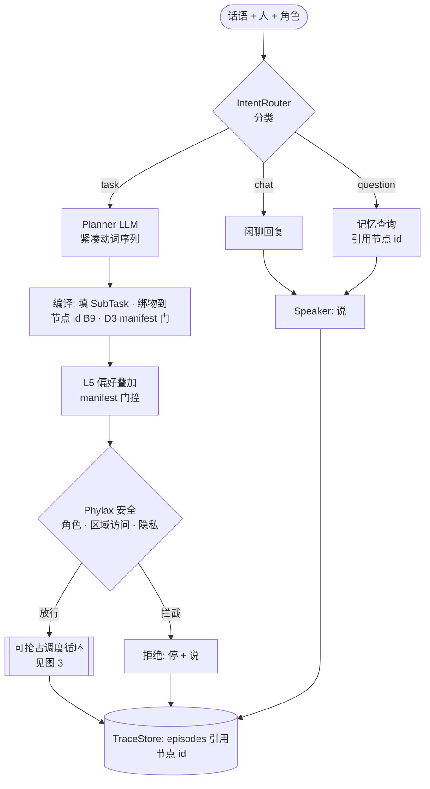
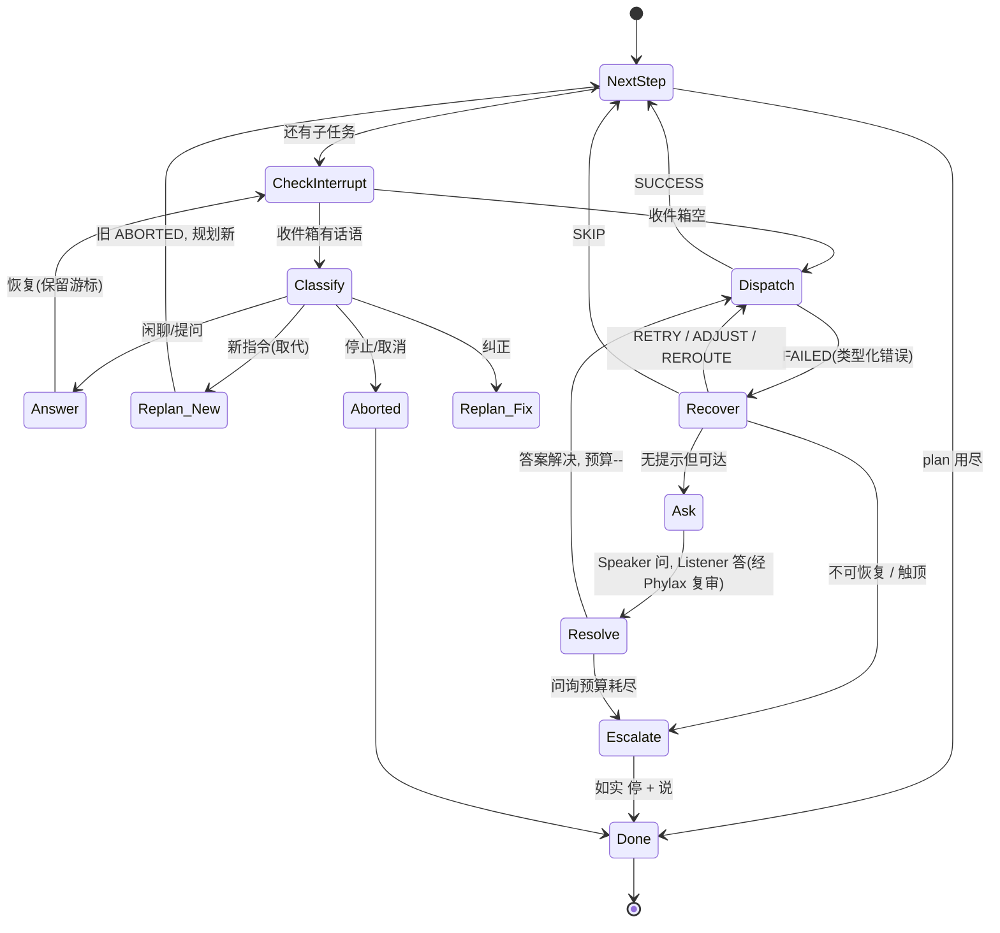
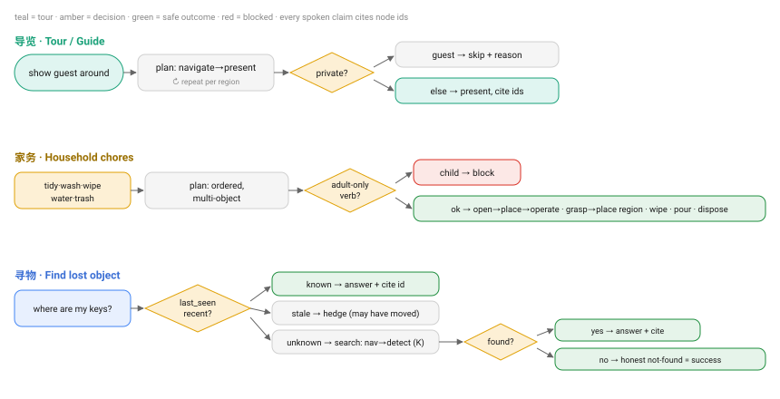
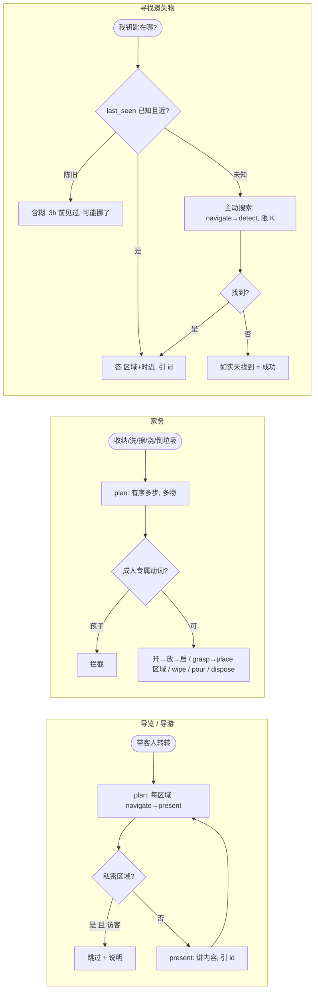
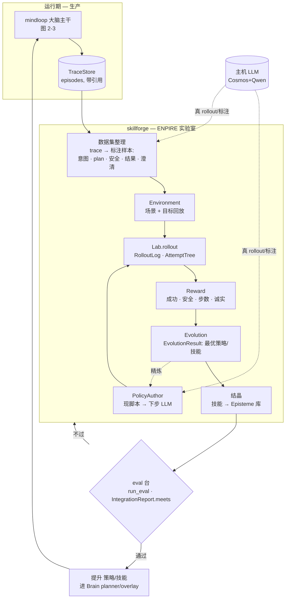

# 流程图 — 场景 · 全流程 · 关键组件 · 数据/训练闭环

> Chronotope 具身大脑栈服务我们家庭机器人场景的规范流程图。Mermaid 在 GitHub 渲染。
> 配套 [INTEGRATION-E2E.md](../en/INTEGRATION-E2E.md)（生产终验）与
> [TASK-FAMILIES.md](../en/TASK-FAMILIES.md)（任务族 + 执行动态）。
> 数据/训练闭环（图 5）是下一阶段的规划。
>
> **每张图都作为独立 SVG 提交在 [`../assets/`](../assets/)（GitHub 渲染，亮/暗均可），
> 其可编辑 mermaid 源放在旁边的 `
` 块里 —— 改图时 mermaid 与 SVG 两者都要更新。**

---

## 1. 组件图（谁管什么 · 数据方向）

mermaid 源 —— 编辑后请同步更新 SVG

依赖方向（绝不反转）：`worldsense→core`、`mindloop→core`、`bodylink→mindloop`、
`voicelink→mindloop`、`skillforge→tempomem+mindloop+bodylink`。核心 `tempomem` 不导入任何其他成员
—— numpy-only 契约。

---

## 2. 请求生命周期（大脑主干，单条话）

mermaid 源 —— 编辑后请同步更新 SVG

两段式规划是不变量：**LLM 出文本动词 → 确定性编译** 把动词绑到记忆节点 id 并按 D3 manifest
逐动词门控。无在线规则规划回落。

---

## 3. 执行动态（调度循环：打断 · 重规划 · 问询人类）

mermaid 源 —— 编辑后请同步更新 SVG

护栏：不可逆步骤（灶已开）做完或安全中止，绝不动作中途硬杀；取代在当前任务接近完成时确认；
澄清回答经 Phylax 复审（图 2）；问询预算 ≤2/任务。

---

## 4. 任务族流程（紧凑）

mermaid 源 —— 编辑后请同步更新 SVG

横切：每条口述声称都引用节点 id；陌生人问主人物品被隐私拦截；非主人导览跳过私密区域。

---

## 5. 数据与训练闭环（下一阶段规划）

运行期已全程埋点（每个决策都是引用节点 id 的 `TraceStore` episode）。闭环把这份"废气"经
skillforge 变成训练信号。

mermaid 源 —— 编辑后请同步更新 SVG

**闭环阶段 → 真实符号（skillforge）：** `Lab(env, author)` 用 `PolicyAuthor`（今为
`ScriptedAuthor`，下步主机上的 LLM author）驱动 `Environment` 回放 → `RolloutLog` /
`AttemptTree` → `Reward` → `EvolutionResult` → 把技能结晶进 Episteme 库 → `run_eval` /
`IntegrationReport.meets` 门控 → 提升进活的 `Brain`。闭环就是让机器人在我们场景上自我提升的关键；
指标（TASK-FAMILIES §4）就是那道门。

**已建 vs 规划：** 运行期 tracing ✅、eval 台 ✅、ENPIRE 行走骨架（`v0.1.0a0`，无网络，ScriptedAuthor）✅。
规划：从真 trace 整理数据集、主机 LLM PolicyAuthor、Episteme 结晶、提升回灌门。见 TASK-FAMILIES 落地顺序第 7 步。
