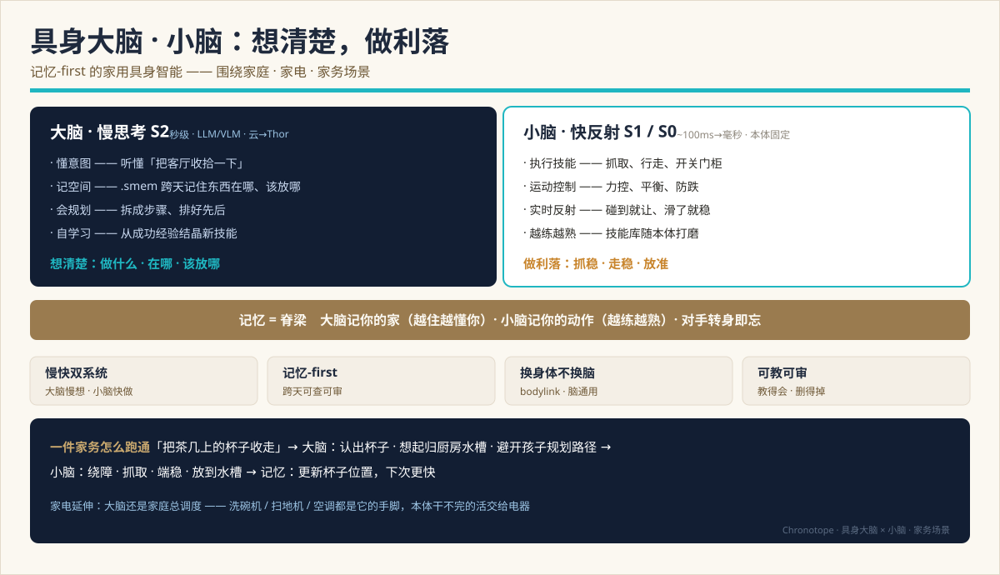
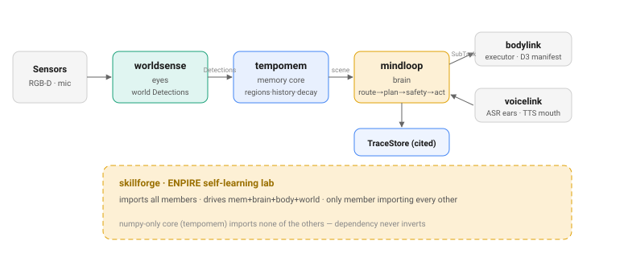
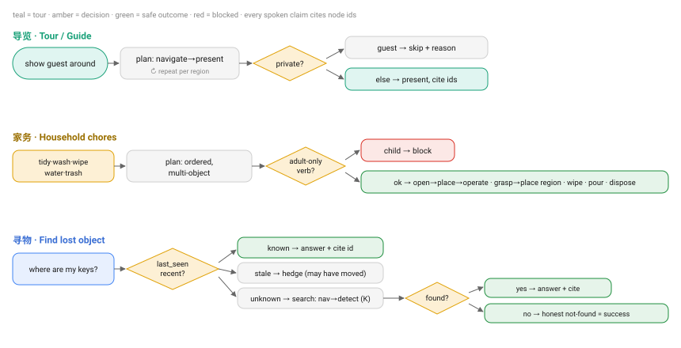

> 🌐 [English](../en/SYSTEM-DESIGN.md) · **中文**

# Chronotope — 总体设计

一份把整套具身大脑串起来的总体设计：**①** 系统总体设计、**②** 各子系统内部设计、
**③** 层与层之间、以及**大脑与本体之间**如何交互。这是唯一的「怎么拼在一起」文档；
它复用并交叉引用更深的来源，而不重复它们。

- 愿景 / 为什么：[VISION.md](VISION.md) · 品牌 / 定位：[BRAND.md](BRAND.md)
- 现状快照 + 已拍板契约：[TECH-DESIGN.md](TECH-DESIGN.md)
- 规范流程图（下方内嵌的 SVG）：[FLOWS.md](FLOWS.md)
- 生产端到端：[INTEGRATION-E2E.md](INTEGRATION-E2E.md) · 场景族：[TASK-FAMILIES.md](TASK-FAMILIES.md)
- 各子系统规范在 §3 内联交叉引用。

**日期：** 2026-07-14。**当前进度：** L3 大脑软件功能完备（P0–P5 ✅，P6 真 LLM 已验证 ◐，
P7 failover + ASR/VAD ◐）；bodylink 多机型 + Genesis 仿真 ✅；skillforge ENPIRE walking
skeleton（`v0.1.0a0`）。所有测试网络无关、GPU 无关。

---

## 1. 总览

Chronotope 是家用机器人的**记忆-first 具身大脑**。整个栈拆成**六个独立发布、独立版本化的
Python 包**，映射到身体隐喻。一句话设计目标：**想清楚（慢的深思大脑），做利落（快的反射
小脑），并跨时间记住（一段持久、可审计、贯穿两者的记忆脊梁）。**



### 六个包

| 包 | 身体部位 | 职责 | 重依赖 |
|---|---|---|---|
| **tempomem** | 海马体 | 记忆核 — `.smem` SQLite 场景图，fuse→persist→query；**唯一有状态对象** | 无（numpy-only） |
| **worldsense** | 眼睛 | RGB(-D) → 世界系 `Detection`；相机→世界几何抬升，CLIP/VLM 检测器 | `[clip]` 后（torch） |
| **mindloop** | 大脑（S2） | 深思认知环 + `Reasoner`；发布 `ExecutorAdapter`/`Listener`/`Speaker` 缝 | 核内无；LLM 远程/自托管 |
| **bodylink** | 本体缝 | 填 `ExecutorAdapter`：`MockBody` + `CapabilityManifest` + 多机型 + Genesis 仿真 | 无（stdlib） |
| **voicelink** | 耳 + 嘴 | 填 `Listener`/`Speaker`（ASR/TTS），走 OpenAI 兼容音频端点 | 无（stdlib） |
| **skillforge** | 自学习实验室 | ENPIRE 环，跨 mem+brain+body+world；**唯一** import 全部成员 | 无（`v0.1.0a0`） |

### 谁拥有什么、数据往哪流



### 依赖方向（永不反转）

```
worldsense → tempomem      bodylink → mindloop      skillforge → tempomem + mindloop + bodylink
mindloop   → tempomem      voicelink → mindloop
```

**核（`tempomem`）不 import 任何其他成员。** 它只**发布协议**给别人填（`PerceptionAdapter`、
`Verbalizer`）；`mindloop` 发布 `ExecutorAdapter` / `Listener` / `Speaker`。往核里加 torch/LLM
import 会破坏 numpy-only 契约 —— 这是承重不变量，不是偏好。

---

## 2. 分层模型

栈里有两条正交的分层：**认知栈**（速度层）与**记忆栈**（表示层）。

### 2.1 认知栈 — 三个速度层

| 层 | 「脑部位」 | 时延 | 做什么 | 在哪 | 算力 |
|---|---|---|---|---|---|
| **深思 Deliberation（S2）** | 大脑 | ~秒级 | 意图→规划→安全→分派→重规划；推理 + 记忆 | **mindloop** | LLM/VLM，云→Thor |
| **习惯 Habit（S1）** | 小脑 | ~100ms | 技能执行（BT + 记忆）、运动控制 | **bodylink**（本体） | 本体，随机型 |
| **反射 Reflex（S0）** | 脑干 | ~1ms | 急停、力矩/碰撞限位、平衡 | 固件 | 随机型 MCU |

统辖规则（`mindloop/docs/en/brain-architecture.md`）：**上层的「想做」永远不能覆盖下层的
「不许做」。** 安全向下单调。mindloop **仅 S2**（契约 **D1**）—— 它从不说关节空间或基座系
几何（**B8**）。

### 2.2 记忆栈 — 表示层

记忆当前是符号的，并有一条 torch-在-extras-后 通往 latent 的路径，且始终以符号图为真值源
（见 [research/l3-l2-fusion-roadmap.md](research/l3-l2-fusion-roadmap.md)）：**L0** 符号场景图
（已发布，即 `.smem`）→ **L1** 逐节点 embedding（已发布，CLIP feature）→ **L2** 图编码器
（研究）→ **L3** 通往 VLA 的 bridge latent（研究）。编码器是 torch-在-extras-后 ——
**从不进 numpy 核**。

---

## 3. 各子系统设计

每小节是内部设计；规范文档在末尾链接。符号均为真实代码名。

### 3.1 tempomem — 记忆核（海马体）

**职责。** numpy-only、单一有状态对象的记忆核：把逐帧 `Detection` 变成一个 `.smem` SQLite 文件
里持久、可查询的 3D 场景图。

**内部模块**（`TempoMem` 组合的无状态帮手）：`store.py`（行级 CRUD：
nodes/edges/observations/node_obs/props/events）· `fusion.py`（融合仲裁：`ingest_observation`
匹配→打分→合并/新建/拒绝，`split_node`，`consolidate`）· `query/`（检索器
`semantic_vec`/`semantic_keyword`/`spatial`/`recent`/`relational` + `detect_intent` 路由）·
`serialize.py`（图 → `format="prompt"` 按 token 预算 / `format="json"`）· `relations.py`
（纯几何 `near`/`on`/`under` 边）· `persist/`（打开/创建 `.smem`，仅向前迁移）· `trace.py`
（L4 情节 `TraceLog`/`TraceRecord`，引用节点 id，D2）· 支撑：`frame.py`（`Detection`/`Observation`）、
`encoders.py`/`verbalize.py`/`perception.py`（BYO 协议）、`vec.py`（sqlite-vec ANN）、`cli.py`/`viz.py`。

**公共 API**（`TempoMem`，来自 `__all__`）：摄入 `add_detections(dets, episode=)`（米，世界系）/
`add_frame(rgb, depth, pose, intrinsics=)`（走 `PerceptionAdapter`）/ `commit()` → `CommitStats`；
维护 `decay` / `forget` / `resplit` / `consolidate` / `relate` / `update` / `define_region`；
查询 `query(text, k, intent)` → `QueryResult`、`semantic` / `spatial` / `recent` / `salient`、
`answer(query, verbalizer=)`；输出 `serialize(format, root, k_hops, relations, max_tokens, node_ids)`。

**Schema**（`.smem`，一个 SQLite 文件）：`nodes`（type ∈ object|place|room|floor；label +
`labels_json` 分布；置信度加权的滑动质心+bbox；`feature` BLOB；`parent_id`）、`edges`（带类型，
唯一 `(src,dst,type)`）、`observations`、`node_obs`（多对多）、可选 `node_vec`（sqlite-vec 余弦镜像）。
**节点 id 就是 SQLite INTEGER 主键** —— 唯一 id 空间，作为引用逐字回显（**B9**），并与 `TraceLog` 共享。

**不变量。** *fuse-before-persist*：`add_*` 只把观测暂存进 `self._pending`；`commit()` 前不融合，
且 commit 是**唯一排空者**。每个结构性 mutator 先调 `_flush_pending()`（sqlite 隐式事务模式 ——
带着未融合行 commit 会持久化孤儿观测）。*numpy-only*：重后端在 `[clip]`/`[vec]`/`[perception]` 后，
带线性/关键词回退。*BYO*：无 encoder ⇒ 关键词；无 verbalizer ⇒ 抛错 —— 从不静默给默认。

规范：[API](../../tempomem/spec/API.md) · [SCHEMA](../../tempomem/spec/SCHEMA.md) ·
[FUSION-ARBITER](../../tempomem/spec/FUSION-ARBITER.md) · [QUERY-ROUTER](../../tempomem/spec/QUERY-ROUTER.md)

融合决策（出自 `spec/FUSION-ARBITER.md`）：
```
s = w_g·s_geom + w_i·s_iou + w_s·s_sem + w_l·s_label     # w = 0.2, 0.2, 0.5, 0.1
if   s(c*) ≥ τ_merge (0.62) → 合并进 c*
elif s(c*) ≥ τ_ambig (0.45) → 暂缓 DEFER
elif o.confidence < τ_obs (0.30) → 拒绝 REJECT
else → 新建节点 NEW
```

### 3.2 worldsense — 眼睛

**职责。** 把一帧带位姿的 RGB(-D) 变成世界系 `tempomem.Detection`：把重的 GPU 检测器注入一个
纯 numpy 适配器，让记忆核保持无感知。

**内部模块：** `geometry.py`（纯 numpy 相机→世界抬升：`rpy_to_matrix`、`transform_points`、
`oriented_box_corners`、`world_aabb_from_obb`）· `adapters.py`（`Box3D` 相机系 OBB、`Detector3D`
注入检测器 Protocol、`BoxDetectorAdapter` = `PerceptionAdapter` 的填充）· `encoders.py`
（`ImageEncoder` Protocol + `OpenClipImageEncoder`，文本+图像双塔 CLIP）· `vlm.py`（`VLMDetector`，
一个由 grounding VLM 支撑的 `Detector3D` —— Qwen3-VL 走 OpenAI 兼容端点；stdlib PNG 编码，免 pillow）。

**`Detection`**（定义在**核** `tempomem/frame.py`，因此是跨缝共享类型）：
`@dataclass(frozen=True, slots=True)`；坐标右手系、**米、世界系**；`label`、`feature`（L2 归一化）、
`center_xyz`、`bbox_min`、`bbox_max`（轴对齐世界系）、`confidence∈[0,1]`、`mask_rle`、`ts`、`aux`。

**几何抬升。** 检测器输出相机系 OBB（`center`、`size`、`rpy`）；`world_aabb_from_obb(pose, center,
size, rpy)` 构造 8 个局部角点（`R = Rz(yaw)@Ry(pitch)@Rx(roll)`），乘 4×4 相机→世界 `pose`，逐分量取
min/max → 世界 AABB。`vlm.py` 里的 2D→3D 反投影用内参（`Z = 框内深度中位数`，`X=(u−cx)/fx·Z`，
`Y=(v−cy)/fy·Z`；厚度取框内深度 10–90 分位，下限 0.15 m）。

**编码器。** `OpenClipImageEncoder`（`[clip]` 后）**同时**实现 `encode_text`（满足 `tempomem.Encoder`
供查询）和 `encode_image`（感知），在**同一** CLIP 空间 —— 一个实例服务两缝，语义查询才对齐。
无 `[clip]` ⇒ 测试用 hash 编码器。规范：[cosmos3-perception-adapter](../../worldsense/docs/en/cosmos3-perception-adapter.md)。

### 3.3 mindloop — 大脑（S2 认知环）

**职责。** 深思（S2）大脑：一个薄的 stdlib-only 编排器，把 tempomem 记忆绑到 BYO LLM `Reasoner`，
把指令路由成一个答案或一个 grounded 计划、安全把关、分派给本体、并修复失败 —— 拥有别人填的各缝协议。

**流水线** —— `Brain.handle(instruction, *, k, person, safety_context, dialogue)`：


1. **`IntentRouter.classify`** → `task | question | chat`（*LLM*）。`question`/`chat` 转 **`ask`**
   （检索 → 推理 → 带引用 `Answer`）。
2. **`Planner.plan(instruction, context)`** → `tuple[Command,...]`（*LLM —— 唯一生成步；一行一动词的紧凑文本序列*）。
3. **`compile_commands(commands, mem, manifest)`** → `Plan`（*确定性：宏展开 → 丢弃不在 manifest 的动词（D3）
   → 把物体提及绑到节点 id（B9）→ 填每动词元数据*）。
4. **`Phylax.check(plan, safety_context)`** → 违规（*确定性策略门；任一违规阻断**整个**计划 —— 停 + 说，不重路由*）。
5. **`ExecutorAdapter.dispatch(subtask)`** → `Iterator[StatusUpdate]`（*可抢占的循环，见 §5*）。

`handle` 之外的入口：`observe(rgb, depth, pose)` / `ingest(detections)`（感知→融合→提交）；
`ask`（检索→推理）；`converse(instruction, conversation, …)`（P5 多轮）。**只有 路由/编译/Phylax/重规划
是确定性的；分类、规划、推理是 LLM。**

**mindloop 发布的协议：** `ExecutorAdapter`（`capabilities()→CapabilityManifest`、
`dispatch(SubTask)→Iterator[StatusUpdate]`）· `Reasoner`（`reason(question, context)→Answer`）·
`Verbalizer`（`complete(prompt)→str`，协议归核所有，这里由 `CosmosReasonVerbalizer` /
`FailoverVerbalizer` 填）· `Listener`（`transcribe(bytes)→str`）/ `Speaker`（`say(text)→None`）·
`IntentRouter` / `Planner`。

**子组件：** `CosmosReasonVerbalizer`（stdlib urllib → 任意 OpenAI 兼容 `/v1/chat/completions`）·
`Phylax`（P3 语义安全：权限 / 仅成人 / 禁区 / 区域访问 / 过敏原 / 邻近-限速；`conservative_policy()`
FMEA 预设；`vet_card`/`vet_role` 溯源门）· `TraceStore`（核 `TraceLog` 之上的 append-only 适配，引用节点 id，D2）·
`Replanner`（P4 有界 typed-error 修复）· `Conversation` + L5 `PreferenceStore`（manifest 门控、编译后叠加）·
`VoiceLoop`（听→想→说）· `FailoverVerbalizer`（边缘 P7，基于调用次数的迟滞）· `run_eval`（P6 指标 + 覆盖门）。

规范：[brain-architecture](../../mindloop/docs/en/brain-architecture.md) ·
[全系统设计](../../mindloop/docs/en/cosmos3-tempomem-llm-brain.md) ·
[devplan specs P1–P7](../../mindloop/docs/en/devplan/)。

### 3.4 bodylink — 本体缝（换本体，不换脑）

**职责。** 用一个参考本体 + 声明式逐机型适配框架填 mindloop 的 `ExecutorAdapter`，让一个大脑不改地
驱动多种机器人（契约 **D3**）。

**两层 `CapabilityManifest`**（定义在 `mindloop.execute` —— 大脑拥有契约，本体填充）：一层
**`BodyProfile`** 硬件层（`dof`、`base_type` ∈ wheeled/legged/fixed，joints/sensors/gripper ——
**面向执行器；大脑从不读这些**，B8）+ 一层 **`VerbSpec`** 动词层（`name`、`params`、`appliance_types`
—— **唯一改变大脑能规划什么的部分**）。D3 门控：本体省略某动词（如轮式 `g1d` 没有 `climb_stair`），
该计划步被静默丢弃，大脑不变。

**`BaseExecutorAdapter` SDK。** 设备包**只**实现 `_execute(subtask)→StatusUpdate`；基类处理动词门
（D3，抛 `UnsupportedVerbError`）、RUNNING→终态流、节点 id 回显（B9）、以及可选的取消/暂停抢占握手。
`MockBody` 和示例 `SimDeviceAdapter` 都是子类。

**目录 & 一致性。** `load_manifest("g1d"|"h1"|"gr1"|"arm6")` 解析 stdlib 内建（零依赖）或厂商 `*.yaml`
（惰性 PyYAML，`manifests` extra）。`check_executor_adapter()` 证明任一本体守缝：manifest 良构 · 到达终态 ·
B9 回显 · B3 typed error · D3 拒绝 · （可选）取消握手。

| id | 本体 | dof | base_type | 动词 |
|---|---|---|---|---|
| g1d | Unitree G1-D | 32 | wheeled | `_COMMON_VERBS` |
| h1 | Unitree H1 | 19 | legged | `_COMMON_VERBS` + `climb_stair` |
| gr1 | Fourier GR-1 | 40 | legged | `_COMMON_VERBS` + `climb_stair` |
| arm6 | 参考 6 自由度臂 | 6 | fixed | `_ARM_VERBS`（无移动） |

**物理仿真**（`bodylink.sim`，`[sim]` extra）：`SimBackend = (verb, params, node_ids) → (success, message)`；
`MockSimBackend`（CI 默认）+ `GenesisSimBackend`（真 Genesis 场景；`node_map` 把节点 id → 场景实体，
因为大脑发 id 不发坐标，B8）；`make_sim_backend("mock"|"genesis")`。已在 Linux RTX PRO 6000 主机**和**
macOS Apple Silicon 验证。规范：[multi-model-adaptation-design](../../bodylink/docs/en/multi-model-adaptation-design.md)。

### 3.5 voicelink — 耳 + 嘴（语音缝）

**职责。** stdlib-only 填 mindloop 的 `Listener`（ASR）/ `Speaker`（TTS），走 OpenAI 兼容音频端点 +
本地能量 VAD 分段 —— 大脑保持纯文本却能听会说（P7 离线链）。

**模块：** `endpoint.py`（`EndpointListener.transcribe(bytes)→str` POST multipart 到
`/audio/transcriptions`；`EndpointSpeaker.synthesize(text)→bytes` / `say(text)` POST JSON 到
`/audio/speech`；`ASRTransport`/`TTSTransport` 可注入 callable → 网络无关测试）· `vad.py`
（`SpeechSegmenter` 确定性能量 VAD 状态机、`pcm_to_wav`；stdlib `array`/`wave`，无 numpy）·
`stream.py`（`MicSource` Protocol、`SpeechStream` 麦克风帧 → VAD → WAV 话语）。默认 `model="qwen3-asr"` / `"qwen3-tts"`。

**VAD 不在 listener 内** —— `SpeechSegmenter` 产出话语 PCM，`pcm_to_wav` 包成 WAV，再交给 `transcribe`。
`VoiceLoop.turn`（在 mindloop）驱动这对：`transcribe` →（静音 `""` 空转）→ `Brain.converse` →
`reply_text` → `say`。每一缝上音频都是不透明 `bytes`。

**状态：** 端点填充 + transport 注入 + **ASR+VAD v1** 已建、网络无关测试；待办：本机引擎（`local` extra 空）、
真麦采集、对所选服务器的线格式校验。

### 3.6 skillforge — 自学习实验室（研究轨道）

**职责。** 一个元编排器，把记忆 + 眼 + 脑 + 本体驱动进一个闭合 **ENPIRE** 环，让本体从自己的试错中习得技能、
全程无人 —— 唯一 import 全部成员（`v0.1.0a0` walking skeleton）。

**ENPIRE 环**（移植 NVIDIA GEAR 的 ENPIRE）：**EN — Environment**（`environment.py`+`reward.py`：补上无状态
`ExecutorAdapter` 缺的两个原语 —— `reset()→list[Detection]` 和 `reward(goal)`）· **PI — Policy Improvement**
（`author.py`+`policy.py`：`PolicyAuthor.author(task, history)→Policy`，一个不可变 `tuple[SubTask,…]`）·
**R — Rollout**（`rollout.py`：`run_episode` reset→plan→预算内逐步 dispatch→打分→`RolloutLog`）·
**E — Evolution**（`evolution.py`+`tree.py`：`evolve` = author→rollout→打分→**gate**→追加；`AttemptTree` 谱系）。

**API：** `Lab(env, author).run(task, val_tasks=, env_for=) → LabResult{tree, metrics, solved}`。
Walking-skeleton 默认网络无关/GPU 无关（`ScriptedAuthor` + `MockEnvironment` over `bodylink.MockBody`）。
Reward bricks 在**真 `tempomem.Detection`** 上打分 —— 与真 `worldsense` 相机产的完全同型 —— 所以换真环境或
真 LLM author 不需改环代码。

**Gate（借来的 SkillOpt 纪律）：** `gate.py evaluate_gate` 只在候选**严格**优于当前被接受分数时才接受，
在不泄漏的 held-out 拆分上打分 —— 补上「脚本化到成功、无验证门」的缺口，且不依赖该包。**反馈：**
`crystallize(result, task) → mindloop.SkillCard | None` 把 gate 接受的赢家变成 `provenance="learned"` 技能卡，
运行时大脑经既有 P2 库复用 —— 学 → 结晶 → 从卡规划，无新运行时机制，且 `Phylax.vet_card` 仍管着它。
规范：[architecture](../../skillforge/docs/en/architecture.md) ·
[skillopt-borrow-decision](../../skillforge/docs/en/skillopt-borrow-decision.md)。

---

## 4. 层间交互

整个栈是一串**带类型的缝**。每条缝是一个协议（一方拥有、另一方填），承载冻结值类型。除这些外，什么都不过缝。

| 缝（从 → 到） | 协议（拥有者） | 过缝的东西 | 关键不变量 |
|---|---|---|---|
| worldsense → tempomem | `PerceptionAdapter`（核） | `Detection[]`（世界米） | 感知不进 numpy 核 |
| tempomem → mindloop | `Verbalizer` / 查询 API（核） | 序列化子图（`format="prompt"`）+ `NodeHit[]` | BYO 编码器/verbalizer；核内无模型 |
| mindloop → bodylink | `ExecutorAdapter`（mindloop） | `SubTask`（动词 + 节点 id） | 动词 ∈ manifest（D3）；id 非几何（B8） |
| bodylink → mindloop | `ExecutorAdapter`（mindloop） | `StatusUpdate[]`（RUNNING→终态） | 回显 `touched_node_ids`（B9）；typed 错误（B3） |
| voicelink ↔ mindloop | `Listener` / `Speaker`（mindloop） | 音频 `bytes` ↔ 文本 | 缝上音频不透明 |
| mindloop → tempomem | `TraceLog`（核） | `TraceRecord`（情节，带引用） | 每个决策引用节点 id（D2/B9） |
| skillforge → all | 以上，作为库 | 驱动闭环 | 结晶技能作为 P2 卡反馈 |

**感知 → 记忆。** `worldsense.BoxDetectorAdapter.process_frame(rgb, depth, pose, intrinsics)` 跑注入的
`Detector3D`，把每个框抬升成世界 AABB，附 CLIP `feature`，产出 `Detection[]`；`TempoMem.add_detections/add_frame`
暂存进 `_pending`，`commit()` 融合（仲裁见 §3.1）并持久化。

**记忆 → 大脑。** `ask`/规划时，`SceneContextProvider.context(Focus(query), k, max_tokens)` 在 token 预算内包起
`mem.query` + 命中的 `serialize` + 1 跳关系 + 层级祖先。`_assemble_context` 叠：近期对话（P5）+ `WorldState` 叠加层
（P2）+ 场景子图。reasoner prompt 强制 `[#id]` 引用；`_extract_ids` 解析进 `Answer.cited_node_ids`。**同一批节点 id**
之后过缝到本体、再回来 —— 端到端一个 id 空间（B9）。

**在线上的值类型：** `Command`（编译前的 LLM IR：`verb`/`args`/`params`）→ `SubTask`（`id`、`verb`、
`target_node_ids: tuple[int,…]`、`params`、`skill`、`preconditions`、`effects`、`timeout_s`、
`negation_constraints`）→ `StatusUpdate`（`status: TaskStatus`、`progress`、`error_code: ErrorCode|None`、
`recovery_actions: tuple[RecoveryHint,…]`、`touched_node_ids`）。`Answer(text, cited_node_ids)`、
`HandleResult(intent, answer, plan, statuses, violations, mode; .blocked)`、`SafetyContext`、`Policy`、`Violation`。

---

## 5. 大脑 ↔ 本体交互（分派环）

这是 S2 遇上 S1 的地方。大脑规划**技能动词 + 节点 id**，从不发关节角（B8）；本体在 L2 以下实现动词。流水线的第 ⑤ 步
是一个**可抢占的循环**，不是一锤子。


**dispatch 发什么、收什么。** `ExecutorAdapter.dispatch(subtask)` 发一个带开放词汇 `verb`（编译时已按
`manifest.verb_names()` 门控 —— D3）+ `target_node_ids`（B9）的 `SubTask`。返回一个 `Iterator[StatusUpdate]`，
排空到终态；`touched_node_ids` 逐字回显 id，让引用审计闭环。预期失败返回 `FAILED`（从不抛）。

**每步的循环：**
- **插话 barge-in** —— 分派前轮询话语收件箱；新指令可抢占（当前任务接近完成时确认）、问题被回答后游标续跑、
  停止则中止。澄清答案**由 Phylax 复审**。
- **幂等跳过** —— 若 `WorldState` 叠加层已满足某步的 `effects`，跳过（P3-dyn）—— 多步任务不必重新感知就保持 grounded。
- **主动感知** —— 大脑可在步间重新看，并从新鲜上下文触发一个有界的尾部重规划（P4-dyn）。
- **typed 失败 → 重规划** —— `FAILED` + `RecoveryHint` 喂给 **`Replanner`**（P4）：有界 `RETRY` / `ADJUST` /
  `REROUTE` / `SKIP` / `ESCALATE` / `ASK`，上限 `max_per_target=2`、`max_total=6`、提问预算 ≤2。`REROUTE` 经 Phylax 复审。
- **成功写回** —— 确认成功把其 `effects` 写进符号 `WorldState` 叠加层（P2），注入下一步上下文。

**安全是三层（契约 D4）：** **语义**层（Phylax，在大脑 —— ✅）在分派*前*阻断违反声明式 `Policy` 的计划；
**符号-BT** 层（在 bodylink —— 规划中）守技能执行；**反射**层（固件 —— 随机型）是硬底线。向下单调：下层「不许做」永远赢。

**不可逆守护：** 不可逆步（如开灶）做完-或-安全中止，绝不在动作中途硬杀。

---

## 6. 端到端流程（一个走通的例子）

> **「把茶几上的杯子收走。」** —— 一句话，整套栈。

1. **耳** —— `voicelink.EndpointListener.transcribe` 把话变文本；`VoiceLoop` 交给 `Brain.converse`。
2. **路由** —— `IntentRouter.classify` → `task`。
3. **检索** —— `SceneContextProvider` 查 `tempomem`（「杯子」「茶几」「厨房水槽」）→ 带节点 id 的序列化子图
   `[#42 杯子, #17 茶几, #12 厨房]`。
4. **规划**（*LLM*）—— `Planner.plan` → `navigate(sink) · grasp(mug) · place(mug, sink)` 文本动词。
5. **编译**（*规则*）—— 绑「杯子」→`#42`、「水槽」→解析节点；每动词按本体 manifest 门控（`g1d` 有
   `grasp`/`place`/`navigate`）；填 `preconditions`/`effects`。
6. **安全** —— `Phylax.check` 放行（无禁区，执行者被允许）。
7. **分派环** —— 每个 `SubTask`，`bodylink` 流出 `RUNNING → SUCCESS`，回显 `touched_node_ids=[42]`；
   遇 `FAILED(ERR_GRASP_SLIP)` 时 `Replanner` 发 `ADJUST`/`RETRY`；每次成功推进 `WorldState`。
8. **记忆更新** —— 杯子的新位置被重新观测并融合；**下次更快。**
9. **说 + 追踪** —— `Speaker.say` 汇报；每个决策都是一条引用节点 id 的 `TraceStore` 情节。

**家电延伸：** 同一个大脑当家庭总调度 —— 洗碗机 / 扫地机 / 空调都是动词 + `appliance_types` 的 manifest 条目，
本体干不完的活交给它们。

任务族形态（导览/讲解、家务、找丢物）共用这条脊梁：



---

## 7. 自学习闭环

运行时已被埋点 —— 每个决策都是一条引用节点 id 的 `TraceStore` 情节。skillforge 把这份「废气」变成训练信号，并把
学到的技能反馈回去。


`Lab(env, author)` 用一个 `PolicyAuthor`（今天 `ScriptedAuthor`，下一步主机上的 LLM author）驱动 `Environment` 回放
→ `RolloutLog` / `AttemptTree` → `Reward` → `EvolutionResult` → `crystallize` 成一张 Episteme 技能卡 →
`run_eval` / `IntegrationReport.meets` go/no-go 门 → 提升进在线 `Brain`。**skillforge 的 `Evolution` 跨回合改进策略；
mindloop 的 `Replanner` 在一回合内修一步 —— 不同高度，互补。** 已建：运行时追踪 ✅、eval 门 ✅、ENPIRE walking skeleton ✅。
计划：从真轨迹做数据集整编、主机 LLM author、提升回灌门。

> **完整的数据与训练方案 —— 业务闭环、部署前后所需数据、以及哪些模型做 SFT / RL / 冻结 ——
> 见 [DATA-AND-TRAINING.md](DATA-AND-TRAINING.md)。**

---

## 8. 契约与不变量

缝所受的承重决策（完整列表见 [TECH-DESIGN.md §4](TECH-DESIGN.md)）：

| Id | 契约 |
|---|---|
| **D1** | 大脑**仅 S2**（深思）；反射/控制在 L2 以下 |
| **D3** | **开放词汇动词** + 两层 `CapabilityManifest` —— 新本体，大脑不变 |
| **D4** | 三层 **Phylax** 守护（语义在大脑 ✅、符号-BT 在 bodylink、反射在固件） |
| **B3** | 执行器故障是 **typed**（`ErrorCode` + `RecoveryHint`），绝非自由文本 |
| **B8** | 大脑从不说**关节空间 / 基座系几何** |
| **B9** | 场景图**节点 id 过缝并被回显** —— 审计链闭合 |
| **K2** | 技能卡是**扁平步骤 + 规则**（DAG 由 `schema_version` 预留） |

横切不变量：**fuse-before-persist**（`commit()` 是唯一排空者）· **两阶段规划**（LLM 文本动词 → 确定性编译；
**在线无规则-规划回退**）· **numpy-only 核** · **每句话都引用节点 id**。

---

## 9. 模型与部署

- **Reasoner：** Cosmos-Reason2-8B（物理 AI VLM），RTX PRO 6000（96 GB），OpenAI 兼容服务；
  `CosmosReasonVerbalizer` 对接任意 `/v1/chat/completions`。
- **Planner / IntentRouter：** 一个强指令跟随者（Qwen3.x，关思考）出干净动词序列 —— 双模型分工是质量甜点；单 Cosmos 也行。
- **眼：** `VLMDetector`（Qwen3-VL grounding）或 `OpenClipImageEncoder`，都走注入的 `Detector3D`/transport 缝。
- **语音：** Qwen3-ASR / Qwen3-TTS 走 OpenAI 兼容音频端点。
- **本机（P7 边缘 failover）：** 同一 Qwen 对齐分工、更小，网络掉线时经 `FailoverVerbalizer` 接管（大脑不变）——
  记忆和安全本就在本地，从不离线。
- **仿真：** Genesis（CPU 后端）在主机、也在 macOS 本地。
- **测试：** 网络无关、GPU 无关 —— `ScriptedReasoner`、hash 编码器、注入 transport、`MockBody`、`MockSimBackend`。
  任何测试都不下模型、不连 LLM。

服务细节：[mindloop/docs/en/local-serving.md](../../mindloop/docs/en/local-serving.md)。

---

## 10. 现状与参考

**已完成：** P0 缝 · P1 规划 · P2 技能卡 · P3 安全门 · P4 追踪 + 有界重规划 · P5 对话 + 完整 S2 环 ·
P6 eval 门 + 真 Cosmos+Qwen 已验证 · P7.1 LLM failover + P7.2/P7.3 语音 ASR+VAD · 动态场景上下文（4 相位）·
bodylink 多机型（4 内建、SDK、一致性）· Genesis 仿真（主机 + mac）· skillforge ENPIRE walking skeleton + 结晶 + gate。

**待办：** Cosmos 端到端做标准 reasoner + 云→Thor 切换（硬件）；本机 ASR/TTS 引擎 + 降级遥测（边缘硬件）；
真硬件本体适配（非仿真）；D4 的符号-BT 与反射层；真轨迹上的自学习提升回灌。

**参考：** [DATA-AND-TRAINING](DATA-AND-TRAINING.md) · [VISION](VISION.md) ·
[TECH-DESIGN](TECH-DESIGN.md) · [FLOWS](FLOWS.md) · [TASK-FAMILIES](TASK-FAMILIES.md) ·
[INTEGRATION-E2E](INTEGRATION-E2E.md) · [BRAND](BRAND.md) · [DEV-STATUS](DEV-STATUS.md)。
各子系统规范在 §3 内联链接。
