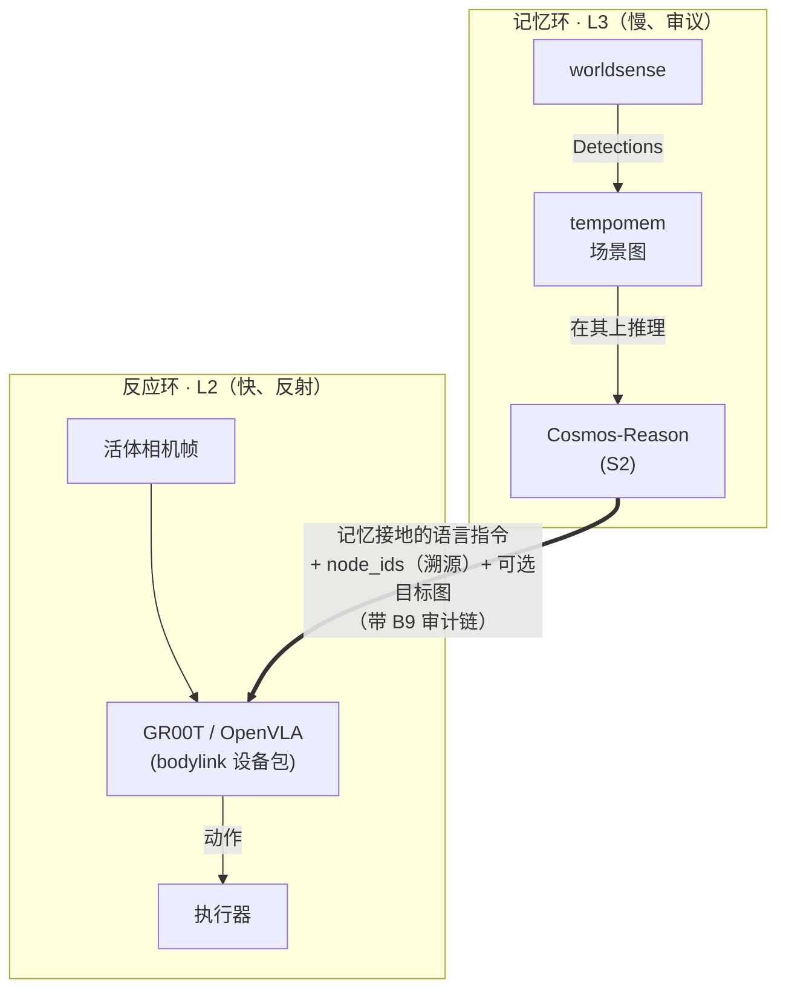

# L3↔L2 接口路线图 —— 脑怎么跟身说话

> 🌐 [English](../../en/research/l3-l2-fusion-roadmap.md) · **中文**
>
> 状态：**研究路线图，低优先。** 后续有空推动。暂不落地。
> 最后更新：2026-06-25。

> **TL;DR —— 决策：** L3→L2 以显式**语言 + 图像**传递，**不**走 latent 向量。latent 融合 park 到研究
> 轨道（§6）。这条接缝落在 **`bodylink`**（Chronotope 第 4 成员，填充 `mindloop` 的 `ExecutorAdapter`）：
> 今天 `bodylink.MockBody` 是无硬件参考实现；真实 GR00T/OpenVLA 本体是一个 **out-of-tree 的
> `bodylink` 式设备包**，消费 `instruction + live frames`。理由：语言+图像保住可审计（B9）、换身
> （D3）、免训远程脑三件事 —— latent 会把这三样全部交换掉。

## 1. 问题与决策

**提出的问题：** 能否把 L3 脑（`mindloop`，LLM 认知循环）和 L2 VLA（底层
vision-language-action 策略）用**隐向量**传递融合，做成端到端（可联合训练）？

**决策（当前阶段）：数据用显式的 *语言 + 图像* 传，不用 latent。** 隐融合推迟到研究轨
（§6）。理由：

- **隐向量 ≠ 免费端到端。** 只传隐向量不联合训只是*条件化*。真端到端要把动作 loss
  反传进 LLM——需本地可训 LLM + 可训 VLA + 真机交互数据。
- **隐向量换掉本栈赖以建立的三样东西：** 可审计/溯源（B9 记忆→执行器链——隐向量不透明，
  无法 cite 是哪个记忆节点驱动了动作）、换身（D3「swap the body, keep the mind」——隐
  接口跟某一特定 VLA 联合训）、训练-free 远程脑 + numpy-only 核契约。
- **chat API 出不了隐向量。** 现 `CosmosReasonVerbalizer` 走 `/v1/chat/completions`，
  进文本出文本，没 hidden states。隐传递得先把 LLM 重新服务化暴露 hidden。

相比之下，**语言+图像传递是最可解释的接口**（能逐字看到 L3 跟 L2 说了啥）、**无需联合
训练**、是现代 VLA（GR00T、OpenVLA）的**原生输入**，也满足评测选的可解释性优先。

## 2. 双环图

> **桥是文本 + 图像**（粗箭头），不是 latent —— 端到端可读。

**分工。** L3 给*记忆接地的意图*：它读持久场景图（知道"你昨天用的杯子在左柜"），出
自然语言子指令。VLA 给*像素+语言→反应控制*，用它自己的活体相机。桥是文本+图，人类可读。

桥载的正是离散 verb 载不动的东西：VLA 只看当前帧；语言指令把 `tempomem` 的持久空间记忆
注入 VLA 的反应环。

## 3. 当前阶段接口（语言 + 图像）

现符号 seam 是 `SubTask(verb, node_ids, params)`，对 `CapabilityManifest` 校验。VLA 要
自由语言。**推荐并存，不替换**——保留符号 verb 做审计+能力校验，加一个 VLA 实际消费的
语言字段。

| 字段 | 角色 | 消费者 |
|---|---|---|
| `verb`（符号） | 审计锚 + 能力校验（D3） | 规划器 / manifest |
| **`instruction`（新，自然语言）** | VLA 执行的指令；L3 据记忆生成 | VLA |
| `node_ids` | 溯源（B9） | 审计链 |
| `goal_image`（新，可选） | 目标条件 | 目标条件 VLA |

**图像通道（两条，并行）：**

- **活体帧 → VLA。** GR00T on-robot 自带相机，反应环吃**原始像素**，不经 `tempomem`
  的 `Detection` 抽象。
- **Detections → tempomem。** `worldsense` 仍出 `Detection` 喂记忆环（L3 推理用）。两环
  并行。
- L3 可选出 `goal_image`（目标裁剪）给目标条件 VLA。

**纸面改动（暂不实现）：**

- `mindloop.execute`：`SubTask` 加 `instruction: str`（+可选 `goal_image`）；
  `CapabilityManifest` 加 body 是否吃 language / image-goal 的标志。
- L3 出口：`Brain.plan` / reasoner 产出携带据子图生成的接地 `instruction` 的 `SubTask`。
- 新 VLA 设备包填 `ExecutorAdapter` —— 即一个 **out-of-tree 的 `bodylink` 设备包**（与
  `bodylink.MockBody` 填的是同一条接缝，换成真实本体）：把 `instruction + 活体帧` 喂 GR00T，流回
  `StatusUpdate`。`tempomem` 核不动。

## 4. VLA 选型

| | 语言+图像接口 | 当前阶段定位 |
|---|---|---|
| **GR00T N1**（NVIDIA） | 原生 language + 多相机 → 动作；配 Cosmos/NVIDIA 栈 | **主** |
| **OpenVLA** | language + 单图 → action token | 对照基线 |

注：GR00T 和 OpenVLA 内部本身就是 `System2(VLM) → System1(动作)` 带隐桥。**当前阶段只用
它们外部 language+图像 API**；接它们内部 latent 是未来轨（§6）。

## 5. 保住的不变量

| 不变量 | 怎么保 |
|---|---|
| 可审计（B9） | `instruction` 文本 + `node_ids`——整桥人类可读，比 latent 强 |
| 换身（D3） | GR00T / OpenVLA 各填 `ExecutorAdapter`；manifest 声明吃啥 |
| 可解释（选的评测优先项） | 语言接口最可解释——直接读 L3→L2 对话 |
| numpy-only 核 / 训练-free 脑 | 无训练、无 torch 进核；L3 仍远程 chat |

## 6. 未来研究轨 —— 隐融合（park）

等语言接口真机跑通再捡起。把推迟的方案记下免得丢：

**融合分层的目标。** 让 L3 的*语言 + 图像联合语义*更清晰地表达任务目标——大脑交给 L2 的
`instruction` / `goal_image` 更锐利、更接地，而不只是"一个动词 + ids"。L3 意图更清晰 → 给
反应式 L2 环一个更紧的目标。

**分层数据分工（关键使能）。** 各层用*不同*数据，联合训练：

- **L3 规划 ← 人类任务 + 第一视角（ego）视频**——海量、无需机器人本体；它教"目标长什么样"
  以及怎么措辞 / 条件化。高层规划器从不需要机器人来学。
- **L2 / L1 控制 ← 机器人本体数据**（遥操作 / 真机）——稀缺数据，仅底层控制器需要。
- **联合训练**把动作 loss 跨层反传。因为只有 L2/L1 依赖稀缺机器人数据、而规划层吃海量人类/ego
  视频，**端到端数据门槛大幅下降**——这正是让隐轨道在实践上可行的关键（也呼应 VLA 预训练本就
  倚重人类/ego 语料）。

隐*接口*再分三级阶梯递进搭建：

- **接地隐（先）：** latent = 查询相关子图的池化 embedding（带 `node_ids`，保部分溯源）
  → 小的可训**投影头** → GR00T **System1** 条件口。不需改 LLM 服务。
- **LLM-hidden 隐（次）：** 把 Cosmos-Reason 重服务化暴露 pooled hidden（vLLM
  pooling / hidden-states 端点）；语义更富，溯源更弱。
- **联合端到端（最后，可选）：** LoRA 可训本地 LLM + 可训 VLA + 真机数据，动作 loss
  反传。上之前评 ROI——它打破远程脑、换身、审计。
- **可解释性优先评测**（选的优先项）：溯源完整率（动作能否回指 `node_ids`）、对 latent
  做线性探针测它编码了什么场景图属性、符号↔隐一致性、消融（latent 真贡献多少）。

### grounding 红线 —— 为什么"走 latent"≠ 变成 Helix / π0.7

Helix 02（S2 → S1 → S0，全靠 **semantic latent** 耦合，[figure.ai/news/helix-02](https://www.figure.ai/news/helix-02)）
与 π0.7（4B Gemma-3 VLM 主干 + 860M action expert，靠 **prompt context conditioning** steer，
[arXiv 2604.15483](https://arxiv.org/abs/2604.15483)）都是 **latent-only**：latent 是*唯一*的场景
表示，端到端学出来，**背后没有显式持久记忆**。Chronotope 保持不同，**前提是每个 latent 都从显式
`.smem` 图派生、且图仍并存**：

- 每个 latent 都是**带 `node_ids` 的查询相关节点的投影** → 溯源存活，永远能 latent → 节点反查。
- 显式图仍是 **source of truth**（持久、可查、可审计、跨回合/跨机）。latent 只是派生的*快路*，
  **永不**作主存储。
- **Tier 3（联合端到端）是红线。** 把 LLM + VLA 在机器人数据上共训,会让 latent 变成主表示、
  绑死一个特定 VLA —— 杀换身(D3)、审计(B9)、远程脑、numpy-only 核。这时 Chronotope 就是个没钱版
  Helix。Tier 1–2 保住混合优势（显式记忆 **+** 稠密 latent 条件）；tier 3 仍标"最后/可选",可能永
  远不值。
- 上面的可解释优先评测,正是逼 latent **对显式图负责**的机制。Helix / π0.7 不做这个。

### 把场景图本身 latent 化（记忆表示，不只是桥）

同一条红线往下一层 —— 落到*记忆*怎么表示。场景图可以走向量/latent，**但作为符号图之上的派生层,
绝不替代它**：

| 层 | 形态 | 性质 |
|---|---|---|
| **L0 符号图** | 节点 / 边 / id / 属性（`.smem`） | **source of truth** —— 显式、可查、可审计、持久 |
| **L1 节点嵌入** | 每节点 CLIP / 语义向量 + ANN | **已交付**（语义向量查询） |
| **L2 图编码器** *（新）* | GNN / graph-transformer → 结构感知的节点 / 子图 / 整图 latent（关系也编进去，保 `node_ids`） | **这才是"场景图变 latent"** |
| **L3 桥 latent** | 池化子图 latent → 策略条件 | 接地隐（上面的 tier 1） |

一份投入两份收益：**L2 图编码器**给出结构感知的更准*检索*,**且**它的池化子图 embedding **就是**
L3→L2 的接地隐。避开陷阱：单一稠密神经场 / 整图 latent 溶掉 L0（丢审计/持久/可查 + 逼 torch 进核）。

**numpy-only 核约束（不变）：** 核只存 numpy 向量 + 跑 ANN；*编码器*（CLIP、L2 GNN、任何稠密场）是
torch，住在 **extra 后 / `worldsense` / 单独编码层 —— 绝不进 `tempomem`**。核拿到的永远是算好的向量。
可对标先验：3D-scene-graph + GNN 嵌入（保结构）；CLIP-Fields / LERF / feature-splatting（稠密场——
更重、可审计差，做可选）；Embodied-RAG / 3DLLM-Mem（场景记忆检索）。

对标此模式的工作：Figure **Helix**（System2 VLM 出单个隐向量条件化快 System1 策略）、
**LCB**（Latent Codes as Bridges——学一个 `<ACT>` token 桥接 LLM 与策略，端到端训）、
Physical Intelligence **π0**（VLM 主干 + flow-matching action expert）。

## 7. 里程碑（当前阶段）

| ID | 里程碑 | 备注 |
|---|---|---|
| M0 | 设计冻结（本文档） | 完成 |
| M1 | seam 改：`SubTask` + `instruction` / `goal_image`（仅协议） | 纸面 |
| M2 | GR00T `ExecutorAdapter` 设备包（语言+帧 in，动作 out）—— 先 IsaacLab 仿真 | 仿真，无真机 |
| M3 | L3 出接地语言指令（`Brain.plan` 据子图生成） | |
| M4 | 闭环：记忆 → 语言 → VLA → 动作（仿真） | |
| M5 | 真机 | 是 §6 隐轨的前置门 |

## 8. 待定决策

1. **`instruction` 与 `verb`：** 并存（推荐——保审计+能力校验）还是 `instruction` 直接
   替掉离散 verb（更贴 VLA，丢 manifest 安全）？
2. **`goal_image`：** 做（仅目标条件 VLA 需要）还是纯语言？
3. **GR00T 部署：** on-robot 自带相机（反应环吃像素）vs `worldsense` 喂帧？
4. **指令粒度：** 整句任务（"把红杯放桌上"）vs 分步原子指令？

## 9. 与栈其余部分的关系

与 `mindloop` DEV-PLAN（P1–P6）符号主线并行的研究分支，不阻塞它。它落在 **`bodylink`**
（Chronotope 第 4 成员）：它填充的 `ExecutorAdapter` 协议正是本文设计的 L3↔L2 接缝，因此
`instruction` / `goal_image` 字段新增与 GR00T 设备包都是 `bodylink` 的活，不动核。依赖 L2 VLA 是
GR00T/OpenVLA（上述决策）而非纯符号的 Brain2Robot L2——若复用的 L2 是纯符号，语言/图像
接口需 VLA 侧改造。隐轨（§6）排在 M5 之后。
